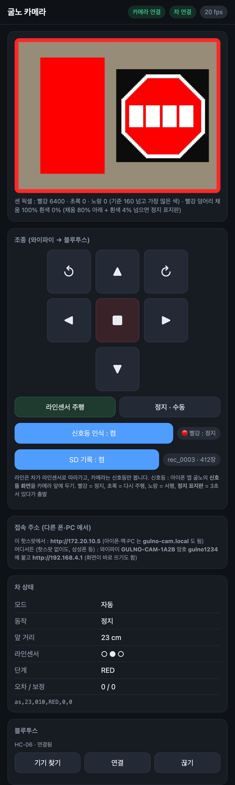
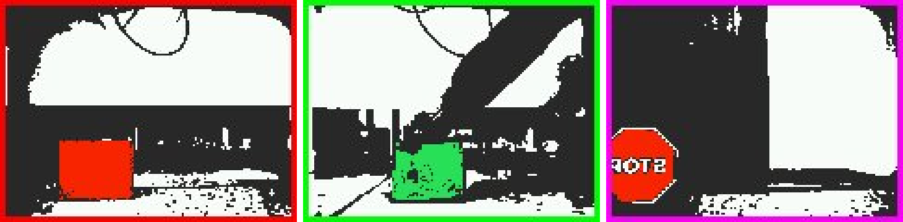
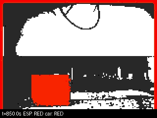
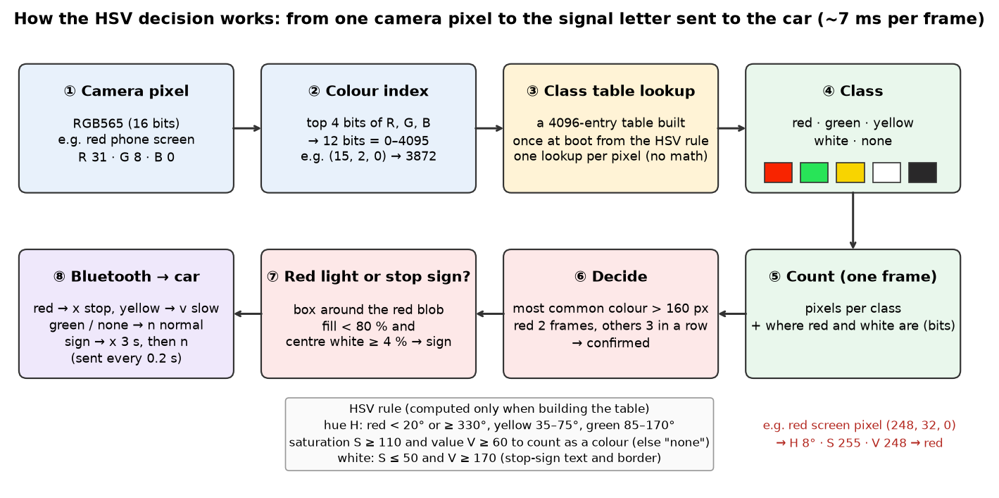
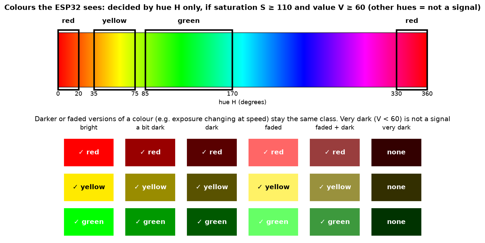
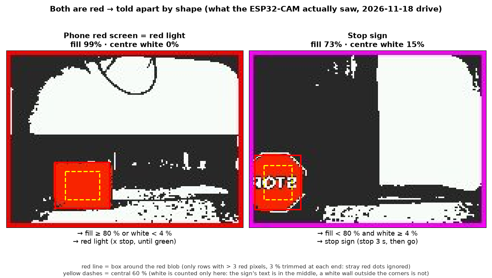
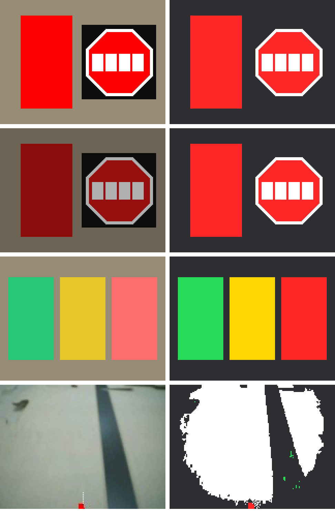

# Gulno Camera (ESP32-CAM): extra project branch `extra/esp32cam`

> **Usage terms:** Code is MIT open source. Original photos, videos and other non-code materials are for non-commercial education and learning only; commercial use is prohibited. See [NOTICE.md](NOTICE.md), including the exception for prior permissions.

> 한국어 : [README.md](README.md)
>
> This branch is **version D** = version C (PID, `main`) plus an **ESP32-CAM camera** (both C and D are submitted). It goes beyond the lecture's team 2 **advanced B "first-person (camera view) control"** (p. 47): the camera recognises **traffic lights** and stop signs, and **the ESP32 decides by itself** and sends signals to the car over Bluetooth (lecture team 4 decides in Python on a PC; we do it inside the ESP32 with no PC).
> **Principle: the camera does not follow the line.** The car follows the line with 3 line sensors + PID; the camera only watches traffic lights and signs.
> **What it detects: [chapter 1](#1-what-it-detects); why HSV image processing: [chapter 2](#2-what-changed-and-why-camera-principle-hsv-recognition-speed).**
> **This branch is ESP32-CAM only.** The car (line following, low-frequency control): wiring, PID and apps are in the [`main` branch README](https://github.com/CHOESEUNGJUN/4wd_car_project/blob/main/README.en.md).

```
 5V external power ──▶ ESP32-CAM ── Wi-Fi (your hotspot) ──▶ any phone/laptop: http://gulno-cam.local (or the numeric address shown on the page)
                         │          colour video (border = current signal), pixel counts, car status, drive buttons, control, SD recording
                         └──── Bluetooth ──▶ HC-06 ──▶ Arduino (version D, line following with line sensors + PID)
 Phone app Gulno (iPhone / Android) "traffic light screen" (green → yellow → red) / "stop sign" ──▶ hold it in front of the camera
```

<p align="center"><br><sub>The ESP32-CAM web page on a phone (sample state: red light detected → red border, car stopped in RED). UI is in Korean.</sub></p>




<sub>What the ESP32-CAM actually saw (SD recording, HSV view): 🔴 red → stop, 🟢 green → go, 🛑 stop sign → stop 3 s. **More photos: [`docs/GALLERY.en.md`](docs/GALLERY.en.md)** (the car, what the ESP saw, the web page while driving)</sub>

| Drive (web page button) | What it does |
|---|---|
| Line-sensor drive (라인센서 주행) | `a` → the car drives itself with 3 line sensors + PID (same as version C) |
| Traffic light recognition on/off (신호등 인식) | The car keeps following the line; the camera keeps sending only signals every 0.2 s: 🔴 `x` stop, 🟡 `v` slow (base speed 120 → 100), 🟢 `n` normal, 🛑 stop sign = stop 3 s then go. Mode is unchanged |

**Who does what in version D** — the app does not drive the car

| | Does | Bluetooth |
|---|---|---|
| **ESP32-CAM web page** (phone or laptop browser) | **All car control**: start/stop line-sensor driving, manual control, traffic-light recognition on, SD recording, car status | the ESP32 holds the HC-06 link |
| **Gulno phone app** | **Only the traffic-light and stop-sign screens** (hold them in front of the camera). The Android app's "Camera" button just opens the web page above inside the app | not used |
| Arduino (car) | follows the line with line sensors + PID, obeys `x` / `v` / `n` from the ESP32 | HC-06 |

- The HC-06 accepts **one device at a time**. While the ESP32 is connected, the phone app can't drive over Bluetooth → driving from the app is for **versions C and E without the ESP32** (main README).
- With only one phone: show the traffic-light screen on another phone or tablet, and drive from a laptop browser.

**Design note: why Bluetooth and a separate power supply**
- This project follows the **course guidance (lecture deck, team 2 assignment: talk to the car over HC-06 Bluetooth, power the camera module separately)**. So the ESP32-CAM runs from its own 5 V power bank and talks to the car (Arduino) **only over Bluetooth (HC-06)**.
- **Had we designed it ourselves**, the ESP32-CAM would **take power from the car's battery through pins** (battery → 5 V buck module, 2 A or more → ESP32-CAM 5 V pin, common GND) and connect to the Arduino **directly by wire (UART)** (ESP32 TX → Arduino RX, Arduino TX → resistor divider → ESP32 RX, 9600).
  - Gains: no Bluetooth, so \~45 KB of ESP32 internal memory comes back; no antenna sharing, so no 1–3 s Wi-Fi stalls; less delay for signals to reach the car; one power source.
  - The memory and antenna problems in these docs come from keeping the wireless setup, and the numbers show how far we reduced them within it.

**Handling the ESP32-CAM (every time)** — details in [`docs/CAMERA.md` chapter 0](docs/CAMERA.md) (Korean)

1. Turn on the iPhone hotspot (Maximize Compatibility) → connect the laptop / phone too
2. Turn on the car (version D) → power the ESP32-CAM with 5V → ready when the front white LED stops blinking and **stays on**
3. Browser **http://gulno-cam.local** (if it doesn't open, use the numeric address from the page's address card, e.g. `http://172.20.10.2`; on Android use "Camera" in the app. Since 2026-11-18 the ESP's own Wi-Fi at `192.168.4.1` only comes up when the hotspot can't be found, to save memory)
4. **Traffic light recognition: on** + phone traffic-light screen → **Line-sensor drive**; to stop, **Stop · Manual (정지 · 수동)**
5. Finish: Stop · Manual → disconnect Bluetooth → power off. One-time setup: upload (PlatformIO) and enter Wi-Fi (`CAMERA.md` ch. 4–5); troubleshooting in `CAMERA.md` ch. 9

| | |
|---|---|
| Folders | **`arduino/`** = uploaded to the UNO (car) with the Arduino IDE: **default = version D + low frequency `motor_control_low_frequency_cam`** (used in the 2026-11-18 driving test), version D with the original wiring `team2_bt_cam`, without the camera version E `motor_control_low_frequency` or version C `team2_bt_pid`, diagnostics `diag` · **`esp32/`** = uploaded to the ESP32-CAM with PlatformIO · **`apps/`** = Gulno apps (iPhone and Android both have traffic-light / stop-sign screens; Android also has a camera screen) |
| Camera code | [`esp32/esp32cam_line/`](esp32/esp32cam_line) (`esp32cam_line.ino`, web page `page.h`, build settings `platformio.ini`) |
| Docs | [`docs/CAMERA.md`](docs/CAMERA.md) (Korean): handling, structure, signals, wiring (5V external power), upload, Wi-Fi (printer-style setup), web page, speed and memory, mounting, troubleshooting, SD recording |
| Command table | [`PROTOCOL.md`](PROTOCOL.md) (`x v n` are version D only) |
| Reports | [`docs/REPORT_20261116.en.md`](docs/REPORT_20261116.en.md) (11-12 → 11-16, English) · [`docs/REPORT_20261111.md`](docs/REPORT_20261111.md) (Korean) |
| Next steps | [`docs/NEXT.md`](docs/NEXT.md) on `main` (checklist, Korean) |
| Upload | **Not from the Arduino IDE** (its prebuilt libraries run out of memory once Bluetooth turns on). Flash the finished firmware (`.bin`) with Chrome or esptool, or build with PlatformIO → **[ESP32 flashing guide (Windows · Linux · macOS)](docs/ESP32_UPLOAD.en.md)**  The car is uploaded from the Arduino IDE (default `motor_control_low_frequency_cam`) |
| Status (2026-11-18) | Confirmed: Bluetooth + Wi-Fi + camera together (after the memory rebuild), web control, HSV colour detection and HSV view (HSV view is the default at power-on), signal response \~0.1–0.15 s, SD recording (keeps the HSV view), **mounted on the low-frequency car (`motor_control_low_frequency_cam`) and passed the track**: stopped at a red light 7 times, started on green 4 times, held 3 s at a stop sign 5 times (logs in `docs/drive_logs/`). Camera line detection and camera driving removed by the principle change. The ESP's own Wi-Fi (192.168.4.1) only comes up when the hotspot can't be found. Android app not yet tested on a phone |

---

## 1. What it detects

| Seen | Character sent by the ESP32 | Car (stays in auto) |
|---|---|---|
| 🔴 red light | `x` (every 0.2 s) | Stop, until another signal arrives or a person sends `a`/`m` (doesn't drive even if the ESP32 dies) |
| 🟡 yellow light | `v` | Slow: base speed 120 → 100 (back to normal after 1 s without `v`) |
| 🟢 green light / no signal | `n` | Normal |
| 🛑 stop sign (red octagon + white text) | `x` for 3 s → `n` | Stops 3 s then drives on, ignores the same sign for 5 s |

Red light and stop sign are both red, so they are told apart by **shape**: how much of the red blob's bounding box is red (phone red screen 86–100 %, octagon 61–68 %) and how much white (text, border) is inside.

## 2. What changed and why: camera principle, HSV, recognition speed

### 2-1. Camera: line following → traffic lights and signs only

| First (2026-11-11) | Now (2026-11-16) |
|---|---|
| The camera found the floor line, cleaned it with morphology, drew the path and target, and drove from the camera | **No camera line following.** The line is followed by the line sensors + PID (same as version C); the camera only gives signals |

- **Why**: on the track the car was faster than expected, so steering from the camera (\~20 fps plus Wi-Fi/Bluetooth delay) was too late. The line sensors + PID already follow the line every 20 ms, so the camera does **one job (watching signals)** — faster and safer. If the camera stops, line following continues, and a red light never times out, so the car stays stopped.
- Lecture team 4 sends the video to a PC and decides in Python → we decide **inside the ESP32** with no PC (no Wi-Fi video round trip, so it is faster).

### 2-2. Colour detection: RGB rules → HSV + class table

| | RGB (first) | **HSV + table (now)** |
|---|---|---|
| Method | Compare R, G, B directly, e.g. "R high and G, B low = red" | Convert to hue H (0–359°), saturation S, value V and decide by **hue** (lecture team 3's method). Red H < 20 or ≥ 330, yellow 35–75, green 85–170, white = low saturation and bright |
| Weakness / strength | Misses dark or faded colours; when exposure changes while driving, all three values shift together | Hue stays the same when brightness changes → **same colour in a dark room or at speed** |
| Test (17 synthetic scenes) | 12 correct (missed dark red, green, yellow, faded red, dark sign) | **All 17 correct**; floor (beige, wood) and white walls are not signals |
| Speed | Comparisons for every pixel | A 4096-colour (4 bits per R, G, B) class table (4 KB) built once at boot; per pixel just **one table lookup** → no math |


**How it decides**: one camera pixel → colour index (12 bits) → precomputed class table → count per class → decide → Bluetooth letter. The HSV math runs only 4096 times when the table is built at boot; while driving each pixel is a single table lookup, so a frame (19,200 pixels) takes about 7 ms.





**Red light vs stop sign**: both are red, so colour alone can't tell them apart → the ESP32 looks at the red blob's **shape**. The phone's red screen almost fills its box (99 %) with no white; the octagon leaves the corners empty (73 %) and has white text in the middle (15 %). Below: the boxes the firmware's rule finds on real frames from the drive.






- **Why**: when the car drove fast, recognition often failed because colours got darker or washed out → HSV separates brightness from hue. HSV is normally slower to compute, but the precomputed table makes it lighter than the RGB comparisons.
- **HSV view is the fastest video**: no JPEG encoding; only colour classes are packed and sent, and the browser paints them (\~1.4 KB per frame; on the same hotspot link JPEG 3–4 fps → HSV 5–11 fps, measured).
- Turn on **HSV view** in the web camera settings to paint the video with the colour class the ESP32 sees (red, green, yellow, white; grey = not a signal) — useful for tuning under real lighting.

### 2-3. Speed: recognition speed over resolution

| Tried | Result | Chosen |
|---|---|---|
| 320x240 colour | Sensor gives only 9–10 fps → \~105 ms per loop | ✗ |
| Sensor JPEG (hardware compression) + decode | Decoding takes 95 ms → 110 ms per loop | ✗ |
| Camera clock 24 MHz | Not faster, only more incomplete frames | ✗ (20 MHz) |
| **160x120 colour, every pixel** | \~48 ms per loop (\~20 fps), catches stop signs down to an 11 px radius | ✓ |

- Signal response: \~2 s at first → **\~0.1–0.15 s** (confirmed after 2 frames for red, 3 for other colours; a change is sent immediately and repeated every 0.2 s).
- Per-frame functions run from IRAM with -O2 (flash code and PSRAM frames share the cache, so code would be evicted); each frame is read once and signal counting and video copy share the same row pass. The field of view is already maximal (the OV3660 scales the full sensor even at small sizes; wider needs a wide-angle lens module).
- **The camera chip is an OV3660 (confirmed on the board 2026-11-18, not an OV2640).** The sensor sets the frame rate: at 160x120 colour the driver runs the sensor clock at 40 MHz, giving **one frame every 45 ms (22.2 fps)** (measured on the VSYNC pin). Of the 48 ms loop only \~7 ms is processing; the rest is waiting for the next frame, so trimming code no longer helps. Raising the sensor clock (PLL multiplier 8 → 10) makes the sensor output 27.8 fps, but the ESP32 can't capture it: incomplete frames rise from 1 to 28 per 10 s, and multiplier 12 breaks almost every frame → left unchanged. Going faster needs an ESP32-S3 board (faster camera input)

## 3. Communication

| Between | How | What goes over it |
|---|---|---|
| ESP32-CAM ↔ car | HC-06 Bluetooth (the ESP32 connects as master, PIN 1234) | signals `x` stop · `v` slow · `n` normal (every 0.2 s), control letters `g b l r q w s a m`, heartbeat `h` / car → ESP status line every 0.2 s |
| Phone / laptop ↔ ESP32-CAM | Wi-Fi (your hotspot), HTTP + WebSocket | web page, HSV video, car status, drive and control buttons |
| Module ↔ Arduino | UART 9600 bps, D3·D4 SoftwareSerial | car-side communication: main README and report 6-1 |

## 4. Driving results

| Log | Result |
|---|---|
| log_0011, log_0012 (2026-11-18) | 🔴 red: stopped 7 times (0.21–0.54 s), 🟢 green: started 4 times (0.11–0.33 s), 🛑 stop sign: 3 s stop then go 5 times, obstacle stop |
| log_0013 (additional run) | 🟡 yellow: slowed 15 times (tested with yellow wheels, no yellow sign), 🔴 red: stopped 4 times (0.18–0.34 s), 🟢 green: started 2 times (0.11–0.30 s) |

No restart with Bluetooth + Wi-Fi + camera all on. Logs: [`docs/drive_logs/`](docs/drive_logs/) · analysis: report chapter 7 ([Korean](docs/REPORT_20261116.md), [English](docs/REPORT_20261116.en.md))

## 5. The car side (version D)

Car wiring, PID line following, low-frequency PWM, apps and debugging are in the **main README**: [README.md](https://github.com/CHOESEUNGJUN/4wd_car_project/blob/main/README.md) · [README.en.md](https://github.com/CHOESEUNGJUN/4wd_car_project/blob/main/README.en.md)

| For the car with the camera | Wiring |
|---|---|
| **`arduino/motor_control_low_frequency_cam/`** (default, version D + low frequency) | low-frequency wiring (main README ch. 2, swap 5↔9 · 6↔10) |
| `arduino/team2_bt_cam/` (version D, high frequency) | original lecture-deck wiring |

Version D only adds handling of the signal letters `x v n` to versions C/E (the 6 changed places: [CODE.en.md ch. 3](docs/CODE.en.md)).

## 6. More

| | |
|---|---|
| Handling, structure, troubleshooting | [`docs/CAMERA.md`](docs/CAMERA.md) (Korean) |
| Flashing (three OSes) | [ESP32_UPLOAD.en.md](docs/ESP32_UPLOAD.en.md) |
| Firmware walkthrough | [REQUIREMENTS.en.md appendix](docs/REQUIREMENTS.en.md) |
| Requirements | [REQUIREMENTS.en.md](docs/REQUIREMENTS.en.md) |
| Final report | [REPORT_20261116.en.md](docs/REPORT_20261116.en.md) |
| Photos and videos | [GALLERY.en.md](docs/GALLERY.en.md) |
| Release | [4wd-car ESP32 Car Control V1.0](https://github.com/CHOESEUNGJUN/4wd_car_project/releases/tag/4wd-car-esp32-car-control-v1.0) |

---

## License and copyright

**Source code remains open source under the MIT License.** Use, modification, redistribution and commercial use of code are permitted under MIT; retain its copyright and permission notices.

**Non-code materials have separate terms.** Copyright in original photographs, videos, figures, drive logs and documentation remains with their respective photographers and creators. Materials personally photographed or created by repository owner CHOESEUNGJUN remain that person's copyrighted work.

- Viewing, copying, modification and sharing are permitted solely for non-commercial education and learning. Identify the original creator, link to this repository, retain these terms and indicate changes.
- Commercial or business use is prohibited, including sales, advertising, promotion, paid courses or teaching materials, and use in products or services. An educational label does not permit commercial use. Other uses require prior written permission from the relevant rights holder.
- Confirmed unauthorized commercial use or other copyright infringement may result in legal action under applicable law, including demands to cease use, removal requests and claims for damages.
- These non-code terms apply **from the commit introducing this notice on 2026-11-18**. Existing permissions for materials lawfully released under CC BY 4.0 are not retroactively revoked. This notice alone cannot retroactively restrict identical previously licensed materials.
- Third-party materials retain their original rights holders and licenses. See [`NOTICE.md`](NOTICE.md) for scope and terms and [`LICENSE`](LICENSE) for the MIT text covering code.
- The course lecture deck belongs to its authors and is not included in this repository.
- Software and materials are provided "as is"; users are responsible for safety when handling the car, batteries and power.
