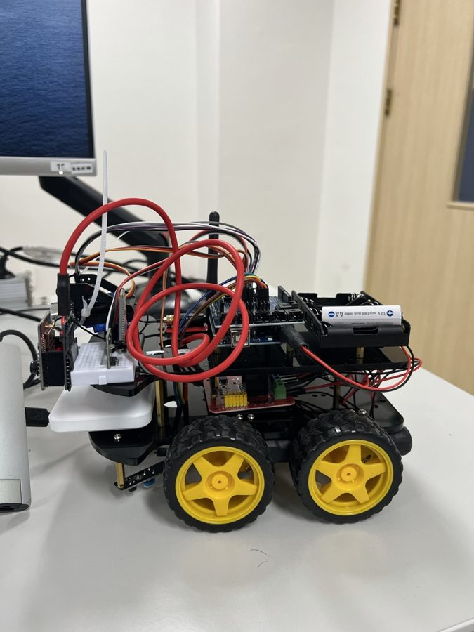
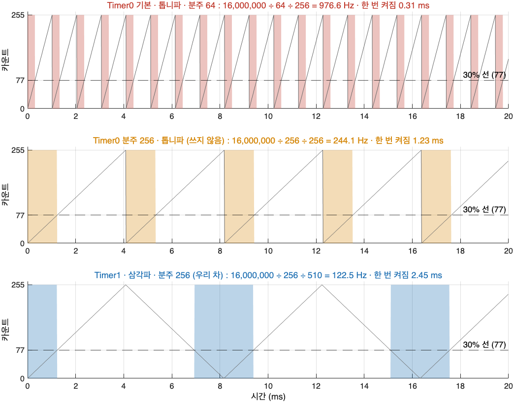
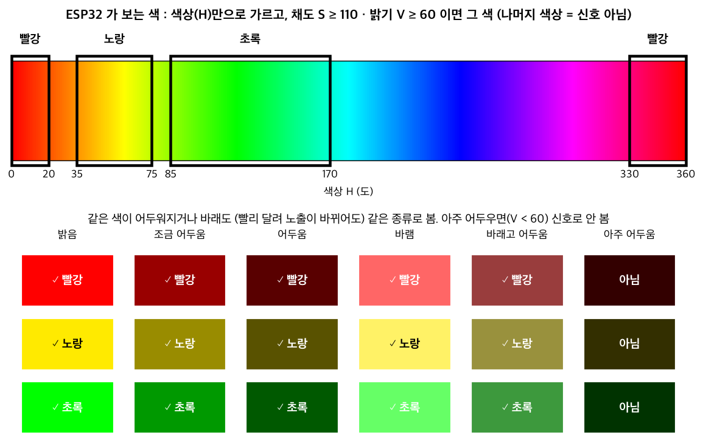
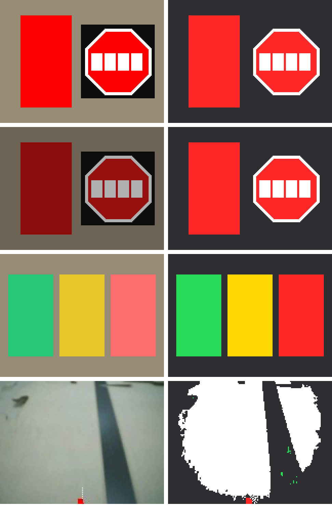

# 굴노 카메라 (ESP32-CAM) : 추가 프로젝트 브랜치 `extra/esp32cam`

> **이용 조건:** 코드는 MIT 오픈소스입니다. 직접 제작한 사진·영상·문서 등은 비상업적 교육·학습 목적만 허용하며 상업적 이용은 금지합니다. 기존 허락의 예외를 포함한 상세 조건은 [NOTICE.md](NOTICE.md)를 확인하세요.

> English : [README.en.md](README.en.md) · 보고서 메모 : [`docs/REPORT_20261116.md`](docs/REPORT_20261116.md)

> 이 브랜치는 버전 C(PID, `main`)에 **ESP32-CAM 카메라**를 더한 **버전 D** 입니다 (버전 C·D 둘 다 제출용). 교안 2팀 **심화 B "1인칭 시점(카메라 화면) 조종"** (47쪽)을 넘어서, 카메라로 **신호등**을 인식하고 **ESP32 가 직접 판단해서** 블루투스로 차에 신호를 보냅니다 (교안 4팀은 PC 파이썬이 판단, 우리는 PC 없이 ESP32 안에서).
> **원칙 : 카메라로 라인 주행은 하지 않는다.** 라인은 차가 라인센서 3개 + PID 로 따라가고, 카메라는 신호등(표지판)만 봅니다.
> **무엇을 감지하는지, 고주파·저주파 주행, HSV 영상 처리로 왜 바꿨는지는 아래 [9장·5장](#9-추가-프로젝트--esp32-cam-카메라-브랜치-extraesp32cam).**
> 버전 C 만의 설명은 [`main` 브랜치](https://github.com/CHOESEUNGJUN/4wd_car_project/tree/main)를 보세요.

```
 5V 외부 전원 ──▶ ESP32-CAM ── 와이파이 (내 핫스팟) ──▶ 어느 폰·노트북이든 http://gulno-cam.local (또는 웹에 나오는 숫자 주소)
                      │         컬러 영상(테두리 = 지금 신호), 색 픽셀 수, 차 상태, 주행 버튼, 조종, SD 기록
                      └──── 블루투스 ──▶ HC-06 ──▶ 아두이노 (버전 D, 라인센서 + PID 로 라인 주행)
 폰 앱 굴노 (아이폰·안드로이드) "신호등 화면" (초록 → 노랑 → 빨강) / "정지 표지판" ──▶ 카메라 앞에 들고 있으면 신호등·표지판
```

| 주행 (웹 화면 버튼) | 하는 일 |
|---|---|
| 라인센서 주행 | `a` → 차가 라인센서 3개 + PID 로 스스로 (버전 C 와 같음) |
| 신호등 인식 (켬/끔) | 라인은 차가 계속 보고, 카메라는 신호만 0.2초마다 계속 보냄 : 🔴 `x` 정지, 🟡 `v` 서행 (기본 속도 120 → 100), 🟢 `n` 보통, 🛑 정지 표지판 = 3초 정지 후 출발. 모드는 그대로 |

<p align="center"><br><sub>폰으로 본 ESP32-CAM 웹 화면 (예시 화면 : 빨간불 인식 → 테두리 빨강, 차는 RED 로 정지)</sub></p>


<sub>ESP32-CAM 이 실제로 본 장면 (SD 기록, HSV 보기) : 🔴 빨간불 → 정지, 🟢 초록불 → 출발, 🛑 정지 표지판 → 3초 정지. **사진 더 보기 : [`docs/GALLERY.md`](docs/GALLERY.md)** (차량 사진, ESP 가 본 장면, 주행 중 웹 화면)</sub>

**버전 D 에서 누가 무엇을 하나** — 앱으로 차를 조종하지 않는다

| | 하는 일 | 블루투스 |
|---|---|---|
| **ESP32-CAM 웹 화면** (폰·노트북 브라우저) | **차 조종 전부** : 라인센서 주행 시작·정지, 수동 조종, 신호등 인식 켜기, SD 기록, 차 상태 보기 | ESP32 가 HC-06 에 붙어 있음 |
| **폰 앱 굴노** | **신호등 화면·정지 표지판 화면만** (카메라 앞에 들고 있기). 안드로이드 앱의 "카메라" 버튼 = 위 웹 화면을 앱 안에서 연 것 | 안 씀 |
| 아두이노 (차) | 라인센서 + PID 로 라인 주행, ESP32 가 보낸 `x` / `v` / `n` 따르기 | HC-06 |

- HC-06 은 **한 번에 한 기기만** 붙는다. ESP32 가 붙어 있으면 폰 앱으로는 블루투스 조종이 안 된다 → 앱으로 직접 조종하는 이야기(아래 0장 5)·6)·6장)는 **ESP32 없이 달리는 버전 C·E** 이야기.
- 폰 하나뿐이면 : 신호등 화면은 다른 폰·태블릿에 띄우고, 조종은 노트북 브라우저로.

**설계 메모 : 왜 블루투스·따로 전원으로 만들었나**
- 이 프로젝트는 **수업에서 내려온 지도(교안 2팀 과제 : HC-06 블루투스로 차와 통신, 카메라 모듈은 따로 전원)** 에 맞춰 구현했다. 그래서 ESP32-CAM 은 5V 보조배터리로 따로 켜고, 차(아두이노)와는 **블루투스(HC-06)** 로만 말한다.
- **우리가 직접 설계했다면** : ESP32-CAM 을 **차 배터리에서 핀으로 전원**(배터리 → 5V 강압 모듈 2A 이상 → ESP32-CAM 5V 핀, GND 공통)을 받고, 아두이노와는 **선(UART)으로 바로** 이었을 것이다 (ESP32 TX → 아두이노 RX, 아두이노 TX → 저항 분압 → ESP32 RX, 9600).
  - 좋아지는 것 : 블루투스를 안 쓰니 ESP32 내부 메모리 약 45KB 를 돌려받고, 안테나를 나눠 쓰지 않아 와이파이가 1~3초씩 멈추는 일이 없어지고, 신호가 차에 가는 지연도 줄어든다. 전원도 하나로.
  - 이 문서의 메모리·안테나 문제(5장)는 무선 구성을 지키느라 생긴 것이고, 그 안에서 줄인 결과다.

**ESP32-CAM 다루기 (매번)** — 자세히는 [`docs/CAMERA.md` 0장](docs/CAMERA.md)

1. 아이폰 핫스팟 켜기 (호환성 최대화) → 노트북·폰도 연결
2. 차(버전 D) 켜기 → ESP32-CAM 5V 켜기 → 앞 흰 LED 가 깜빡이다 **계속 켜지면** 준비
3. 브라우저 **http://gulno-cam.local** (안 열리면 웹 "접속 주소" 칸의 숫자 주소 예 `http://172.20.10.2`, 안드로이드는 앱의 "카메라". ESP 자기 와이파이 `192.168.4.1` 은 메모리 때문에 2026-11-18 부터 핫스팟을 못 찾을 때만 켜짐) → 블루투스 **연결** (처음은 기기 찾기 → HC-06, PIN 1234. 켤 때마다 한 번)
4. **신호등 인식 : 켬** + 폰 신호등 화면 → **라인센서 주행**, 멈출 때 **정지 · 수동**
5. 끝: 정지 · 수동 → 블루투스 끊기 → 전원 끄기. 처음 한 번은 업로드(PlatformIO)·와이파이 넣기 (`CAMERA.md` 4·5장), 안 되면 9장 문제 해결

| | |
|---|---|
| 폴더 | **`arduino/`** = Arduino IDE 로 UNO(차)에 올리는 것 : **기본 = 버전 D + 저주파 `motor_control_low_frequency_cam`** (2026-11-18 주행 시험에 쓴 것), 버전 D 원래 배선 `team2_bt_cam`, 카메라 없이 달릴 때 버전 E `motor_control_low_frequency`·버전 C `team2_bt_pid`, 진단 `diag` · **`esp32/`** = PlatformIO 로 ESP32-CAM 에 올리는 것 · **`apps/`** = 굴노 앱 (아이폰·안드로이드 모두 신호등·정지 표지판 화면, 안드로이드는 카메라 화면도) |
| 카메라 코드 | [`esp32/esp32cam_line/`](esp32/esp32cam_line) (`esp32cam_line.ino`, 웹 화면 `page.h`, 빌드 설정 `platformio.ini`) |
| 설명 | [`docs/CAMERA.md`](docs/CAMERA.md) : 다루기, 구조, 신호등, 배선(5V 외부 전원), 올리기, 와이파이(프린터처럼), 웹 화면, 속도·메모리, 카메라 달기, 문제 해결, SD 기록 |
| 명령표 | [`PROTOCOL.md`](PROTOCOL.md) (`x v n` 은 버전 D 만) |
| 작업 보고 | [`docs/REPORT_20261111.md`](docs/REPORT_20261111.md) : 잘된 점, 안된 점, 앞으로 할 것 |
| 다음에 할 일 | `main` 의 [`docs/NEXT.md`](https://github.com/CHOESEUNGJUN/4wd_car_project/blob/main/docs/NEXT.md) (체크리스트) |
| 업로드 | **Arduino IDE 로 올리면 안 됨** (미리 만든 라이브러리라 블루투스를 켜면 메모리 부족으로 멈춤). 완성 펌웨어(`.bin`)를 크롬·esptool 로 올리거나 PlatformIO 로 빌드 → **[ESP32 올리기 안내 (윈도우·리눅스·맥)](docs/ESP32_UPLOAD.md)**  차는 Arduino IDE 로 (기본 `motor_control_low_frequency_cam`) |
| 지금 상태 (2026-11-18) | 확인됨 : 블루투스 + 와이파이 + 카메라 동시 동작 (메모리 다시 빌드 후), 웹 조종, HSV 색 판단·HSV 보기(전원을 켜면 HSV 보기가 기본), 신호 반응 약 0.1~0.15초, SD 기록(HSV 보기 그대로), **저주파 차(`motor_control_low_frequency_cam`)에 달고 트랙 주행 통과** : 빨간불 7번 정지, 초록불 4번 출발, 정지 표지판 5번 3초 정지 (기록 `docs/drive_logs/`). 원칙 변경으로 카메라 라인 인식·카메라 주행은 뺌. ESP 자기 와이파이(192.168.4.1)는 핫스팟을 못 찾을 때만. 안드로이드 앱 폰 시험은 아직 |

아래는 `main` 과 같은 차량(버전 C·E) 설명입니다. 기본은 저주파 배선 (2장, 2-1).

---

# 4wd-car : 2팀 굴노 (굴러라 노란바퀴) 자율주행 미니카

PID 라인트레이서 + 저주파 PWM 주행 + 블루투스 수동 / 자동 전환 + ESP32-CAM 신호등·정지 표지판

> English : [README.en.md](README.en.md) · 보고서 메모 : [`docs/REPORT_20261116.md`](docs/REPORT_20261116.md)

4륜 RC카(에듀이노 키트, Arduino UNO)가 **PID 제어로 검은 선을 따라 달리는(자동)** 프로젝트. 폰 앱 "굴노"로 조종(수동)하다가 버튼 하나로 자동으로 바꾼다.
연결이 끊기면 차가 스스로 멈추고, 자동으로 달리는 동안에도 폰 화면에서 차가 지금 무엇을 하는지(직진, 코너, 선 찾기, 장애물 대기 …)를 볼 수 있다.

<p align="center">




<br><sub>완성 차량 (2026-11-18) : 앞 · 옆 · 뒤 · HC-06 블루투스</sub>
</p>

- 폴더 : **`arduino/`** = Arduino IDE 로 UNO(차)에 올리는 코드. 카메라(ESP32, PlatformIO)는 브랜치 `extra/esp32cam` 의 **`esp32/`** 에 있다.
- 차량 코드 : **기본은 `arduino/motor_control_low_frequency/` (버전 E = PID + 저주파 PWM)**. 버전 C(`team2_bt_pid`)는 교안 원래 배선용으로 남겨 둠 (핀이 왜 다른지 [2-1](#2-1-저주파는-왜-핀을-바꾸나)). 첫 완성 버전은 [릴리스 1.0 PID 버전](https://github.com/CHOESEUNGJUN/4wd_car_project/releases/tag/v1.0) (앱 APK 포함).
- 교안 : 수업 교안 (`minicar_lecture_deck_all_teams_v5.pdf`) 의 2팀 (34~48쪽) — 저작권 때문에 저장소에는 없음 ([라이선스](#라이선스--저작권))
- 통신 프로토콜 (팀 합의 문서) : [`PROTOCOL.md`](PROTOCOL.md) — 앱이나 스케치의 통신 부분을 고치기 전에 먼저 이 문서를 바꾸고 합의한다.
- 추가 프로젝트 **ESP32-CAM 카메라** 는 브랜치 [`extra/esp32cam`](https://github.com/CHOESEUNGJUN/4wd_car_project/tree/extra/esp32cam) 에 따로 있다 (9장).
- **주행 방식과 영상 처리를 무엇을, 왜 바꿨는지 : [5장](#5-무엇을-왜-바꿨나--고주파저주파-주행-hsv-영상-처리)** (고주파 → 저주파 PWM, 카메라 라인 인식 → 신호등·표지판만, RGB → HSV)
- **완성 릴리스 : [4wd-car ESP32 Car Control V1.0](https://github.com/CHOESEUNGJUN/4wd_car_project/releases/tag/4wd-car-esp32-car-control-v1.0)** (아두이노 스케치, ESP32-CAM 펌웨어, 안드로이드 앱, 주행 기록·영상, 사용법) · **최종 보고서 : [`docs/REPORT_20261116.md`](docs/REPORT_20261116.md)**
- 다음에 할 일 : [`docs/NEXT.md`](docs/NEXT.md) (신호 기준 다시 맞추기, 안드로이드 앱 폰 시험, 저주파 숫자 비교)

| 버전 | 폴더 | 모터 PWM | 카메라 | 상태 |
|---|---|---|---|---|
| **C** | `arduino/team2_bt_pid/` | 고주파 (기본 976.6Hz) | 없음 | **통과** (2026-11-16, 팀 차량 코드) |
| **E (기본)** | `arduino/motor_control_low_frequency/` | **저주파 약 122Hz** (배선 4개 맞바꿈) | 없음 | **통과** (2026-11-16, 더 부드러움) |
| D | 브랜치 `extra/esp32cam` 의 `arduino/team2_bt_cam/` (+ 저주파판 `motor_control_low_frequency_cam`) | C 또는 E | ESP32-CAM : 신호등·정지 표지판 (HSV) | **통과** (2026-11-18, 저주파 차에 달고 트랙 주행 : 빨간불·초록불·정지 표지판 모두 반응) |

---

## 0. 받아서 쓰기 (처음 보는 사람용)

> 이 장은 ESP32 없이 차만 달리는 순서 (버전 C·E, 폰 앱으로 조종). 카메라를 단 버전 D 는 맨 위 "ESP32-CAM 다루기" 순서대로 (조종은 웹 화면).

이 저장소를 받은 사람이 같은 차를 만들어 달리게 하는 순서. 자세한 내용은 각 장에 있다.

**준비물**

| 부품 | 비고 |
|---|---|
| 4륜 RC카 키트 (Arduino UNO + 센서 확장 쉴드, L298N 모터 드라이버, TT 기어모터 4개) | 에듀이노 4WD 키트 기준 |
| 디지털 라인센서 3개 (검은 선 = 1 이 나오는 것) | 차 앞에 왼·가운데·오른 |
| 초음파 센서 + 서보 | 장애물 정지용 |
| 블루투스 모듈 **HC-06** (안드로이드) 또는 **HM-10** (아이폰, 웹) | 9600 bps |
| 배터리 (모터용) : **1.2V 충전지 6개 (7.2V)** | 새로 충전할수록 세게 돈다 → 4-3, 4-4 참고 |
| 트랙 : 밝은 바닥 + **검은 절연테이프 (폭 약 1.9cm)** | 판이 미끄러우면 코너 값 조정 |

**1) 코드 받기** — GitHub 에서 **Code → Download ZIP** 후 압축 풀기, 또는

```bash
git clone https://github.com/CHOESEUNGJUN/4wd_car_project.git
```

**2) 배선** — [2장 배선](#2-배선) 표대로 (**모터 드라이버는 저주파 배선**). 라인센서는 **왼 A3 / 가운데 A4 / 오른 A5**, 블루투스는 **TXD → D3, RXD → D4** (엇갈리게).

**3) 업로드**
1. [Arduino IDE](https://www.arduino.cc/en/software) 설치 (2.x).
2. `arduino/motor_control_low_frequency/motor_control_low_frequency.ino` 열기 (원래 배선이면 `team2_bt_pid`) → 보드 **Arduino Uno**, 포트 선택 → **업로드**.
3. `Servo.h` 가 없다는 오류가 나면 **라이브러리 매니저**에서 `Servo` 설치.

**4) 센서 확인** — 차를 들어 바퀴를 띄우고 시리얼 모니터 **115200**.
라인센서를 하나씩 테이프 위에 올려 `라인=100 / 010 / 001` 이 맞는 자리에서 바뀌는지 본다.
안 바뀌면 센서의 감도 나사를 돌리고, 좌우가 반대면 스케치 위쪽 `L_Line`, `R_Line` 을 바꾼다.

**5) 앱 연결** — [6장 앱](#6-앱)
- 안드로이드 + HC-06 : [릴리스 1.0](https://github.com/CHOESEUNGJUN/4wd_car_project/releases/tag/v1.0) 에서 `gulno.apk` 받아 설치 (또는 Android Studio 로 `apps/android` 를 열어 ▶).
- 아이폰 + HM-10 : Xcode 로 `apps/ios_mac/MiniCar.xcodeproj` 를 열어 ▶.
- 설치 없이 : 크롬으로 `apps/web/index.html` 열기 (HM-10 BLE, 맥은 HC-06 시리얼도).

**6) 달리기** — 앱에서 수동으로 ▲ 눌러 움직이는지 확인 → 차를 선 위에 놓고 **자동으로** → 0.5초 뒤 출발.
확인 순서는 [3장](#3-처음-시작하기) 표.

**7) 내 트랙에 맞추기** — 흔들리거나 코너를 못 돌면 [4-4](#4-4-설정값과-맞추는-법) 순서대로 `KP`, `KD`, `CORNER_OUT` 을 바꿔 다시 업로드. 증상별 해결은 [`docs/PID.md`](docs/PID.md).

---

## 1. 한눈에 보기

```
 [폰 앱 / 웹]  ──블루투스 9600──▶  [HC-06 또는 HM-10]  ──D3/D4──▶  [Arduino UNO]  ──▶ 모터, 서보
   버튼 누름: g b l r q w s              (선 없는 시리얼)                 라인센서 3개
   모드 버튼: a / m                                                       초음파 센서
   0.6초마다: h (연결 신호)
       ◀── 0.2초마다 상태 한 줄 "ag,23,010,LINE" ──
```

| 폴더 | 무엇 | 언제 쓰나 |
|---|---|---|
| `arduino/team2_bt_pid/` (Arduino IDE → UNO) | **버전 C** 차량 스케치 (교안 원래 배선용) | PID 라인 추종 + 코너는 바깥·안쪽 바퀴 힘 따로. 설명은 `docs/PID.md` |
| `arduino/motor_control_low_frequency/` (Arduino IDE → UNO) | **기본 : 버전 E = 버전 C + 저주파 PWM (2026-11-16 통과)** | 모터 PWM 약 122Hz 로 저속 힘이 좋고 더 부드러움 (트랙 주행 확인), 출발 킥 170·0.06초. **배선 4개 맞바꿈** (ENA 9, IN2 5, ENB 10, IN3 6). 원래 배선이면 버전 C. `docs/PID.md` 끝 |
| 카메라 (추가 프로젝트) | ESP32-CAM 신호등·정지 표지판 인식 (HSV) + 와이파이 화면 + 블루투스 | **브랜치 [`extra/esp32cam`](https://github.com/CHOESEUNGJUN/4wd_car_project/tree/extra/esp32cam)** 에만 있음 (아래 9장) |
| `arduino/diag/` (Arduino IDE → UNO) | 진단 스케치 | 블루투스 글자가 들어오는지, 센서 값이 나오는지만 볼 때 |
| `apps/ios_mac/` | 아이폰·맥 앱 (Xcode) | 아이폰 + **HM-10** |
| `apps/android/` | 안드로이드 앱 | 안드로이드 + **HC-06** |
| `apps/web/index.html` | 웹 조종 페이지 | 크롬에서 바로 (HM-10 BLE / 맥에서 HC-06) |

---

## 2. 배선

교안 공통 핀 약속(교재 131~140쪽)과 같다. 번호는 센서 확장 쉴드의 S(신호) 핀.

| 부품 | 핀 |
|---|---|
| 모터 드라이버 L298N | **기본 (저주파, 버전 E·D)** : ENA **9**, IN1 8, IN2 **5** (오른쪽) / ENB **10**, IN3 **6**, IN4 11 (왼쪽)<br>원래 배선 (버전 C, 교안) : ENA 5, IN2 9 / ENB 6, IN3 10 — 굵은 4개만 다름 ([2-1](#2-1-저주파는-왜-핀을-바꾸나)) |
| 라인센서 3개 | 왼 A3 / 가운데 A4 / 오른 A5 (검은 선 = 1) |
| 초음파 | TRIG 13, ECHO 12 |
| 서보 (초음파 받침) | 2 — **빼지 않는다**. 켜면 정면(90°)을 보게 함 |
| **블루투스 모듈** | VCC → V(3) 5V, GND → G(3), **TXD → S(3) = D3**, **RXD → S(4) = D4** |

- 블루투스 TX/RX 는 **엇갈리게** (모듈이 보내는 TXD 를 아두이노가 받는 D3 에). 연결은 되는데 글자가 안 오가면 두 선을 바꿔 본다.
- 0, 1번 핀에는 꽂지 않는다 (USB 와 겹쳐 업로드가 안 됨).
- RXD 는 3.3V 기준이라 D4 ─ 1kΩ ─ RXD ─ 2kΩ ─ GND 로 분압하면 더 안전 (필수 아님).
- **HC-06 은 아이폰에서 못 쓴다** (클래식 블루투스). 아이폰은 HM-10(BLE). 핀·코드는 같고 모듈만 바꿔 꽂으면 된다.

### 2-1. 저주파는 왜 핀을 바꾸나

UNO 의 PWM 핀(속도를 조절할 수 있는 핀)은 **타이머 3개**에 묶여 있고, PWM 주파수는 타이머마다 하나다. 저주파(약 122Hz)로 바꾸려면 타이머 하나의 설정을 바꿔야 한다.

| 타이머 | PWM 핀 | 이미 쓰는 곳 | 주파수를 바꾸면 |
|---|---|---|---|
| Timer0 | **5, 6** | `millis()`, `delay()` (아두이노의 시계) | 시계가 틀어져 PID 20ms 주기, 연결 끊김 감지가 다 망가짐 → **못 바꿈** |
| Timer1 | **9, 10** | 서보 라이브러리 (켤 때 한 번 정면만 봄) | **바꿔도 됨** → 약 122Hz 로 |
| Timer2 | 3, 11 | 3번 = 블루투스 받는 핀(D3), 11번 = 모터 방향 | 비어 있지 않음 |

- 교안 배선은 속도 핀(ENA, ENB)이 **5·6번 = Timer0** 이라 주파수를 못 바꾼다 → 속도 핀을 **Timer1 이 나오는 9·10번** 으로 옮긴다.
- 원래 9·10번에 있던 **방향 핀(IN2, IN3)** 은 켜고 끄기(디지털)만 하므로 아무 핀이나 되고, 비게 된 5·6번으로 옮긴다.
- 그래서 **선 4개를 서로 맞바꾸면 끝** : 5↔9, 6↔10. 코드에서 다른 것은 핀 번호 4개와 Timer1 설정 몇 줄뿐이다.
- 대가 : 주행 중에는 서보를 못 움직인다 (Timer1 을 모터가 씀). 초음파 받침 서보는 켤 때 한 번 정면만 보면 돼서 상관없다.
- 왜 저주파가 기본인지(저속 힘, 부드러움)는 [5-1](#5-1-모터--고주파-pwm-버전-c--저주파-pwm-버전-e).

**122Hz 는 어떻게 나오나** : 타이머는 16MHz 시계를 **분주**로 나눠 한 칸씩 세고, 0 → 255 를 **톱니파**(Timer0, 한 주기 256칸) 또는 **삼각파**(Timer1·2, 한 주기 510칸)로 반복한다. `analogWrite` 값은 그 위의 가로 선이고, 카운트가 선 아래인 동안 켜진다.

> 주파수 = 16,000,000 ÷ (분주 × 한 주기 칸 수) → Timer1 삼각파, 분주 256 : 16,000,000 ÷ (256 × 510) = **122.5Hz**



켜진 비율(30%)은 같고 한 번 켜지는 길이만 0.31ms → 2.45ms 로 길어진다. 계산 단계, 듀티(90·100·120) 그림, Timer0 을 바꾸면 `delay` 가 몇 배 틀어지는지, MATLAB·Simulink 파일은 [`docs/PWM.md`](docs/PWM.md).

---

## 3. 처음 시작하기

1. Arduino IDE 에서 `arduino/motor_control_low_frequency/motor_control_low_frequency.ino` (원래 배선이면 `team2_bt_pid`) 를 **파일 → 열기** 로 열어 업로드한다.
   (예전 파일을 연 채로 두면 IDE 가 옛 내용을 컴파일한다. 새로 받았으면 탭을 닫고 다시 연다.)
2. 차를 들어서 바퀴를 띄우고 시리얼 모니터를 연다 — **차 스케치(버전 C·D·E)는 115200**, 진단 스케치는 9600.
3. 폰 앱으로 연결한다 (아래 5번).
4. 확인 순서

| 해 볼 것 | 이렇게 되면 정상 |
|---|---|
| 연결 직후 | 시리얼에 `링크 O`, 앱에 "수동 · 정지" |
| ▲ 를 누르고 있기 | 바퀴가 앞으로, 앱에 "수동 · 직진" |
| 손 떼기 | 바로 멈춤 |
| **자동으로** | "자동 모드로 전환하시겠습니까?" → 전환 → 주황 배너와 함께 0.5초 멈췄다가 라인 따라가기 |
| 자동 중 아무 방향 버튼 | 지연 없이 바로 수동으로 돌아와 그 방향으로 움직임 (긴 동작 중이어도) |
| 앱 끄기 / 블루투스 끄기 | 수동 모드면 0.45초 안에 멈춤, 앱에는 빨강 배너 "원격 제어 불가" |
| 센서 앞에 손 (10cm) | 전진이 막히고 "장애물 정지" |

---

## 4. 핵심 기술 : PID 라인 추종

### 4-1. PID 가 뭔가

**PID 제어**는 "목표에서 얼마나 벗어났는지(오차)를 계속 재고, 그 오차를 줄이는 쪽으로 출력을 바로잡는" **피드백 제어** 방법이다.
공장 온도 조절, 드론 자세, 자동차 크루즈 컨트롤처럼 "목표값을 유지해야 하는" 거의 모든 곳에 쓰인다.

우리 차에서 목표는 **선이 차 가운데 오는 것**, 출력은 **왼쪽·오른쪽 바퀴 속도 차이**다.

```
            ┌───────────┐  오차 e   ┌─────────┐  보정 u   ┌───────────────────┐
 목표 ─────▶│ 목표 - 현재 │─────────▶│   PID   │──────────▶│ 왼쪽 = BASE + u    │──▶ 차가 움직임
 (선이 가운데) └───────────┘           └─────────┘           │ 오른쪽 = BASE - u  │      │
                 ▲                                         └───────────────────┘      │
                 └──────────── 라인센서 3개로 다시 잼 (20ms 마다 반복) ◀─────────────────┘
```

출력(보정 u)은 세 가지를 더한 것이다.

```
u = Kp × e  +  Ki × ∫e dt  +  Kd × de/dt
    ── P ──    ──── I ────    ──── D ────
```

| 항 | 이름 | 무엇에 반응 | 자전거로 비유 | 너무 크면 |
|---|---|---|---|---|
| **P** | 비례 (Proportional) | **지금** 벗어난 만큼 | 많이 벗어나면 핸들을 많이 꺾음 | 선을 지나쳐 좌우로 흔들림 |
| **I** | 적분 (Integral) | **오래** 벗어나 있던 만큼 (오차를 시간 동안 더함) | 계속 한쪽으로 밀리면 점점 더 꺾음 | 커브가 끝나도 계속 꺾어 반대로 휘청 |
| **D** | 미분 (Derivative) | 오차가 **변하는 속도** | 선으로 빠르게 돌아오는 중이면 미리 덜 꺾음 (브레이크) | 오차가 바뀔 때마다 툭툭 튐 |

P 만 쓰면 선을 지나쳤다가 되돌아오기를 반복(진동)하고, D 가 그 진동을 눌러 주며, I 는 P 만으로 남는 한쪽 쏠림(모터 힘 차이, 긴 커브)을 없앤다.

### 4-2. 우리 차에서 어떻게 작동하나

**① 오차 만들기 — 라인센서 3개 (검은 선 = 1, 흰 바닥 = 0)**

| 왼 가운데 오른 | 오차 e | 뜻 | 차가 하는 일 |
|---|---|---|---|
| 0 1 0 | 0 | 선이 가운데 | PID → 직진 |
| 0 1 1 / 1 1 0 | +1 / −1 | 선이 살짝 오른쪽 / 왼쪽 | PID → 그쪽으로 살짝 꺾기 |
| 0 0 1 / 1 0 0 | +2 / −2 | 끝 센서만 = 코너 | 코너 회전 : 바깥 180 / 안쪽 −90 |
| 0 0 0 | ±3 | 선 놓침 (마지막으로 본 쪽) | PID 로 0.5초 보정 → 마지막 쪽 0.5초 → 반대쪽 1초 찾기 → 정지 |
| 1 1 1 | 0 | 교차선 | 직진, 0.5초 넘게 계속이면 선 끝으로 보고 정지 |

**② PID 계산 — 20ms 마다 (`pidLine()`)**

```cpp
integ = constrain(integ + e * dt, -I_LIMIT, I_LIMIT);   // I : 오차를 시간 동안 더함 (±50 까지)
dTerm = dTerm * D_DECAY + KD * (e - lastErr);           // D : 오차가 바뀐 순간 생기고 0.1초에 걸쳐 줄어듦
float u = KP * e + KI * integ + dTerm;                  // P + I + D

int left = BASE + u, right = BASE - u;                  // u 가 + 면 왼쪽이 빨라져 오른쪽으로 돎
driveManualLR(constrain(left, 0, 255), constrain(right, 0, 255));
```

**③ 바퀴로 꺾기 — 핸들이 없는 차 (차동 구동)**

이 차는 조향 핸들이 없고, **좌우 바퀴 속도 차이**로만 방향을 바꾼다. 보정 u 만큼 바깥 바퀴를 빠르게, 안쪽 바퀴를 느리게 한다. (안쪽은 계산상 더 작아도 최소 힘 90 으로 올라감)

```
   직진 (e = 0)        살짝 오른쪽 (e = +1)       오른쪽 코너 (e = +2)
   ▲       ▲           ▲         ▲               ▲          ▼
  [왼]    [오]         [왼]      [오]             [왼]       [오]
  120     120         170~200     90               180        -90 (뒤로)
```

### 4-3. 이 차에 맞게 바꾼 것

교과서 PID 를 그대로 쓰면 안 되는 이유와 해결 :

| 문제 | 해결 |
|---|---|
| 센서가 0/1 뿐이라 오차가 0 → 1 처럼 **계단**으로 바뀜. 보통 D 는 바뀐 순간 20ms 만 생겼다 사라져 모터가 반응하기 전에 끝남 | D 를 20ms 마다 0.8 배씩 줄이며 약 0.1초 이어지게 (`D_DECAY` 0.8) |
| I 가 쌓이면 커브 뒤 반대로 휘청 | 오차가 반대쪽으로 넘어가면 0 으로 비우고, ±50 을 넘지 않게 (`I_LIMIT`) |
| PID 만으로는 급한 코너(끝 센서만 선을 봄)를 못 돎 | 코너는 PID 대신 바깥 180 / 안쪽 −90 으로 확실히 돌기. 돌고 나서 PID 로 돌아갈 때 쌓인 I·D 를 비워 튀지 않게 |
| 모터 감속기가 작아 작은 PWM 은 바퀴가 안 돎 | 0 이 아니면 최소 90, 방향이 바뀌는 순간 출발 킥 (버전 C 255·0.12초). 원인은 고주파(976.6Hz)에서 전류가 끝까지 못 차는 것 → **버전 E** (저주파 122.5Hz, 배선 4개 맞바꿈) 에서는 킥 170·0.06초로 충분 (5-1) |
| 센서 간격(4.9cm)이 테이프(1.9cm)보다 넓어, 선이 센서 사이 틈에 들어가면 `000` 이 됨. 코너 뒤 넘치면 선이 반대쪽에 있음 | 놓치자마자 돌지 않고 먼저 PID 로 0.5초 보정, 그래도 없으면 마지막 쪽 → 반대쪽 순서로 찾기 |
| 배터리 전압에 따라 같은 PWM 도 회전량이 다름 | 새 배터리에서 코너 바깥 220 → 180 으로 맞춤 (약해지면 200~220) |

### 4-4. 설정값과 맞추는 법

스케치(`motor_control_low_frequency` 또는 `team2_bt_pid`) 맨 위 `[설정]` 숫자를 고쳐 업로드한다. 두 스케치의 PID·코너 값은 같다. 시리얼(115200)과 앱 화면에 오차·보정값이 나온다.

| 이름 | 지금 | 뜻 |
|---|---|---|
| `KP` / `KI` / `KD` | 51 / 0.2 / 30 | P·I·D 세기 |
| `BASE` | 120 | 직선 기본 속도 |
| `CORNER_OUT` / `CORNER_IN` | 180 / −90 | 코너 바깥·안쪽 바퀴 |
| `PID_MS` | 20 | 계산 주기 (ms) |
| `LOST_PID_MS` / `LOST_STOP_MS` / `BACK_SEARCH_MS` | 500 / 500 / 1000 | 선 놓침 : PID 보정 / 마지막 쪽 찾기 / 반대쪽 찾기 (ms) |

맞추는 순서 (한 번에 하나씩) : **Ki = Kd = 0 에서 Kp 를 올려** 살짝 흔들리기 직전 값 → 흔들리면 **Kd ↑** → 코너에서 덜 돌면 `CORNER_OUT` ↑ → 한쪽으로 쏠리면 **Ki** 조금 → 다 되면 `BASE` ↑ 하고 다시.

- **더 자세한 설명, 증상별 해결은 [`docs/PID.md`](docs/PID.md).**
- 2026-11-09 작업 보고(잘된 점, 안된 점, 앞으로 할 것)는 [`docs/REPORT_20261109.md`](docs/REPORT_20261109.md).

> **핀 주의**: 라인센서는 왼 A3 / 가운데 A4 / 오른 A5 로, 교안(A5/A4/A3)과 다르다. 처음 올리면 센서를 손으로 하나씩 가려 보고, 시리얼 모니터의 라인 값이 맞는 자리에서 바뀌는지 꼭 확인한다. 어긋나면 스케치 위쪽 `L_Line, C_Line, R_Line` 만 고치면 된다.

---

## 5. 무엇을 왜 바꿨나 : 고주파·저주파 주행, HSV 영상 처리

### 5-1. 모터 : 고주파 PWM (버전 C) → 저주파 PWM (버전 E)

**왜 저주파로 갔나 (목적)** — 소리 때문이 아니다.
1. **멈췄다가 다시 출발** : 고주파에서는 서 있는 차가 작은 PWM 으로는 다시 못 굴러갔다 (빨간불·정지 표지판·장애물 뒤 재출발, 수동에서 천천히 출발). 그래서 킥 255 로 억지로 밀었고 차가 툭 튀어나갔다.
2. **조종 안정성** : 저속에서 힘이 붙었다 빠졌다 하지 않고 PWM 값만큼 꾸준히 움직여야 PID·수동 조종이 정밀해진다.
3. **저속 토크** : 같은 `analogWrite` 값에서 실제로 흐르는 전류가 평균 1.5~1.7배, 순간 1.25~1.4배 (아래 그림) → 위 두 가지가 해결된다.
- 결과 (2026-11-18 주행 기록) : 빨간불·표지판에서 선 뒤 초록이 되면 0.1~0.3초 안에 다시 출발. 조용해진 것은 덤.

PWM 은 모터 전원을 아주 빠르게 켰다 껐다 하며, 켜 둔 시간의 비율(듀티)로 힘을 정한다. **주파수**는 1초에 몇 번 켰다 끄느냐다.


같은 `analogWrite` 값(90·100·120)을 줘도 모터 코일에 실제로 흐르는 전류(= 힘)가 다르다 (Simulink 모델 [`pwm_power_simulink.m`](docs/matlab/pwm_power_simulink.m), 바퀴가 서 있을 때의 간단한 RL 모델 7.2V (1.2V 충전지 6개)·5Ω·1.5mH) :

| `analogWrite` | 듀티 | 원래 976.6Hz : 평균 / 최대 | 우리 122.5Hz : 평균 / 최대 |
|---|---|---|---|
| 90 | 35% | 0.28A / 1.01A (70%) | **0.47A / 1.44A (100%)** |
| 100 | 39% | 0.33A / 1.06A (74%) | **0.53A / 1.44A (100%)** |
| 120 | 47% | 0.43A / 1.15A (80%) | **0.64A / 1.44A (100%)** |

- **노란 선(976.6Hz)은 삼각파처럼 보이지만 삼각파가 아니다.** 타이머 카운터가 아니라 **코일 전류**다. 켜지면 전류가 곡선으로 차오르는데 0.36~0.48ms 만에 꺼져서 곡선의 앞부분(거의 직선)만 지나가고, 꺼지면 L298N 이 전류를 빠르게 빼서 직선으로 떨어진다. 올라가는 직선 + 내려가는 직선이 붙어 삼각파처럼 보일 뿐, **매번 끝까지 차기 전에 끊기는 전류**다.
- **파란 선(122.5Hz)** 은 켜진 시간(2.9~3.8ms)이 길어 매번 꼭대기 1.44A 까지 차고 평평하게 유지된다. 값은 그 최대 힘을 **얼마나 오래** 줄지만 정한다.
- 그래서 같은 값에서 평균 힘이 약 1.5~1.7배, 순간 힘이 1.25~1.4배. 원래 배선에서 90 으로는 바퀴가 출발을 못 해 킥 255 가 필요했던 이유다. 계산과 그래프 전체는 [`docs/PWM.md`](docs/PWM.md).
- **왜 고주파에서는 PWM 값을 크게 올려야만 차가 나갔나** : 976.6Hz 에서는 `analogWrite` 값을 올려도 전류가 **매번 끝까지 차기 전에 끊겨서** 값만큼 힘이 안 나온다. 같은 시뮬레이션에서 122.5Hz 의 90 과 같은 평균 전류(0.47A)를 내려면 976.6Hz 는 **약 130** 이 필요하고, 순간 전류는 210 을 줘도 94% 에 머물러 **255 (계속 켜짐)** 가 되어야 100% 가 된다. 그래서 버전 C 는 최소 힘 `MIN_PWM` 90 위에 **출발 킥 255** 를 0.12초 줘야 서 있는 차가 나갔다. 122.5Hz 는 작은 값에서도 매번 1.44A 까지 차서 킥 170·0.06초로 충분하다.

| | 고주파 (버전 C) | 저주파 (버전 E) |
|---|---|---|
| 주파수 | UNO 기본 `analogWrite` : 5·6번 핀 **976.6Hz** (주기 1.024ms) | Timer1 직접 설정 : 9·10번 핀 **122.5Hz** (주기 8.16ms) |
| 낮은 속도 힘 | 약함. 켜진 시간(90 에서 0.36ms)이 짧아 코일 전류가 다 차기 전에 꺼짐 → 90 에서 평균 0.28A, 순간 70% | 셈. 켜진 시간(90 에서 2.9ms)이 길어 매번 끝까지 참 → 90 에서 평균 0.47A, 순간 100% |
| 그래서 생긴 것 | 최소 힘 `MIN_PWM` 90 + 출발 킥 255 (0.12초) 로 억지로 출발 → 수동 조종에서 **툭툭 튀어나감**, 저속에서 힘 없이 "이잉" 소리만 | 킥을 **170, 0.06초**로 크게 줄임 → 출발·저속이 부드럽고 정밀 제어가 쉬움 |
| 소리 | 저속에서 높은 **"이잉" 소리** (976.6Hz = 사람 귀에 잘 들리는 높이. 바퀴는 못 돌고 코일만 떨림) | **더 조용함** (2026-11-16 주행 관찰 : 바퀴가 실제로 돌아서 "이잉" 이 사라짐. 122Hz 는 낮은 소리라 귀에 덜 들림) |
| 단점 | 없음 | 주행 중 서보를 못 씀 (Timer1 을 모터가 씀. 서보는 켤 때 한 번 정면만 보면 돼서 괜찮음) |
| 배선 | ENA 5, IN2 9 / ENB 6, IN3 10 | **5↔9, 6↔10 맞바꿈** (Timer1 이 9·10번 핀에만 나와서). 되돌리면 버전 C |

- **왜 바꿨나** : 버전 C 는 킥과 최소 힘으로 "출발은 되게" 만든 반쪽 해결이었다. 원인(저속 토크 부족)은 PWM 주파수였고, 주파수를 낮추니 킥을 크게 줄여도 출발한다. 빨리 달리는 대회가 아니라 정확히 따라가는 게 목적이라 저주파로 고정.
- 결과 (2026-11-16) : 트랙 주행 통과, 더 부드러움. 버전 C 는 롤백용으로 그대로 둠. `millis()`·블루투스·초음파는 Timer0·SoftwareSerial 이라 영향 없음. 자세히는 [`docs/PID.md`](docs/PID.md) 끝 "버전 E".

### 5-2. 카메라 : 라인 인식 → 신호등·표지판만

| 처음 (2026-11-11) | 지금 (2026-11-16) |
|---|---|
| 카메라가 바닥 라인을 찾아 모폴로지로 다듬고, 경로·향할 곳을 그려서 카메라로 주행 | **카메라로 라인 주행은 안 한다.** 라인은 라인센서 + PID (버전 C 그대로), 카메라는 신호만 |

- **왜 바꿨나** : 트랙에서 달려 보니 차가 생각보다 빨라서, 카메라(초당 약 20장 + 와이파이·블루투스 지연)로 라인을 보고 조향하면 늦었다. 라인은 이미 라인센서 + PID 로 20ms 마다 잘 따라가므로, 카메라는 **한 가지 일(신호 보기)** 에 전부 쓰는 게 빠르고 안전하다. 카메라가 꺼지거나 멈춰도 라인 주행은 계속되고, 빨간불은 시간으로 안 풀려서 안전 쪽으로 멈춰 있다.
- 교안 4팀은 PC 파이썬이 영상을 받아 판단 → 우리는 PC 없이 **ESP32 안에서** 판단 (와이파이 영상 왕복이 없어 빠름).

### 5-3. 색 판단 : RGB 기준 → HSV + 색 종류표

| | RGB (처음) | **HSV + 표 (지금)** |
|---|---|---|
| 방법 | "R 이 크고 G·B 가 작으면 빨강" 처럼 R·G·B 값을 직접 비교 | 색상 H(0~359°)·채도 S·밝기 V 로 바꿔서 **색상**으로 가름 (교안 3팀 방식). 빨강 H < 20 또는 ≥ 330, 노랑 35~75, 초록 85~170, 흰색 = 채도 낮고 밝음 |
| 약점 / 장점 | 어둡거나 바랜 색, 달리면서 노출이 바뀌면 값이 다 같이 변해서 놓침 | 밝기가 바뀌어도 색상은 그대로라 **어두운 방, 빠른 주행에서도 같은 색** |
| 시험 (가짜 사진 17가지) | 12개 맞음 (어두운 빨강·초록·노랑, 바랜 빨강, 어두운 표지판 놓침) | **17개 모두 맞음**, 바닥(베이지·나무)·흰 벽은 신호로 안 봄 |
| 속도 | 칸마다 비교 계산 | 켤 때 한 번 4096 색(R·G·B 각 4비트) 종류표(4KB)를 만들고 칸마다 **표 한 번 보기** → 계산 없음 |


**어떻게 판단하나** : 카메라 칸 하나 → 색 번호(12비트) → 미리 만든 색 종류표 → 종류별로 세기 → 판단 → 블루투스 글자. HSV 계산은 켤 때 표를 만들 때 4096번만 하고, 달리는 동안에는 칸마다 표를 한 번 볼 뿐이라 사진 한 장(19,200칸)이 약 7ms.




**빨간불과 정지 표지판 가르기** : 둘 다 빨강이라 색만으로는 못 가른다 → 빨강 덩어리의 **모양**을 본다. 폰 빨간 화면은 네모를 거의 다 채우고(99%) 흰색이 없고, 팔각형 표지판은 모서리가 비고(73%) 가운데에 흰 글자가 있다(15%). 아래는 실제 주행 중 ESP32 화면에서 펌웨어와 같은 규칙으로 잡은 네모.




- **왜 바꿨나** : 트랙에서 빨리 달리면 인식이 잘 안 됐다. 원인은 색이 어두워지거나 바래는 것 → 밝기와 색상을 떼어 보는 HSV 로. HSV 계산은 원래 느리지만 표로 미리 만들어 두어 RGB 비교보다 오히려 가벼움.
- **HSV 보기 = 가장 빠른 영상** : 켜면 JPEG 압축 없이 색 종류만 묶어 보내 브라우저가 칠한다 (한 장 약 1.4KB, 같은 핫스팟 연결에서 JPEG 초당 3~4장 → HSV 5~11장 실측).
- 웹 카메라 설정의 **HSV 보기** 를 켜면 영상을 ESP32 가 본 색 종류(빨강·초록·노랑·흰색, 회색 = 신호 아님)로 칠해 보여 준다 → 실제 조명에서 기준을 맞출 때.

### 5-4. 속도 : 해상도보다 인지 속도

| 시험한 것 | 결과 | 고른 것 |
|---|---|---|
| 320x240 컬러 | 센서가 초당 9~10장만 줌 → 한 바퀴 약 105ms | ✗ |
| 센서 JPEG (하드웨어 압축) 받아 풀기 | 푸는 데 95ms → 한 바퀴 110ms | ✗ |
| 카메라 클럭 24MHz | 빨라지지 않고 덜 찍힌 사진만 늘어남 | ✗ (20MHz) |
| **160x120 컬러, 모든 칸 보기** | 한 바퀴 약 48ms (초당 약 20장), 반지름 11px 작은 표지판도 잡음 | ✓ |

- 신호 반응 : 처음 약 2초 → **약 0.1~0.15초** (빨강 2장, 다른 색 3장 연속이면 확정, 바뀌면 바로 보내고 0.2초마다 다시).
- 사진마다 도는 함수는 IRAM + -O2 (플래시 코드와 PSRAM 사진이 캐시를 같이 써서 밀려나지 않게), 사진은 한 번만 읽고 신호 세기와 영상 복사를 같은 줄에서. 화각은 카메라 칩(OV3660)이 작은 크기에서도 센서 전체를 줄여 써서 이미 최대 (더 넓게는 광각 렌즈 모듈).
- **카메라 칩은 OV3660 (2026-11-18 보드에서 확인, OV2640 이 아님).** 초당 장수는 센서가 정함 : 컬러 160x120 에서 드라이버가 센서 클럭을 40MHz 로 잡아 **45ms 마다 한 장 (초당 22.2장)** (VSYNC 핀으로 실측). 한 바퀴 48ms 중 처리는 약 7ms 뿐이고 나머지는 다음 사진을 기다리는 시간 → 코드를 더 줄여도 빨라지지 않음. 센서 클럭을 올려 보면 (PLL 배수 8 → 10) 센서는 초당 27.8장을 내지만 ESP32 가 못 받아 덜 찍힌 사진이 10초에 1장 → 28장으로 늘고, 배수 12 는 거의 다 깨짐 → 그대로 둠. 더 빠르게는 ESP32-S3 보드 (카메라 입력이 빠름)

---

## 6. 앱

> **ESP32 브랜치(버전 D)** 에서는 차를 ESP32 웹 화면으로 조종하고, 앱은 신호등·정지 표지판 화면에만 쓴다 (맨 위 "버전 D 에서 누가 무엇을 하나"). 아래는 ESP32 없이 폰이 HC-06 에 직접 붙는 **버전 C·E** 이야기.

### 안드로이드 (HC-06)
- 설치: [릴리스](https://github.com/CHOESEUNGJUN/4wd_car_project/releases/tag/v1.0)의 `gulno.apk` 를 폰으로 받아 설치 ("출처를 알 수 없는 앱" 허용). 직접 빌드는 Android Studio 로 `apps/android` 열고 ▶.
- 연결: **기기 찾기** → 주변 기기 목록. `HC-` 로 시작하는 기기는 **★** 로 맨 위에, 신호 세기(0 에 가까울수록 가까움)도 표시. 누르면 연결, 처음이면 PIN **1234**.
- 권한 창이 뜨면 "근처 기기" 허용.

### 아이폰 · 맥 (HM-10)
- Xcode 로 `apps/ios_mac/MiniCar.xcodeproj` 열기 → Signing & Capabilities 에서 Team(내 Apple ID) 선택 → 아이폰 연결 → ▶. 실행 대상을 My Mac 으로 하면 맥 앱.
- 처음 설치하면 폰 **설정 → 일반 → VPN 및 기기 관리** 에서 개발자 앱 신뢰. 아이폰은 **설정 → 개인정보 보호 및 보안 → 개발자 모드** 켜기.
- 무료 Apple ID 는 7일마다 다시 ▶ 해서 설치해야 한다.

### 웹 (`apps/web/index.html`)
- 크롬으로 열기. **BLE 연결** = HM-10 (안드로이드·맥 크롬, 아이폰은 Bluefy 앱), **시리얼 연결** = 맥에 페어링한 HC-06.
- 키보드: 방향키, Q/E 제자리 회전, 스페이스 정지.

### 화면에 보이는 것

```
 연결: HC-06                      [끊기]
 자동 · 제자리 좌회전            [수동으로]     ← 모드 · 지금 동작
        ↺   ▲   ↻
        ◀   ■   ▶
            ▼
 좌우로 흔들며 선 찾기                          ← 지금 단계
 앞: 23cm · 센서 ○ ● ○                          ← 앞 거리 · 라인센서 (● = 검은 선)
```

---

## 7. 어떻게 동작하나

### 명령 (폰 → 차, 한 글자)

| 글자 | 뜻 |
|---|---|
| `g` `b` `l` `r` | 전진, 후진, 좌회전(곡선), 우회전(곡선) |
| `q` `w` | 제자리 좌회전, 제자리 우회전 |
| `s` | 정지 |
| `a` `m` | 자동 모드로, 수동 모드로 |
| `h` | 연결 신호 (0.6초마다, 주행에는 영향 없음) |

교재 앱(Eduino_RC_Car_Controller)의 `g l r b s q w` 와 같고, `a m h` 를 새로 추가했다. 명령표에 없는 글자(터미널 앱이 붙이는 줄바꿈 등)는 무시한다.

### 모드 전환

```
            'a' 받음
  [수동] ───────────────▶ [자동]
     ▲                      │
     └──────────────────────┘
      'm' 받음, 또는 자동 중 방향 버튼 (= 사람이 개입)

  수동으로: 즉시 정지하고 바로 조종 가능 (지연 없음)
  자동으로: 앱에서 "자동 모드로 전환하시겠습니까?" 확인 → 0.5초 무조건 정지 (SWITCH_HOLD_MS) → 출발
            그 0.5초 동안 앱에 주황 배너 "자동 모드 전환 중 · 0.5초 안전 지연"
```

### 안전장치

| 상황 | 동작 | 설정 |
|---|---|---|
| 수동 중 명령이 끊김 (폰 꺼짐, 범위 밖) | 0.45초 뒤 정지. 앱은 버튼을 누르는 동안 0.2초마다 같은 명령을 다시 보냄 | `LINK_MS` 450 |
| **자동 중 블루투스 끊김** | 앱 신호(`h`, 0.6초마다)가 5초 없으면 정지하고 수동으로. 다시 연결 후 자동을 다시 눌러야 출발 | `AUTO_LINK_MS` 5000 |
| 버튼에서 손 뗌 | `s` 를 두 번 보냄 (차가 상태를 보내는 순간 한 글자를 놓칠 수 있어서) | — |
| 자동으로 전환 | 확인 창 + 0.5초 무조건 정지 (수동 전환은 즉시) | `SWITCH_HOLD_MS` 500 |
| 블루투스 끊김 / 차 응답 없음 | 앱: 상태 줄이 1초 넘게 안 오면 빨강 배너 "원격 제어 불가", 조종·모드·PID 버튼 막힘 | 앱 1000ms |
| 수동 중 앞에 장애물 | 앞으로 가는 명령(g l r)만 막고, 후진·제자리 회전은 됨 | `AVOID_MM` 10cm |

- `h` 는 자동 모드의 연결 판단과 "링크 O/X" 표시에 쓰고, 수동 모드의 정지 판단(`LINK_MS`)에는 쓰지 않는다. 쓰면 손 뗄 때 `s` 를 놓쳤을 때 `h` 가 연결을 유지시켜 차가 계속 달린다.
- **블루투스가 끊기면 수동·자동 모두 멈춘다.** `h` 를 안 보내는 시리얼 터미널 앱으로 자동을 켜면 5초 뒤 멈춘다 (우리 앱 3종은 보냄).

### 상태 줄 (차 → 폰, 0.2초마다)

```
ag,23,010,LINE
││ │  │   └ 단계
││ │  └ 라인센서 왼·가운데·오른 (1 = 검은 선)
││ └ 앞 거리 cm (999 = 측정 안 됨)
│└ 지금 동작: g 직진 b 후진 l/r 좌/우 q/w 제자리 s 정지 o 장애물 정지
└ 모드: a 자동, m 수동
```

| 단계 | 앱 표시 |
|---|---|
| `MAN` | 수동 조종 |
| `HOLD` | 전환 대기 (0.5초) |
| `LINE` | 라인 추종 |
| `CORNER` | 코너 회전 |
| `NOLINE` | 선 놓침 (찾는 중) |
| `LOST` | 선 못 찾음 (정지) |
| `OBST` | 장애물 대기 |
| `CROSS` / `END` | 교차선 통과 / 선 끝 (정지) |

버전 C 는 뒤에 오차와 보정을 더 붙인다: `ar,23,011,LINE,1,60`. PID 값은 `#P60.0,I0.00,D40.0,B140` 줄로 따로 보낸다.

---

## 8. 디버깅

- 시리얼 모니터(115200)에 0.2~0.3초마다 한 줄:
  - 버전 C: `링크=O MAN  단계=MAN act=g cmd=g 라인=010 오차=0 보정=0 모터L=150 R=150 거리=230mm 장애물=X`
    - `act` 지금 동작, `cmd` 마지막으로 받은 수동 명령, `모터L/R` 실제로 바퀴에 준 속도 (음수 = 뒤로)
    - `장애물=O` 이면 앞에 막혀 전진(g l r)이 안 됨
- 명령을 받을 때마다 `수신: g` 가 바로 찍힌다.
- `링크 O` = 앱이 연결되어 0.6초마다 신호를 보내는 중. 시리얼 터미널 앱은 `h` 를 안 보내서 조종할 때만 O.
- 블루투스가 의심되면 `arduino/diag/` 를 올린다: 받은 글자를 16진수로 보여 주고 그대로 돌려보낸다(9600). 모터는 안 움직인다.

### 자주 막히는 곳

| 증상 | 원인 → 해결 |
|---|---|
| 컴파일 오류 `'Mode' was not declared` (줄 번호가 이상함) | IDE 가 예전 파일을 열고 있음 → 탭 닫고 다시 열기 |
| 진단 스케치에서 `BT누적=0` | TXD/RXD 가 바뀜 → D3 ← 모듈 TXD, D4 → 모듈 RXD 로 엇갈리게 |
| 아이폰 앱 목록에 모듈이 안 뜸 | HC-06 이라서 → HM-10 으로 바꾸거나 안드로이드·맥 사용 |
| 아이폰 설정에서는 "연결됨" 인데 글자가 안 감 | 아이폰은 HC-06 의 데이터 통로(SPP)를 앱에 안 열어 줌 → 위와 같음 |
| 맥에서 HC-06 포트가 "사용 중" | 크롬 웹 조종 탭이 잡고 있음 → 탭 닫기 |
| 글자가 깨짐 | 속도 불일치 → 모듈 9600, 시리얼 모니터는 차 스케치 115200 |
| 차가 선 반대쪽으로 돎 | 라인센서 핀 좌우가 실제와 반대 → `L_Line` 과 `R_Line` 바꾸기 |
| 초음파 센서(서보)가 덜덜 떤다 | 블루투스(SoftwareSerial)가 글자를 주고받을 때마다 서보 펄스가 흐트러짐 → 정면을 본 뒤 서보 신호를 끄도록 고침. 그래도 떨면 배터리 확인 |
| 라인센서 값이 세 개 다 비슷하게 낮음 | 센서가 바닥에 너무 붙었거나 가려짐 → 높이·가변저항 감도 조정 |
| 안드로이드 앱에서 기기가 안 보임 | 권한 거부 / 블루투스 꺼짐 → 앱 설정에서 "근처 기기" 허용 |

---

## 9. 추가 프로젝트 : ESP32-CAM 카메라 (브랜치 `extra/esp32cam`)

버전 C 에 ESP32-CAM 카메라를 더한 **버전 D (제출용)**. **라인은 차가 라인센서 3개 + PID 로 따라가고, 카메라는 신호등과 정지 표지판만 본다** (카메라로 라인 주행은 하지 않는다 — 이유는 5-2). ESP32 가 직접 색을 판단해서 블루투스로 차에 신호 글자를 보낸다 (PC 없음). `main` 에는 없고 브랜치에서만 이어 간다.

```
 5V 외부 전원 ──▶ ESP32-CAM ── 와이파이 ──▶ 어느 폰·노트북이든 http://gulno-cam.local (핫스팟을 못 찾을 때만 http://192.168.4.1)
                      │         컬러 영상(테두리 = 지금 신호), HSV 보기, 색 픽셀 수, 차 상태, 주행 버튼, SD 기록
                      └──── 블루투스 ──▶ HC-06 ──▶ 아두이노 (버전 D, 라인센서 + PID 로 라인 주행)
 폰 앱 굴노 (아이폰·안드로이드) "신호등 화면" / "정지 표지판" ──▶ 카메라 앞에 들고 있으면 신호등·표지판
```

**감지하는 것**

| 보이는 것 | ESP32 가 보내는 글자 | 차 (자동 모드 그대로) |
|---|---|---|
| 🔴 빨간불 | `x` (0.2초마다) | 정지. 다른 신호가 오거나 사람이 `a`/`m` 을 보낼 때까지 (ESP32 가 꺼져도 안 달림) |
| 🟡 노란불 | `v` | 서행 : 기본 속도 120 → 100 (1초 넘게 안 오면 보통) |
| 🟢 초록불 / 신호 없음 | `n` | 보통 |
| 🛑 정지 표지판 (빨간 팔각형 + 흰 글자) | `x` 3초 → `n` | 3초 서 있다가 스스로 출발, 그 뒤 5초는 같은 표지판 무시 |

빨간불과 정지 표지판은 둘 다 빨강이라 **모양**으로 가른다 : 빨강 덩어리를 감싼 네모를 빨강이 얼마나 채우는지(폰 빨간 화면 86~100%, 팔각형 61~68%)와 그 안의 흰색(글자·테두리) 비율.

| | |
|---|---|
| 받기 | `git clone -b extra/esp32cam https://github.com/CHOESEUNGJUN/4wd_car_project.git` (이미 받았으면 `git switch extra/esp32cam`) |
| 설명 | 브랜치의 `docs/CAMERA.md` (다루기, 신호등·표지판, 배선, 업로드, 와이파이, 웹 화면, 속도·메모리, SD 기록), 작업 보고 `docs/REPORT_20261111.md` |
| 업로드 | **Arduino IDE 로 올리면 안 됨** (미리 만든 라이브러리라 블루투스를 켜면 메모리 부족으로 멈춤). 완성 펌웨어(`.bin`)를 크롬·esptool 로 올리거나 PlatformIO 로 빌드 → **[ESP32 올리기 안내 (윈도우·리눅스·맥)](docs/ESP32_UPLOAD.md)** |
| 상태 (2026-11-18) | 블루투스 + 와이파이 + 카메라 동시 동작, HSV 색 판단·HSV 보기, 신호 반응 약 0.1~0.15초, SD 기록 확인. 저주파 차에 달고 트랙 주행 통과 (빨간불 7번 정지, 초록불 4번 출발, 정지 표지판 5번 3초 정지) |

---

## 라이선스 · 저작권

**소스 코드는 MIT 오픈소스로 공개합니다.** 코드는 MIT 조건에 따라 사용·수정·재배포할 수 있으며, 상업적 이용도 가능합니다. 저작권·허가 문구는 유지해야 합니다.

**사진·영상·그림·주행 로그·문서 등 비코드 자료는 별도 조건을 따릅니다.** 직접 촬영하거나 제작한 자료의 저작권은 해당 촬영자·제작자에게 있으며, 저장소 소유자 CHOESEUNGJUN이 직접 촬영·제작한 자료의 저작권은 본인에게 있습니다.

- 비상업적 교육·학습 목적으로만 열람·복제·수정·공유할 수 있습니다. 원저작자, 저장소 주소, 이 이용 조건을 표시하고 수정 여부를 밝혀야 합니다.
- 판매, 광고·홍보, 유료 강의·교재, 제품·서비스 제공 등 사업·영리 목적의 이용은 금지합니다. 교육 목적을 표방하더라도 상업적 이용이면 허용되지 않습니다. 그 밖의 이용은 해당 권리자의 사전 서면 허락이 필요합니다.
- 무단 상업적 이용 등 저작권 침해가 확인되면 이용 중단·삭제 요구, 손해배상 청구 등 관련 법령에 따른 법적 조치를 취할 수 있습니다.
- 이 비코드 자료 조건은 **2026-11-18 이 고지를 반영한 커밋부터** 적용합니다. 다만 종전에 CC BY 4.0으로 적법하게 공개된 자료에 대한 기존 이용 허락은 소급하여 취소하지 않습니다. 동일한 자료를 이 고지만으로 소급 제한할 수는 없습니다.
- 제3자 자료는 각 권리자와 원래 라이선스를 따릅니다. 상세 범위와 조건은 [`NOTICE.md`](NOTICE.md), 코드의 MIT 전문은 [`LICENSE`](LICENSE)를 확인하세요.
- 수업 교안(PDF)의 저작권은 원저작자에게 있으며 저장소에 포함하지 않습니다.
- 소프트웨어와 자료는 "있는 그대로" 제공됩니다. 차·배터리·전원을 다룰 때의 안전은 사용자 책임입니다.
