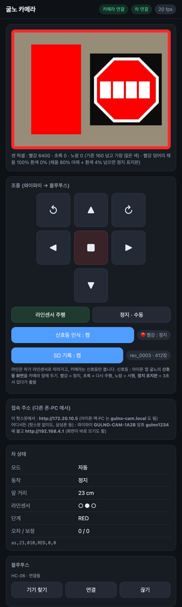
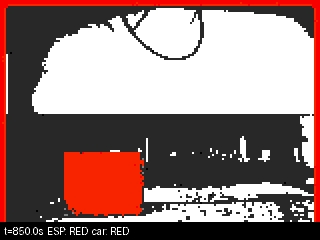
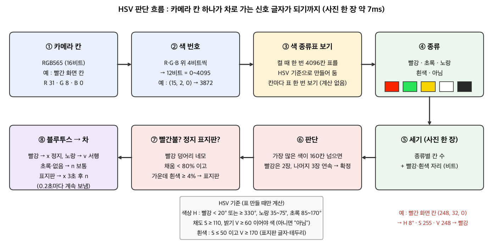
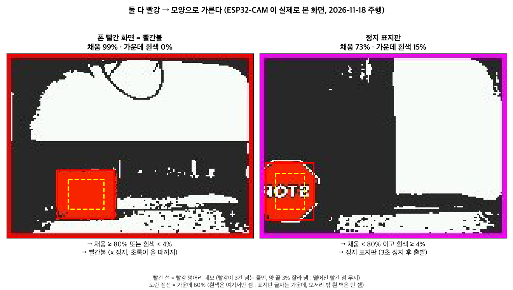

# 굴노 카메라 (ESP32-CAM) : 추가 프로젝트 브랜치 `extra/esp32cam`

> **이용 조건:** 코드는 MIT 오픈소스입니다. 직접 제작한 사진·영상·문서 등은 비상업적 교육·학습 목적만 허용하며 상업적 이용은 금지합니다. 기존 허락의 예외를 포함한 상세 조건은 [NOTICE.md](NOTICE.md)를 확인하세요.

> English : [README.en.md](README.en.md) · 보고서 메모 : [`docs/REPORT_20261116.md`](docs/REPORT_20261116.md)

> 이 브랜치는 버전 C(PID, `main`)에 **ESP32-CAM 카메라**를 더한 **버전 D** 입니다 (버전 C·D 둘 다 제출용). 교안 2팀 **심화 B "1인칭 시점(카메라 화면) 조종"** (47쪽)을 넘어서, 카메라로 **신호등**을 인식하고 **ESP32 가 직접 판단해서** 블루투스로 차에 신호를 보냅니다 (교안 4팀은 PC 파이썬이 판단, 우리는 PC 없이 ESP32 안에서).
> **원칙 : 카메라로 라인 주행은 하지 않는다.** 라인은 차가 라인센서 3개 + PID 로 따라가고, 카메라는 신호등(표지판)만 봅니다.
> **무엇을 감지하는지는 [1장](#1-감지하는-것), HSV 영상 처리로 왜 바꿨는지는 [2장](#2-무엇을-왜-바꿨나--카메라-원칙-hsv-인지-속도).**
> **이 브랜치는 ESP32-CAM 전용**이다. 차(라인 주행·저주파 제어)의 배선·PID·앱 설명은 [`main` 브랜치 README](https://github.com/CHOESEUNGJUN/4wd_car_project/blob/main/README.md) 에 있다.

```
 5V 외부 전원 ──▶ ESP32-CAM ── 와이파이 (내 핫스팟) ──▶ 어느 폰·노트북이든 http://gulno-cam.local (또는 웹에 나오는 숫자 주소)
                      │         컬러 영상(테두리 = 지금 신호), 색 픽셀 수, 차 상태, 주행 버튼, 조종, SD 기록
                      └──── 블루투스 ──▶ HC-06 ──▶ 아두이노 (버전 D, 라인센서 + PID 로 라인 주행)
 폰 앱 굴노 (아이폰·안드로이드) "신호등 화면" (초록 → 노랑 → 빨강) / "정지 표지판" ──▶ 카메라 앞에 들고 있으면 신호등·표지판
```

| 주행 (웹 화면 버튼) | 하는 일 |
|---|---|
| 라인센서 주행 | `a` → 차가 라인센서 3개 + PID 로 스스로 (버전 C 와 같음) |
| 신호등 인식 (켬/끔) | 라인은 차가 계속 보고, 카메라는 신호만 0.2초마다 계속 보냄 : 🔴 `x` 정지, 🟡 `v` 서행 (기본 속도 120 → 100), 🟢 `n` 보통, 🛑 정지 표지판 = 3초 정지 후 출발. 모드는 그대로 |

<p align="center"><br><sub>폰으로 본 ESP32-CAM 웹 화면 (예시 화면 : 빨간불 인식 → 테두리 빨강, 차는 RED 로 정지)</sub></p>



<sub>ESP32-CAM 이 실제로 본 장면 (SD 기록, HSV 보기) : 🔴 빨간불 → 정지, 🟢 초록불 → 출발, 🛑 정지 표지판 → 3초 정지. **사진 더 보기 : [`docs/GALLERY.md`](docs/GALLERY.md)** (차량 사진, ESP 가 본 장면, 주행 중 웹 화면)</sub>

**버전 D 에서 누가 무엇을 하나** — 앱으로 차를 조종하지 않는다

| | 하는 일 | 블루투스 |
|---|---|---|
| **ESP32-CAM 웹 화면** (폰·노트북 브라우저) | **차 조종 전부** : 라인센서 주행 시작·정지, 수동 조종, 신호등 인식 켜기, SD 기록, 차 상태 보기 | ESP32 가 HC-06 에 붙어 있음 |
| **폰 앱 굴노** | **신호등 화면·정지 표지판 화면만** (카메라 앞에 들고 있기). 안드로이드 앱의 "카메라" 버튼 = 위 웹 화면을 앱 안에서 연 것 | 안 씀 |
| 아두이노 (차) | 라인센서 + PID 로 라인 주행, ESP32 가 보낸 `x` / `v` / `n` 따르기 | HC-06 |

- HC-06 은 **한 번에 한 기기만** 붙는다. ESP32 가 붙어 있으면 폰 앱으로는 블루투스 조종이 안 된다 → 앱으로 직접 조종하는 이야기는 **ESP32 없이 달리는 버전 C·E** 이야기 (main README).
- 폰 하나뿐이면 : 신호등 화면은 다른 폰·태블릿에 띄우고, 조종은 노트북 브라우저로.

**설계 메모 : 왜 블루투스·따로 전원으로 만들었나**
- 이 프로젝트는 **수업에서 내려온 지도(교안 2팀 과제 : HC-06 블루투스로 차와 통신, 카메라 모듈은 따로 전원)** 에 맞춰 구현했다. 그래서 ESP32-CAM 은 5V 보조배터리로 따로 켜고, 차(아두이노)와는 **블루투스(HC-06)** 로만 말한다.
- **우리가 직접 설계했다면** : ESP32-CAM 을 **차 배터리에서 핀으로 전원**(배터리 → 5V 강압 모듈 2A 이상 → ESP32-CAM 5V 핀, GND 공통)을 받고, 아두이노와는 **선(UART)으로 바로** 이었을 것이다 (ESP32 TX → 아두이노 RX, 아두이노 TX → 저항 분압 → ESP32 RX, 9600).
  - 좋아지는 것 : 블루투스를 안 쓰니 ESP32 내부 메모리 약 45KB 를 돌려받고, 안테나를 나눠 쓰지 않아 와이파이가 1\~3초씩 멈추는 일이 없어지고, 신호가 차에 가는 지연도 줄어든다. 전원도 하나로.
  - 이 문서의 메모리·안테나 문제(보고서 5장)는 무선 구성을 지키느라 생긴 것이고, 그 안에서 줄인 결과다.

**ESP32-CAM 다루기 (매번)** — 자세히는 [`docs/CAMERA.md` 0장](docs/CAMERA.md)

1. 아이폰 핫스팟 켜기 (호환성 최대화) → 노트북·폰도 연결
2. 차(버전 D) 켜기 → ESP32-CAM 5V 켜기 → 앞 흰 LED 가 깜빡이다 **계속 켜지면** 준비
3. 브라우저 **http://gulno-cam.local** (안 열리면 웹 "접속 주소" 칸의 숫자 주소 예 `http://172.20.10.2`, 안드로이드는 앱의 "카메라". ESP 자기 와이파이 `192.168.4.1` 은 메모리 때문에 2026-11-18 부터 핫스팟을 못 찾을 때만 켜짐) → 블루투스 **연결** (처음은 기기 찾기 → HC-06, PIN 1234. 켤 때마다 한 번)
4. **신호등 인식 : 켬** + 폰 신호등 화면 → **라인센서 주행**, 멈출 때 **정지 · 수동**
5. 끝: 정지 · 수동 → 블루투스 끊기 → 전원 끄기. 처음 한 번은 업로드(PlatformIO)·와이파이 넣기 (`CAMERA.md` 4·5장), 안 되면 `CAMERA.md` 9장 문제 해결

| | |
|---|---|
| 폴더 | **`arduino/`** = Arduino IDE 로 UNO(차)에 올리는 것 : **기본 = 버전 D + 저주파 `motor_control_low_frequency_cam`** (2026-11-18 주행 시험에 쓴 것), 버전 D 원래 배선 `team2_bt_cam`, 카메라 없이 달릴 때 버전 E `motor_control_low_frequency`·버전 C `team2_bt_pid`, 진단 `diag` · **`esp32/`** = PlatformIO 로 ESP32-CAM 에 올리는 것 · **`apps/`** = 굴노 앱 (아이폰·안드로이드 모두 신호등·정지 표지판 화면, 안드로이드는 카메라 화면도) |
| 카메라 코드 | [`esp32/esp32cam_line/`](esp32/esp32cam_line) (`esp32cam_line.ino`, 웹 화면 `page.h`, 빌드 설정 `platformio.ini`) |
| 설명 | [`docs/CAMERA.md`](docs/CAMERA.md) : 다루기, 구조, 신호등, 배선(5V 외부 전원), 올리기, 와이파이(프린터처럼), 웹 화면, 속도·메모리, 카메라 달기, 문제 해결, SD 기록 |
| 명령표 | [`PROTOCOL.md`](PROTOCOL.md) (`x v n` 은 버전 D 만) |
| 작업 보고 | [`docs/REPORT_20261111.md`](docs/REPORT_20261111.md) : 잘된 점, 안된 점, 앞으로 할 것 |
| 다음에 할 일 | `main` 의 [`docs/NEXT.md`](docs/NEXT.md) (체크리스트) |
| 업로드 | **Arduino IDE 로 올리면 안 됨** (미리 만든 라이브러리라 블루투스를 켜면 메모리 부족으로 멈춤). 완성 펌웨어(`.bin`)를 크롬·esptool 로 올리거나 PlatformIO 로 빌드 → **[ESP32 올리기 안내 (윈도우·리눅스·맥)](docs/ESP32_UPLOAD.md)**  차는 Arduino IDE 로 (기본 `motor_control_low_frequency_cam`) |
| 지금 상태 (2026-11-18) | 확인됨 : 블루투스 + 와이파이 + 카메라 동시 동작 (메모리 다시 빌드 후), 웹 조종, HSV 색 판단·HSV 보기(전원을 켜면 HSV 보기가 기본), 신호 반응 약 0.1\~0.15초, SD 기록(HSV 보기 그대로), **저주파 차(`motor_control_low_frequency_cam`)에 달고 트랙 주행 통과** : 빨간불 7번 정지, 초록불 4번 출발, 정지 표지판 5번 3초 정지 (기록 `docs/drive_logs/`). 원칙 변경으로 카메라 라인 인식·카메라 주행은 뺌. ESP 자기 와이파이(192.168.4.1)는 핫스팟을 못 찾을 때만. 안드로이드 앱 폰 시험은 아직 |

---

## 1. 감지하는 것

| 보이는 것 | ESP32 가 보내는 글자 | 차 (자동 모드 그대로) |
|---|---|---|
| 🔴 빨간불 | `x` (0.2초마다) | 정지. 다른 신호가 오거나 사람이 `a`/`m` 을 보낼 때까지 (ESP32 가 꺼져도 안 달림) |
| 🟡 노란불 | `v` | 서행 : 기본 속도 `SLOW_BASE` (저주파판 90 → 70, 고주파판 120 → 100, 1초 넘게 안 오면 보통) |
| 🟢 초록불 / 신호 없음 | `n` | 보통 |
| 🛑 정지 표지판 (빨간 팔각형 + 흰 글자) | `x` 3초 → `n` | 3초 서 있다가 스스로 출발, 그 뒤 5초는 같은 표지판 무시 |

빨간불과 정지 표지판은 둘 다 빨강이라 **모양**으로 가른다 : 빨강 덩어리를 감싼 네모를 빨강이 얼마나 채우는지(폰 빨간 화면 86\~100%, 팔각형 61\~68%)와 그 안의 흰색(글자·테두리) 비율.

## 2. 무엇을 왜 바꿨나 : 카메라 원칙, HSV, 인지 속도

### 2-1. 카메라 : 라인 인식 → 신호등·표지판만

| 처음 (2026-11-11) | 지금 (2026-11-16) |
|---|---|
| 카메라가 바닥 라인을 찾아 모폴로지로 다듬고, 경로·향할 곳을 그려서 카메라로 주행 | **카메라로 라인 주행은 안 한다.** 라인은 라인센서 + PID (버전 C 그대로), 카메라는 신호만 |

- **왜 바꿨나** : 트랙에서 달려 보니 차가 생각보다 빨라서, 카메라(초당 약 20장 + 와이파이·블루투스 지연)로 라인을 보고 조향하면 늦었다. 라인은 이미 라인센서 + PID 로 20ms 마다 잘 따라가므로, 카메라는 **한 가지 일(신호 보기)** 에 전부 쓰는 게 빠르고 안전하다. 카메라가 꺼지거나 멈춰도 라인 주행은 계속되고, 빨간불은 시간으로 안 풀려서 안전 쪽으로 멈춰 있다.
- 교안 4팀은 PC 파이썬이 영상을 받아 판단 → 우리는 PC 없이 **ESP32 안에서** 판단 (와이파이 영상 왕복이 없어 빠름).

### 2-2. 색 판단 : RGB 기준 → HSV + 색 종류표

| | RGB (처음) | **HSV + 표 (지금)** |
|---|---|---|
| 방법 | "R 이 크고 G·B 가 작으면 빨강" 처럼 R·G·B 값을 직접 비교 | 색상 H(0\~359°)·채도 S·밝기 V 로 바꿔서 **색상**으로 가름 (교안 3팀 방식). 빨강 H < 20 또는 ≥ 330, 노랑 35\~75, 초록 85\~170, 흰색 = 채도 낮고 밝음 |
| 약점 / 장점 | 어둡거나 바랜 색, 달리면서 노출이 바뀌면 값이 다 같이 변해서 놓침 | 밝기가 바뀌어도 색상은 그대로라 **어두운 방, 빠른 주행에서도 같은 색** |
| 시험 (가짜 사진 17가지) | 12개 맞음 (어두운 빨강·초록·노랑, 바랜 빨강, 어두운 표지판 놓침) | **17개 모두 맞음**, 바닥(베이지·나무)·흰 벽은 신호로 안 봄 |
| 속도 | 칸마다 비교 계산 | 켤 때 한 번 4096 색(R·G·B 각 4비트) 종류표(4KB)를 만들고 칸마다 **표 한 번 보기** → 계산 없음 |


**어떻게 판단하나** : 카메라 칸 하나 → 색 번호(12비트) → 미리 만든 색 종류표 → 종류별로 세기 → 판단 → 블루투스 글자. HSV 계산은 켤 때 표를 만들 때 4096번만 하고, 달리는 동안에는 칸마다 표를 한 번 볼 뿐이라 사진 한 장(19,200칸)이 약 7ms.




**빨간불과 정지 표지판 가르기** : 둘 다 빨강이라 색만으로는 못 가른다 → 빨강 덩어리의 **모양**을 본다. 폰 빨간 화면은 네모를 거의 다 채우고(99%) 흰색이 없고, 팔각형 표지판은 모서리가 비고(73%) 가운데에 흰 글자가 있다(15%). 아래는 실제 주행 중 ESP32 화면에서 펌웨어와 같은 규칙으로 잡은 네모.




- **왜 바꿨나** : 트랙에서 빨리 달리면 인식이 잘 안 됐다. 원인은 색이 어두워지거나 바래는 것 → 밝기와 색상을 떼어 보는 HSV 로. HSV 계산은 원래 느리지만 표로 미리 만들어 두어 RGB 비교보다 오히려 가벼움.
- **HSV 보기 = 가장 빠른 영상** : 켜면 JPEG 압축 없이 색 종류만 묶어 보내 브라우저가 칠한다 (한 장 약 1.4KB, 같은 핫스팟 연결에서 JPEG 초당 3\~4장 → HSV 5\~11장 실측).
- 웹 카메라 설정의 **HSV 보기** 를 켜면 영상을 ESP32 가 본 색 종류(빨강·초록·노랑·흰색, 회색 = 신호 아님)로 칠해 보여 준다 → 실제 조명에서 기준을 맞출 때.

### 2-3. 속도 : 해상도보다 인지 속도

| 시험한 것 | 결과 | 고른 것 |
|---|---|---|
| 320x240 컬러 | 센서가 초당 9\~10장만 줌 → 한 바퀴 약 105ms | ✗ |
| 센서 JPEG (하드웨어 압축) 받아 풀기 | 푸는 데 95ms → 한 바퀴 110ms | ✗ |
| 카메라 클럭 24MHz | 빨라지지 않고 덜 찍힌 사진만 늘어남 | ✗ (20MHz) |
| **160x120 컬러, 모든 칸 보기** | 한 바퀴 약 48ms (초당 약 20장), 반지름 11px 작은 표지판도 잡음 | ✓ |

- 신호 반응 : 처음 약 2초 → **약 0.1\~0.15초** (빨강 2장, 다른 색 3장 연속이면 확정, 바뀌면 바로 보내고 0.2초마다 다시).
- 사진마다 도는 함수는 IRAM + -O2 (플래시 코드와 PSRAM 사진이 캐시를 같이 써서 밀려나지 않게), 사진은 한 번만 읽고 신호 세기와 영상 복사를 같은 줄에서. 화각은 카메라 칩(OV3660)이 작은 크기에서도 센서 전체를 줄여 써서 이미 최대 (더 넓게는 광각 렌즈 모듈).
- **카메라 칩은 OV3660 (2026-11-18 보드에서 확인, OV2640 이 아님).** 초당 장수는 센서가 정함 : 컬러 160x120 에서 드라이버가 센서 클럭을 40MHz 로 잡아 **45ms 마다 한 장 (초당 22.2장)** (VSYNC 핀으로 실측). 한 바퀴 48ms 중 처리는 약 7ms 뿐이고 나머지는 다음 사진을 기다리는 시간 → 코드를 더 줄여도 빨라지지 않음. 센서 클럭을 올려 보면 (PLL 배수 8 → 10) 센서는 초당 27.8장을 내지만 ESP32 가 못 받아 덜 찍힌 사진이 10초에 1장 → 28장으로 늘고, 배수 12 는 거의 다 깨짐 → 그대로 둠. 더 빠르게는 ESP32-S3 보드 (카메라 입력이 빠름)

## 3. 통신

| 어디 ↔ 어디 | 방식 | 오가는 것 |
|---|---|---|
| ESP32-CAM ↔ 차 | HC-06 블루투스 (ESP32 가 마스터로 연결, PIN 1234) | 신호 `x` 정지 · `v` 서행 · `n` 보통 (0.2초마다), 조종 글자 `g b l r q w s a m`, 연결 신호 `h` / 차 → ESP 상태 줄 0.2초마다 |
| 폰·노트북 ↔ ESP32-CAM | 와이파이 (내 핫스팟), HTTP + 웹소켓 | 웹 화면, HSV 영상, 차 상태, 주행·조종 버튼 |
| 모듈 ↔ 아두이노 | UART 9600bps, D3·D4 SoftwareSerial | 차 쪽 통신 전체는 main README 와 보고서 6-1 |

## 4. 주행 결과

| 기록 | 결과 |
|---|---|
| log_0011, log_0012 (2026-11-18) | 🔴 빨간불 7번 정지 (0.21\~0.54초), 🟢 초록불 4번 출발 (0.11\~0.33초), 🛑 정지 표지판 5번 3초 정지 후 출발, 장애물 정지 |
| log_0013 (추가 기록) | 🟡 노랑 15번 서행 (노란 표지판이 없어 노란 바퀴로 시험), 🔴 빨간불 4번 정지 (0.18\~0.34초), 🟢 초록불 2번 출발 (0.11\~0.30초) |

블루투스 + 와이파이 + 카메라를 같이 켠 채 재시작 없음. 로그 : [`docs/drive_logs/`](docs/drive_logs/) · 분석 : 보고서 7장 ([한국어](docs/REPORT_20261116.md), [English](docs/REPORT_20261116.en.md))

## 5. 차 쪽 (버전 D)

차의 배선, PID 라인 추종, 저주파 PWM, 앱, 디버깅은 **main README** 를 본다 : [README.md](https://github.com/CHOESEUNGJUN/4wd_car_project/blob/main/README.md) · [README.en.md](https://github.com/CHOESEUNGJUN/4wd_car_project/blob/main/README.en.md)

| 카메라를 단 차에 올릴 것 | 배선 |
|---|---|
| **`arduino/motor_control_low_frequency_cam/`** (기본, 버전 D + 저주파) | 저주파 배선 (main README 2장, 5↔9 · 6↔10 맞바꿈) |
| `arduino/team2_bt_cam/` (버전 D, 고주파) | 교안 원래 배선 |

버전 D 는 버전 C·E 에 신호 글자 `x v n` 처리만 더한 것이다 (바뀐 6곳 : [CODE.md 3장](docs/CODE.md)).

## 6. 더 보기

| | |
|---|---|
| 다루기·구조·문제 해결 | [`docs/CAMERA.md`](docs/CAMERA.md) |
| 올리기 (세 OS) | [ESP32_UPLOAD.md](docs/ESP32_UPLOAD.md) |
| 펌웨어 코드 해설 | [REQUIREMENTS.md 부록](docs/REQUIREMENTS.md) |
| 요구사항별 구현 | [REQUIREMENTS.md](docs/REQUIREMENTS.md) |
| 최종 보고서 | [REPORT_20261116.md](docs/REPORT_20261116.md) |
| 사진·영상 | [GALLERY.md](docs/GALLERY.md) |
| 완성 릴리스 | [4wd-car ESP32 Car Control V1.0](https://github.com/CHOESEUNGJUN/4wd_car_project/releases/tag/4wd-car-esp32-car-control-v1.0) |

---

## 라이선스 · 저작권

**소스 코드는 MIT 오픈소스로 공개합니다.** 코드는 MIT 조건에 따라 사용·수정·재배포할 수 있으며, 상업적 이용도 가능합니다. 저작권·허가 문구는 유지해야 합니다.

**사진·영상·그림·주행 로그·문서 등 비코드 자료는 별도 조건을 따릅니다.** 직접 촬영하거나 제작한 자료의 저작권은 해당 촬영자·제작자에게 있으며, 저장소 소유자 CHOESEUNGJUN이 직접 촬영·제작한 자료의 저작권은 본인에게 있습니다.

- 비상업적 교육·학습 목적으로만 열람·복제·수정·공유할 수 있습니다. 원저작자, 저장소 주소, 이 이용 조건을 표시하고 수정 여부를 밝혀야 합니다.
- 판매, 광고·홍보, 유료 강의·교재, 제품·서비스 제공 등 사업·영리 목적의 이용은 금지합니다. 교육 목적을 표방하더라도 상업적 이용이면 허용되지 않습니다. 그 밖의 이용은 해당 권리자의 사전 서면 허락이 필요합니다.
- 무단 상업적 이용 등 저작권 침해가 확인되면 이용 중단·삭제 요구, 손해배상 청구 등 관련 법령에 따른 법적 조치를 취할 수 있습니다.
- 이 비코드 자료 조건은 **2026-11-18 이 고지를 반영한 커밋부터** 적용합니다. 다만 종전에 CC BY 4.0으로 적법하게 공개된 자료에 대한 기존 이용 허락은 소급하여 취소하지 않습니다. 동일한 자료를 이 고지만으로 소급 제한할 수는 없습니다.
- 제3자 자료는 각 권리자와 원래 라이선스를 따릅니다. 상세 범위와 조건은 [`NOTICE.md`](NOTICE.md), 코드의 MIT 전문은 [`LICENSE`](LICENSE)를 확인하세요.
- 수업 교안(PDF)의 저작권은 원저작자에게 있으며 저장소에 포함하지 않습니다.
- 소프트웨어와 자료는 "있는 그대로" 제공됩니다. 차·배터리·전원을 다룰 때의 안전은 사용자 책임입니다.
