# Gallery: 4wd-car (Team "Gulno", 굴러라 노란바퀴)

> 한국어 : [GALLERY.md](GALLERY.md) · Videos and original files: [release 4wd-car ESP32 Car Control V1.0](https://github.com/CHOESEUNGJUN/4wd_car_project/releases/tag/4wd-car-esp32-car-control-v1.0)

## 1. The finished car (2026-11-18)

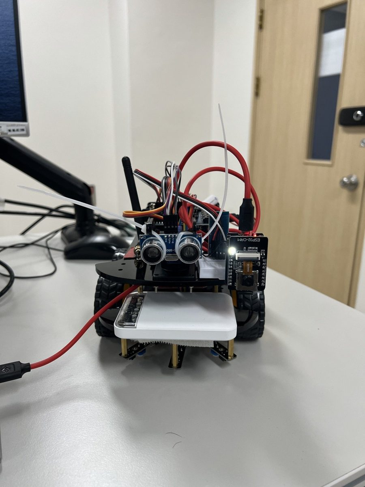
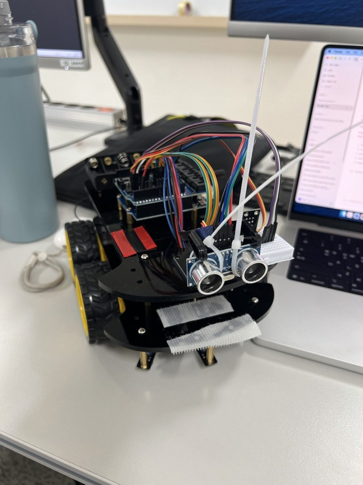
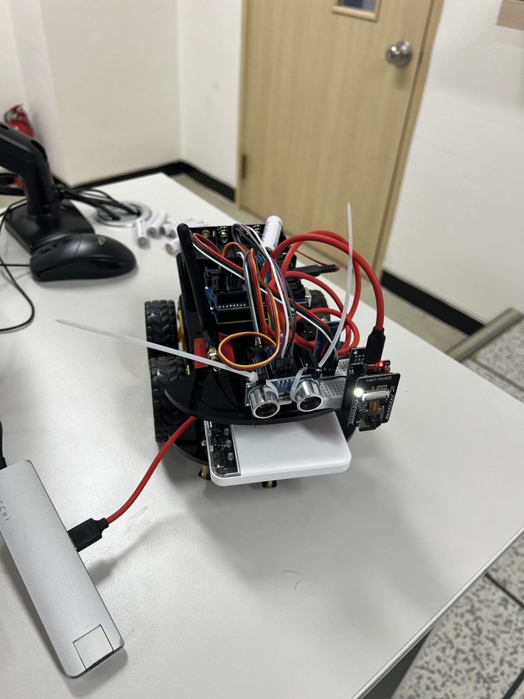

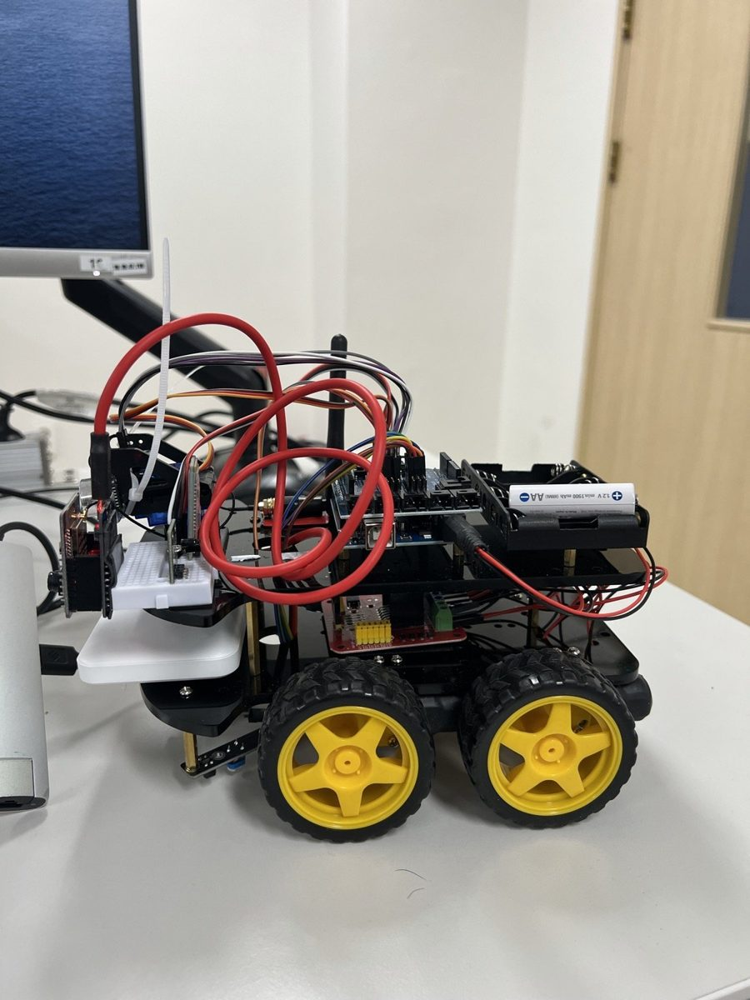
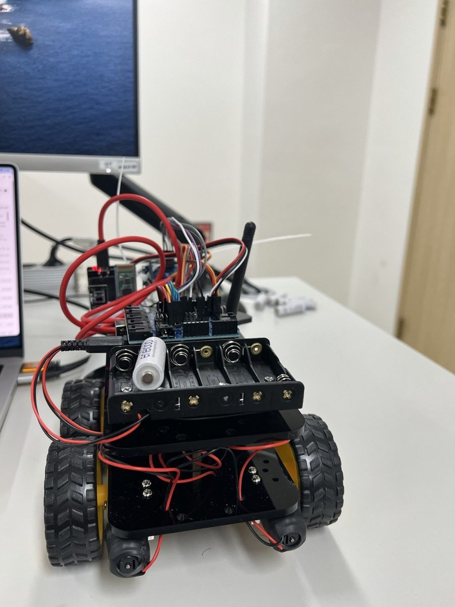
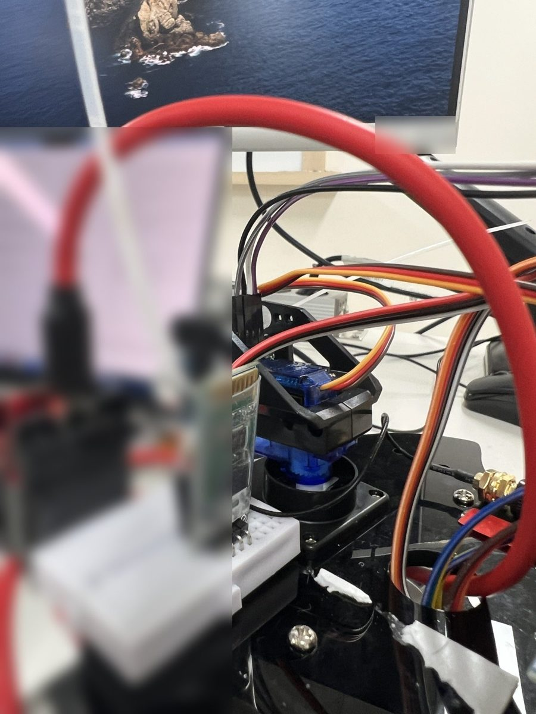

| Where | What |
|---|---|
| Front, top | ESP32-CAM (the board with the antenna), HC-SR04 ultrasonic sensor |
| Front, bottom | 3 line sensors (left A3 / centre A4 / right A5) |
| Middle | Arduino UNO + sensor shield, L298N motor driver (low-frequency wiring: ENA 9, IN2 5, ENB 10, IN3 6) |
| Small breadboard at the front | HC-06 Bluetooth (TXD → D3, RXD → D4) |
| Rear | AA battery pack (motors); the ESP32-CAM runs from a separate 5 V power bank |

## 2. What the ESP32-CAM saw (SD recording rec_0012, HSV view)

| 🔴 Red light → stop | 🟢 Green light → go | 🛑 Stop sign → stop 3 s |
|---|---|---|
| 848.1 s: 1211 red pixels, fill **99 %**, white 0 % → car stops (`RED`) | 856.3 s: 1144 green pixels → car drives on (`LINE`) | 893.6 s: fill **72 %**, centre white **15 %** → stop sign |

- The 160x120 picture the ESP32 actually saw, painted with its colour classes: red, green, yellow, white; dark grey = not a signal.
- The border colour is the ESP32's decision (red / green / magenta = stop sign). The sign's text is mirrored because horizontal mirroring was off (it doesn't affect the decision).
- A red light and a stop sign are both red, so they are told apart by **shape**: the phone's red screen almost fills its box (99 %) with no white, while the octagon leaves the corners empty (72 %) and has white text in the middle (15 %).

## 3. The web page while driving (on a phone or laptop)

| Red light | Green light | Stop sign |
|---|---|---|
| 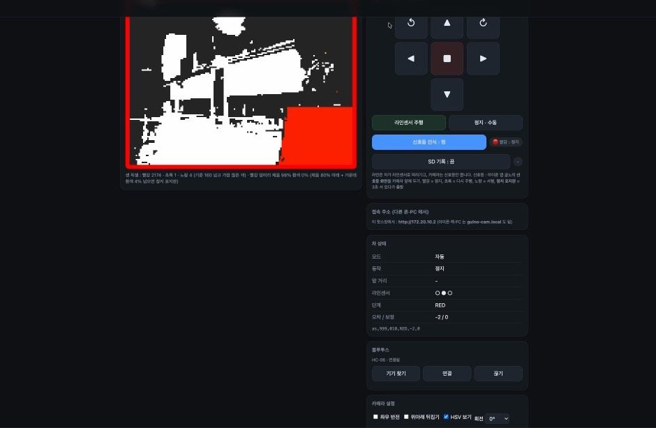 | 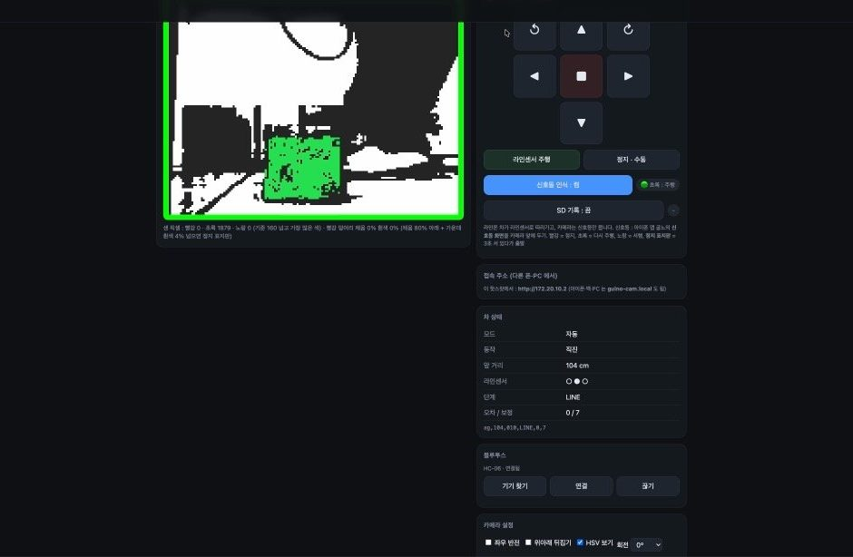 | 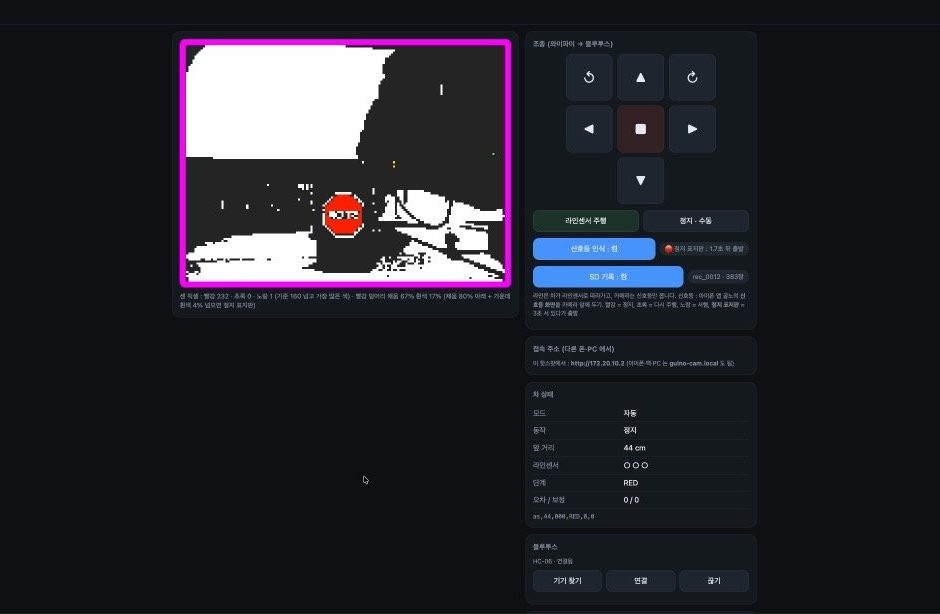 |

Left: the HSV video the ESP32 sees (border = current signal). Right: drive buttons, traffic-light recognition and SD recording, car status (mode, action, distance ahead, line sensors, stage). The page UI is in Korean. Full videos: `screen_web_drive_1~3.mp4` in the release.

## 4. Figures (README)

| | |
|---|---|
| 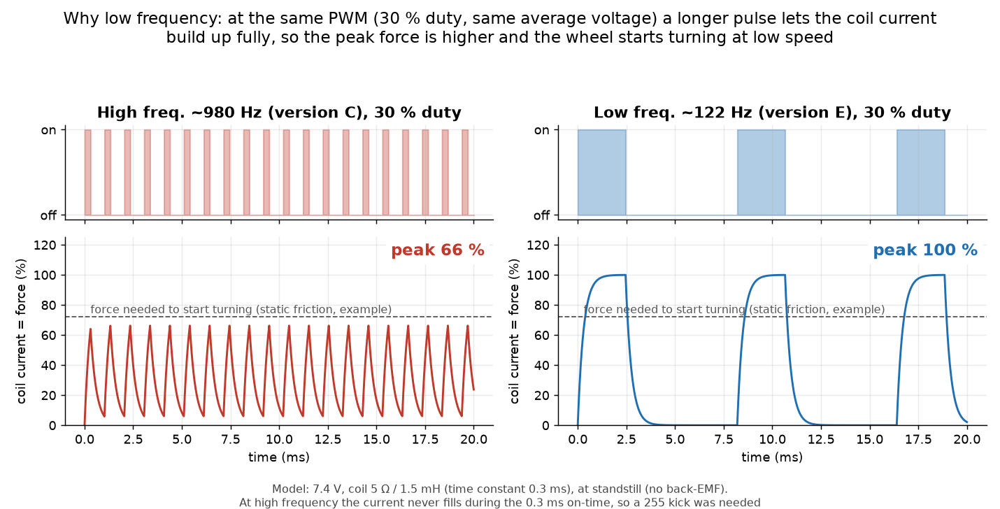 | 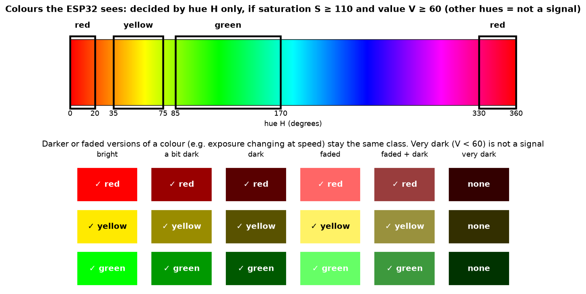 |
| Coil current at high vs low frequency PWM (README 5-1) | Colour ranges the ESP32 uses (README 5-3) |
