# 사진 모음 : 4wd-car (굴노 · 굴러라 노란바퀴)

> English : [GALLERY.en.md](GALLERY.en.md) · 영상·원본 파일 : [릴리스 4wd-car ESP32 Car Control V1.0](https://github.com/CHOESEUNGJUN/4wd_car_project/releases/tag/4wd-car-esp32-car-control-v1.0)

## 1. 완성 차량 (2026-11-18)

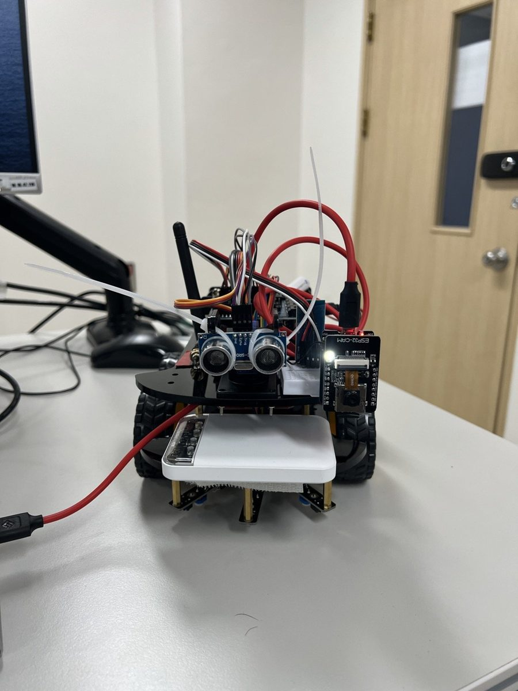
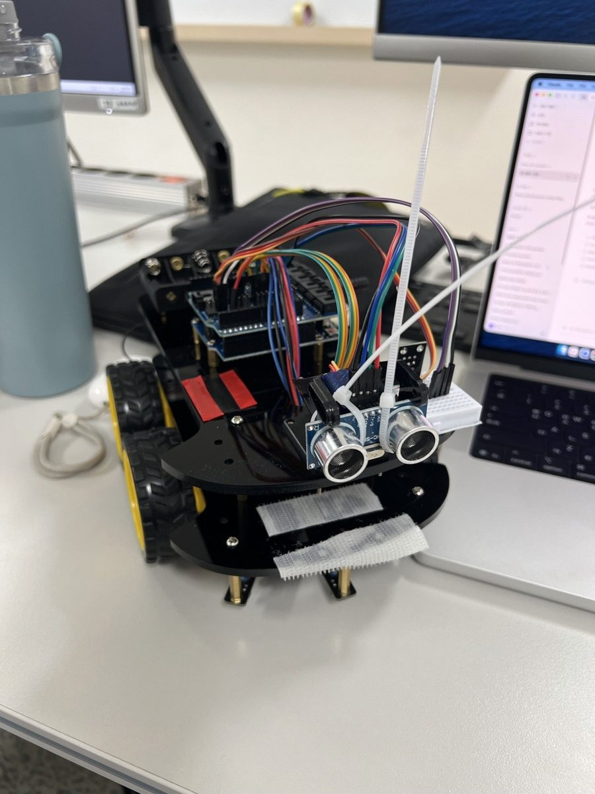
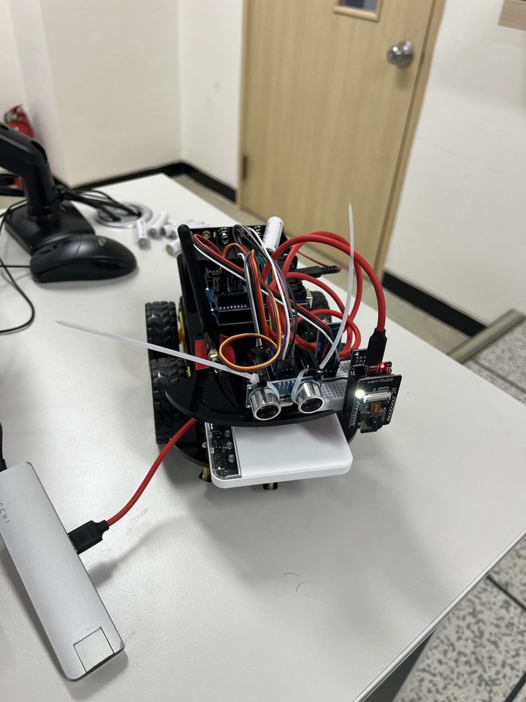

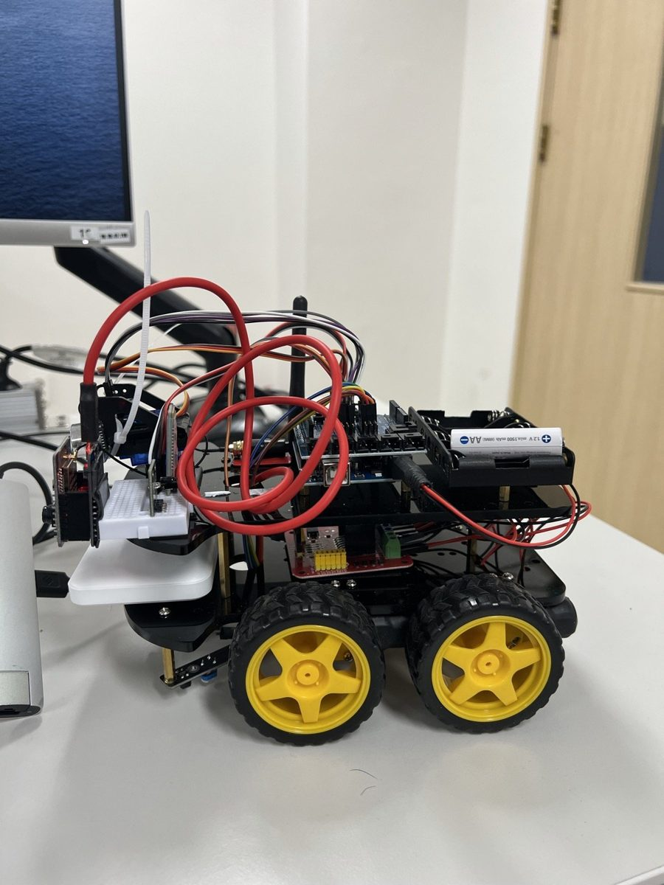
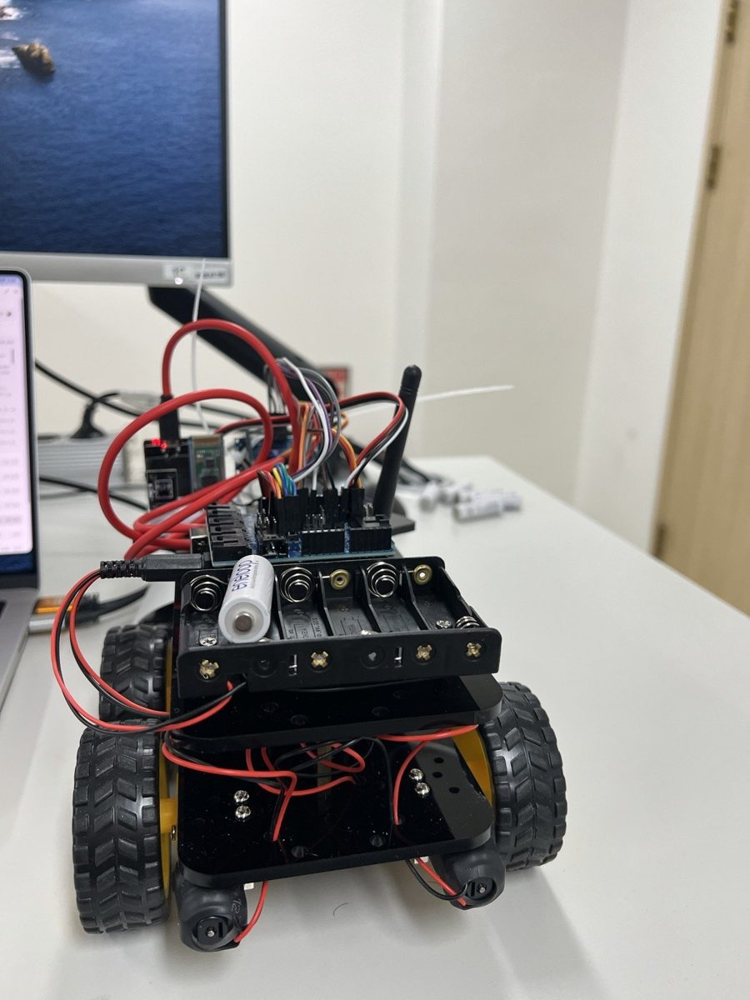
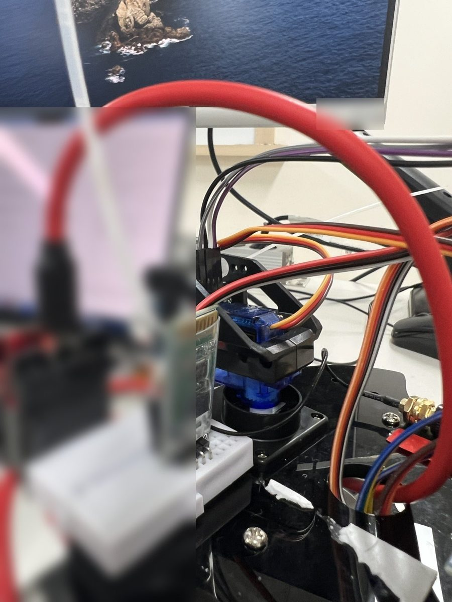

| 보이는 것 | 무엇 |
|---|---|
| 앞쪽 위 | ESP32-CAM (안테나 달린 보드), 초음파 센서 HC-SR04 |
| 앞쪽 아래 | 라인센서 3개 (왼 A3 / 가운데 A4 / 오른 A5) |
| 가운데 | Arduino UNO + 센서 확장 쉴드, L298N 모터 드라이버 (저주파 배선 : ENA 9, IN2 5, ENB 10, IN3 6) |
| 앞 작은 빵판 | HC-06 블루투스 (TXD → D3, RXD → D4) |
| 뒤 | AA 배터리 팩 (모터), ESP32-CAM 은 5V 보조배터리로 따로 |

## 2. ESP32-CAM 이 본 장면 (SD 기록 rec_0012, HSV 보기)

| 🔴 빨간불 → 정지 | 🟢 초록불 → 출발 | 🛑 정지 표지판 → 3초 정지 |
|---|---|---|
| 848.1초 : 빨강 1211칸, 채움 **99%**, 흰색 0% → 차 `RED` 정지 | 856.3초 : 초록 1144칸 → 차 `LINE` 다시 주행 | 893.6초 : 채움 **72%**, 가운데 흰색 **15%** → 정지 표지판 |

- ESP32 가 실제로 본 160x120 화면을 HSV 색 종류로 칠한 것 : 빨강·초록·노랑·흰색, 어두운 회색 = 신호 아님.
- 테두리 색 = ESP32 의 판단 (빨강 / 초록 / 자홍 = 정지 표지판). 표지판 글자가 거꾸로인 건 좌우 반전이 꺼져 있어서 (판단과 상관없음).
- 빨간불과 정지 표지판은 둘 다 빨강이라 **모양**으로 가른다 : 폰 빨간 화면은 네모를 거의 다 채우고(99%) 흰색이 없고, 팔각형 표지판은 모서리가 비고(72%) 가운데에 흰 글자가 있다(15%).

## 3. 차가 직접 찍어 온 영상 (ESP32-CAM SD 기록)

ESP32-CAM 이 달리면서 스스로 찍어 SD 카드에 남긴 영상 (초당 5장, HSV 보기). 아래 줄 = 그때 시각, ESP 판단, 차 상태 (`LINE` 라인 주행, `CORNER` 코너, `RED` 정지 …).

| 🔴 빨간불에 서 있다가 🟢 초록불에 출발 | 🛑 정지 표지판 → 3초 정지 → 출발 |
|---|---|
| 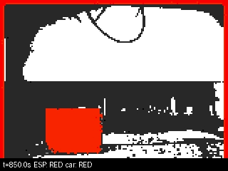 | 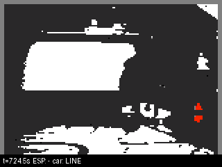 |
| log_0012, 850~859초 : 빨강 동안 `RED` 로 서 있고, 초록이 되자 0.3초 뒤 `LINE` | log_0012, 724~731초 : 표지판(자홍 테두리) → `RED` 로 약 3초 → 다시 주행 |

**한 번의 주행 전체 (log_0011, 55초를 2배 빠르게)** : 수동 → 자동 출발 → 빨간불 정지 18초 → 초록불 출발 → 장애물 정지 → 출발 → 빨간불 정지

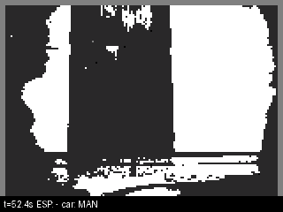

**4분 26초 주행을 6초마다 한 장 (log_0012)** : 빨강·초록·자홍 테두리가 그때 ESP 판단

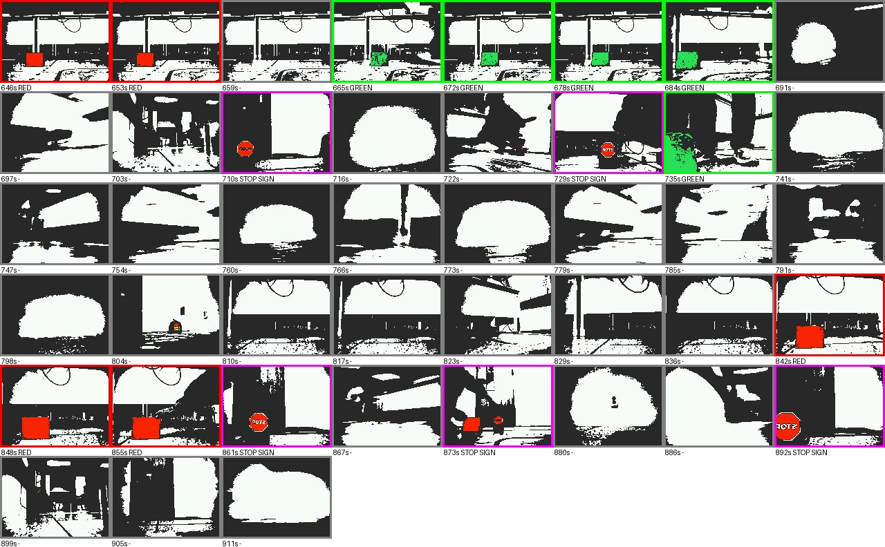

원본 영상 (전체 1,544장)과 로그 : 릴리스의 `drive_rec_0011·0012.mjpeg`, `drive_log_0011·0012.csv` (VLC 또는 `esp32/rec_viewer.html` 로 보기).

## 4. 주행 중 웹 화면 (폰·노트북에서 본 것)

| 빨간불 | 초록불 | 정지 표지판 |
|---|---|---|
| 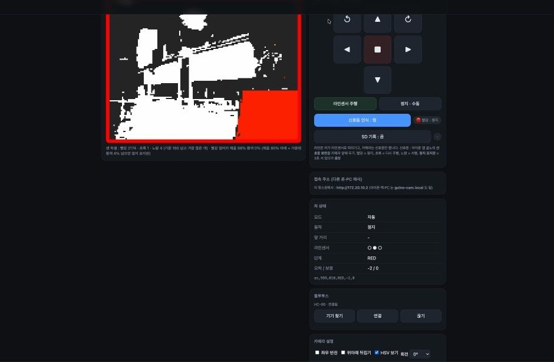 | 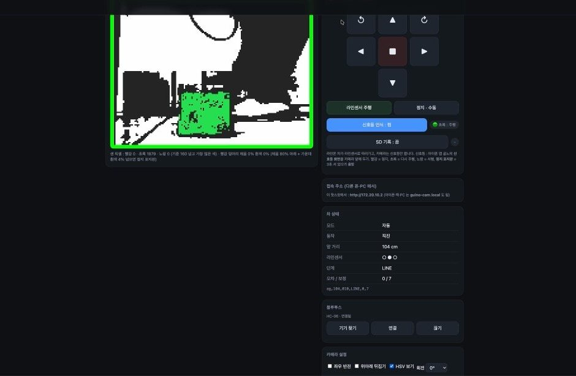 | 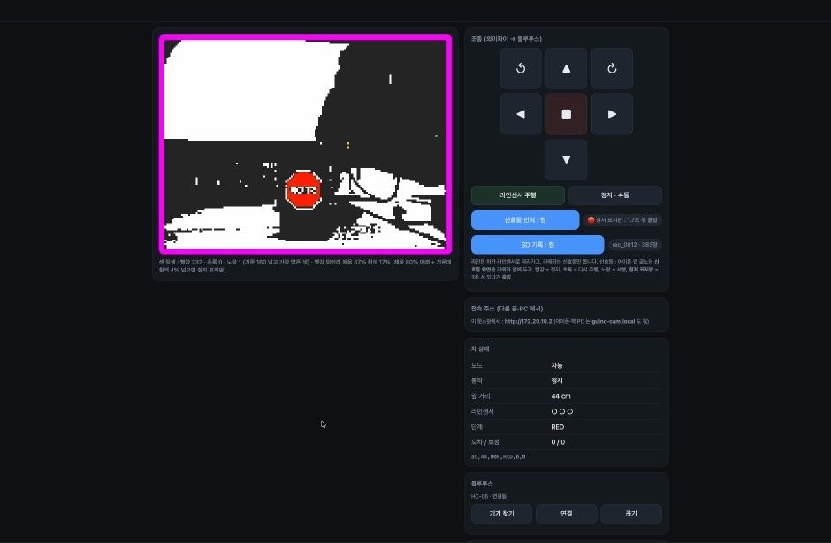 |

화면 왼쪽 = ESP32 가 본 HSV 영상 (테두리 = 지금 신호), 오른쪽 = 조종 버튼, 신호등 인식·SD 기록, 차 상태 (모드, 동작, 앞 거리, 라인센서, 단계). 전체 영상 : 릴리스의 `screen_web_drive_1~3.mp4`.

## 5. 그림 (README)

| | |
|---|---|
| 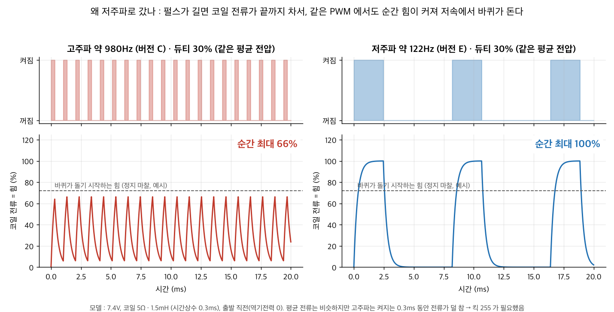 | 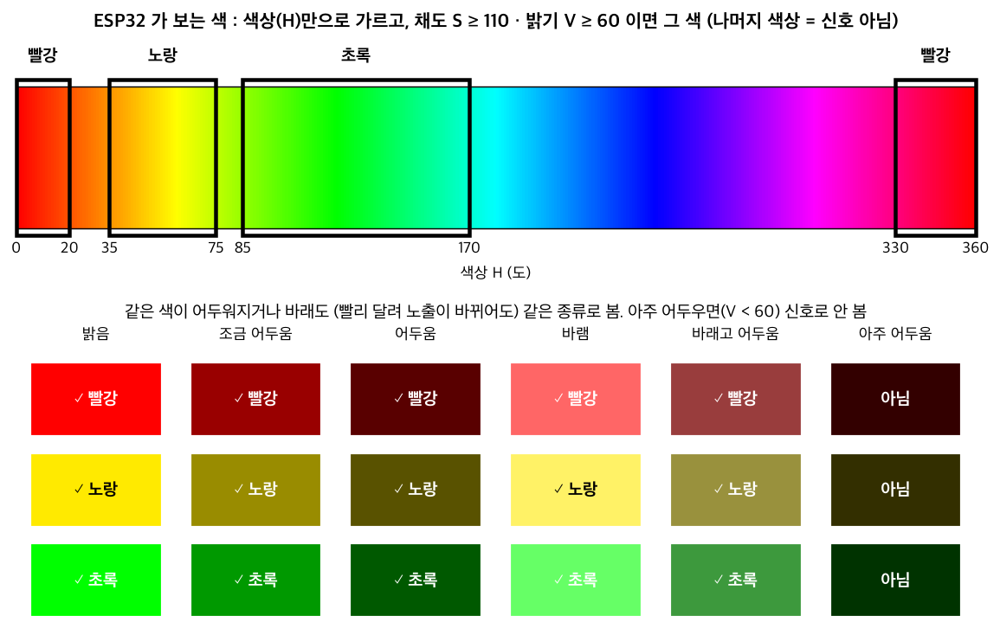 |
| 고주파·저주파 PWM 의 코일 전류 (README 5-1) | ESP32 가 보는 색 범위 (README 5-3) |
| 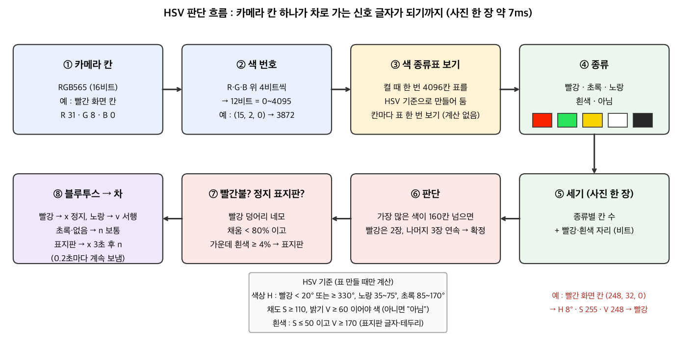 | 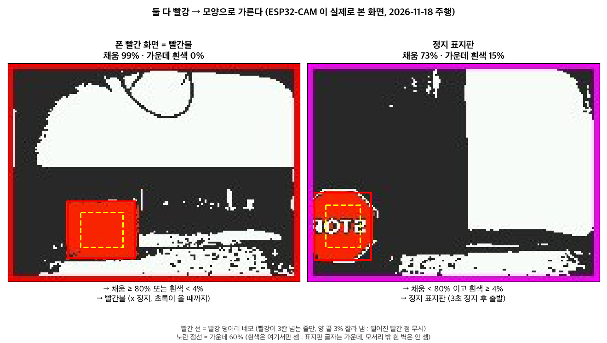 |
| HSV 판단 흐름 (README 5-3) | 빨간불과 정지 표지판을 모양으로 가르기 (README 5-3) |
