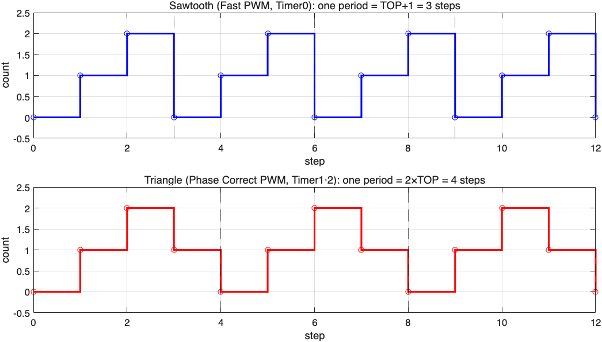
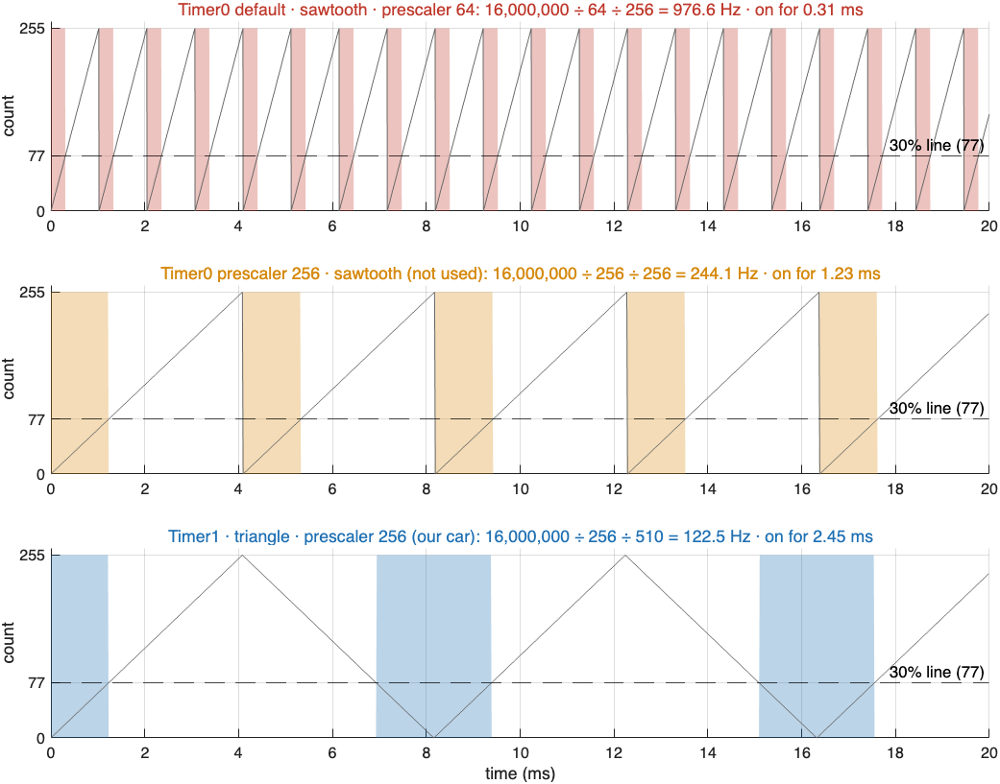
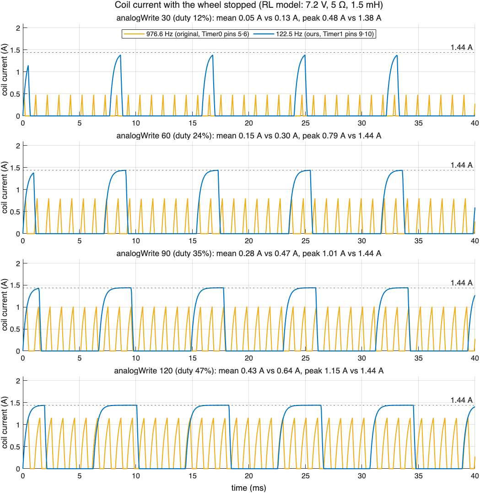
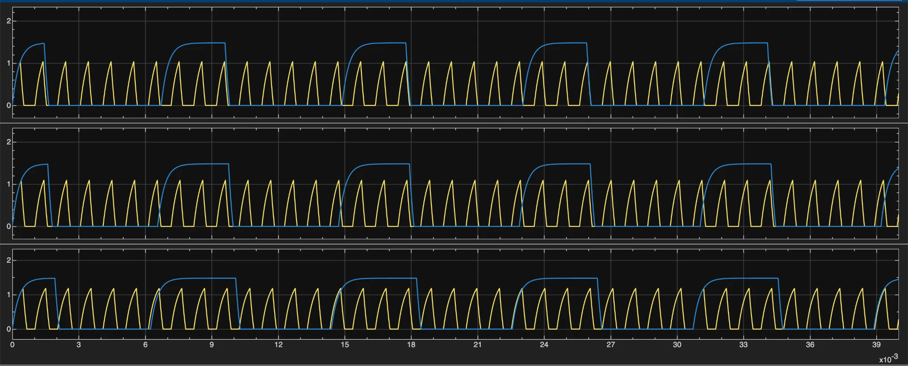
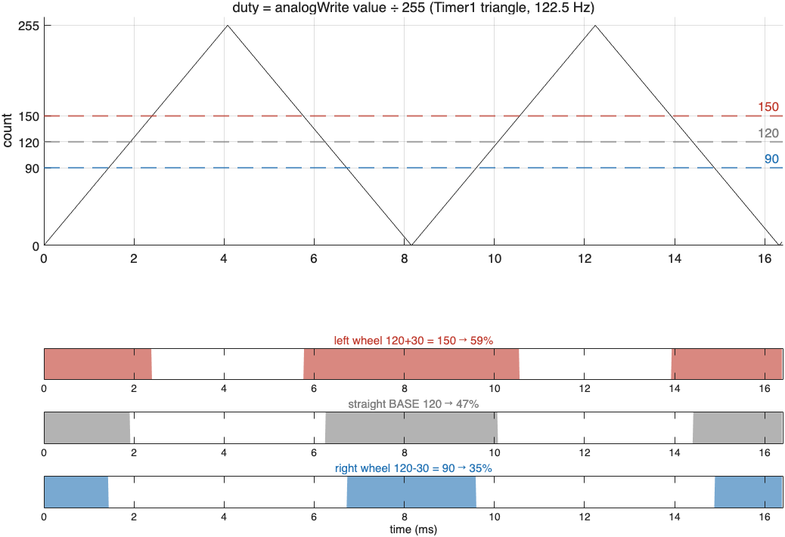
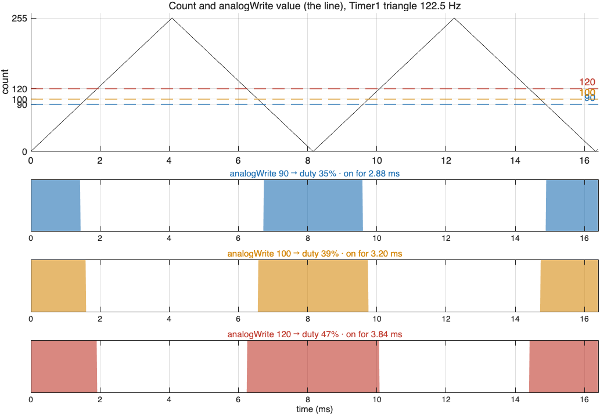
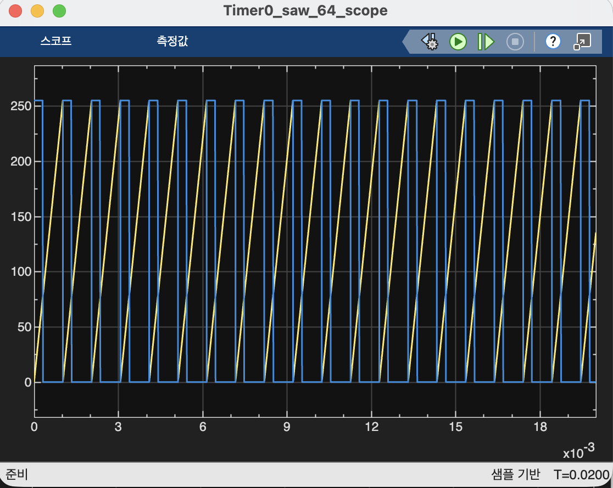
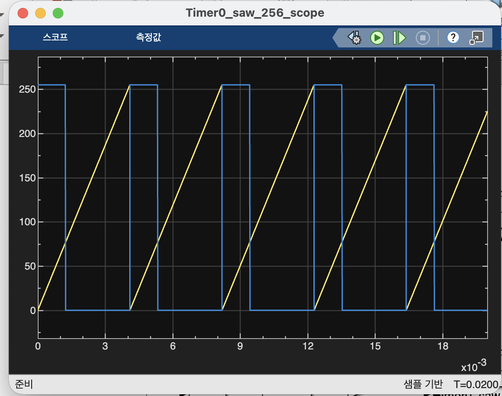
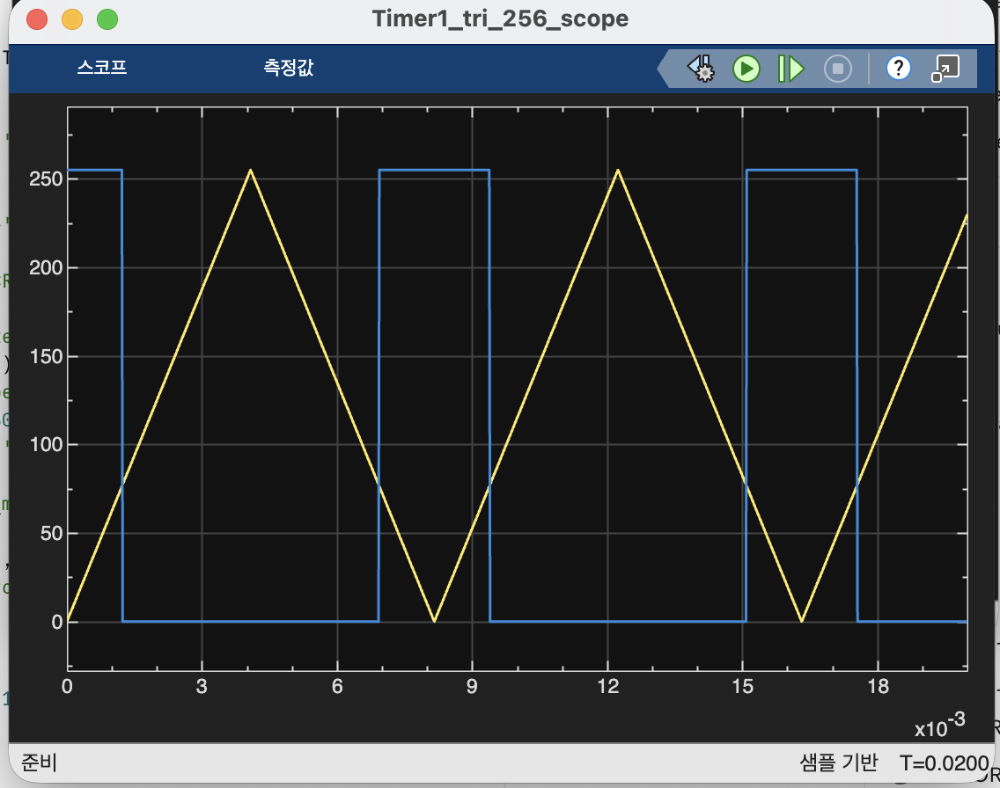

# PWM and timers: where 122.5 Hz comes from, and why Timer1

> 한국어 : [PWM.md](PWM.md) · Short version in README [2-1](https://github.com/CHOESEUNGJUN/4wd_car_project/blob/main/README.en.md#2-1-why-low-frequency-moves-the-pins), [5-1](https://github.com/CHOESEUNGJUN/4wd_car_project/blob/main/README.en.md#5-1-motors-high-frequency-pwm-version-c--low-frequency-pwm-version-e)

**In one line**: the Arduino makes PWM with a **timer counter** inside the chip. The frequency is `16,000,000 ÷ prescaler ÷ steps per period`, and the duty is the `analogWrite` value from the code. Our car sets **Timer1 to triangle, prescaler 256** for **122.5 Hz**. Timer0 runs `millis()` and `delay()`, so it must not be changed.

---

## 1. How the Arduino makes PWM: the timer counter

PWM switches the motor power on and off quickly. The switching is done by a **timer (hardware) inside the chip**, not by the code.

1. **Clock**: the UNO ticks **16,000,000 times** a second (16 MHz).
2. **Prescaler**: "how many ticks per step". Chosen from what the chip offers: 1, 8, 64, 256, 1024.
3. **Counter**: counts one step at a time from 0 to **TOP**. For an 8-bit timer TOP = 2⁸ − 1 = **255**.
4. **Compare**: while the count is **below** the `analogWrite` value (**OCR**) the pin is **on**, above it the pin is off.

The counter runs in one of two waveforms.



| Waveform | Datasheet name | How it counts | Steps per period | On the Arduino |
|---|---|---|---|---|
| **Sawtooth** | Fast PWM | up from 0 to TOP, then drops to 0 (the drop is one step) | **TOP + 1** | Timer0 (pins 5, 6) |
| **Triangle** | Phase Correct PWM | up from 0 to TOP, then back down to 0 | **2 × TOP** | Timer1 (pins 9, 10), Timer2 (pins 3, 11) |

- The Arduino's `init()` writes the waveform and prescaler into the chip's setup registers (the **WGM** and **CS** bits of `TCCRnA`, `TCCRnB`) at power-on. The default prescaler is **64** for all three timers.
- The waveform itself doesn't change the force. At the same frequency and duty, sawtooth and triangle give the same pulse length. What changes the force is the **frequency** (chapter 3).

## 2. Calculating the frequency: three steps

| Step | Formula | Meaning |
|---|---|---|
| ① | clock ÷ prescaler | steps per second |
| ② | sawtooth TOP + 1, triangle 2 × TOP | steps per period |
| ③ | ① ÷ ② | periods per second = **frequency (Hz)** |

> **frequency = 16,000,000 ÷ (prescaler × steps per period)**

### Toy numbers first

A clock of 1,000 ticks a second, TOP = 2, triangle (4 steps per period):

| Prescaler | ① steps per second | ② per period | ③ frequency |
|---|---|---|---|
| 10 | 1000 ÷ 10 = 100 | 4 | 100 ÷ 4 = **25 Hz** |
| 20 | 1000 ÷ 20 = 50 | 4 | 50 ÷ 4 = **12.5 Hz** |

Doubling the prescaler makes each step twice as slow, so the frequency **halves**. That is what "a bigger prescaler means a lower frequency" means.

### The real UNO (8-bit, TOP = 255)

| Timer | Waveform | Prescaler | ① steps per second | ② per period | ③ frequency | Period |
|---|---|---|---|---|---|---|
| Timer0 default | sawtooth | 64 | 250,000 | 256 | **976.6 Hz** | 1.024 ms |
| Timer1·2 default | triangle | 64 | 250,000 | 510 | **490.2 Hz** | 2.04 ms |
| Timer0 with prescaler 256 (not used) | sawtooth | 256 | 62,500 | 256 | **244.1 Hz** | 4.096 ms |
| **Timer1, our car** | **triangle** | **256** | **62,500** | **510** | **122.5 Hz** | **8.16 ms** |

- The lecture-deck wiring (version C) has the speed pins on 5 and 6 = Timer0, so it ran at **about 980 Hz**.
- With the same prescaler 256, the triangle (510 steps) has almost twice the period of the sawtooth (256 steps), so almost half the frequency.

## 3. Seeing it: same 30 % duty, different frequency



- All three are **on 30 % of the time** (same average voltage).
- What differs is **how long each pulse lasts**: 0.31 ms → 1.23 ms → **2.45 ms**.
- The motor coil needs time for the current to build up (about 0.3 ms in our motor model). A 0.31 ms pulse switches off before it is full; a 2.45 ms pulse fills it → **more peak force (torque)**, so a stopped car can start again.

### The power that actually flows: coil current



| `analogWrite` | Duty | Original 976.6 Hz: mean / peak | Ours 122.5 Hz: mean / peak |
|---|---|---|---|
| 30 | 12 % | 0.05 A (3 %) / 0.48 A (33 %) | **0.13 A (9 %) / 1.38 A (96 %)** |
| 60 | 24 % | 0.15 A (11 %) / 0.79 A (55 %) | **0.30 A (21 %) / 1.44 A (100 %)** |
| 90 | 35 % | 0.28 A (20 %) / 1.01 A (70 %) | **0.47 A (33 %) / 1.44 A (100 %)** |
| 120 | 47 % | 0.43 A (30 %) / 1.15 A (80 %) | **0.64 A (45 %) / 1.44 A (100 %)** |

(Brackets = share of 1.44 A, the current if always on. Simulink model [`matlab/pwm_power_simulink.m`](matlab/pwm_power_simulink.m): RL model with the wheel stopped (no back-EMF), 7.2 V (six 1.2 V cells) · 5 Ω · 1.5 mH, on = +V, off = −V through the L298N diodes. These are example values, so the real car's numbers can differ; the difference between the two frequencies goes the same way.)

- **The yellow line (976.6 Hz) looks like a triangle wave, but it is not one.** It is the **coil current**, not the counter. It rises along a curve but switches off after only 0.12–0.48 ms, so only the start of the curve (almost straight) is used; when off, the L298N pulls the current out fast, so it drops in a straight line. It only looks like a triangle; it is **current cut off every time before it fills up**.
- At 976.6 Hz the time spent pulling the current out is a big share of each period, so a 35 % duty gives only 20 % mean current. At 122.5 Hz that loss is small, so it gives 33 %, close to the duty.
- **The blue line (122.5 Hz)** reaches 1.44 A every time and stays flat. Raising the value makes it **wider**, not higher.

**Why the car only moved at high frequency when the PWM value was raised a lot**: the same model with higher values (only `vals` changed in `pwm_power_simulink.m`):

| `analogWrite` | 976.6 Hz: mean / peak | 122.5 Hz: mean / peak |
|---|---|---|
| 130 | 0.48 A / 1.19 A (82 %) | 0.70 A / 1.44 A (100 %) |
| 150 | 0.58 A / 1.25 A (87 %) | 0.81 A / 1.44 A (100 %) |
| 180 | 0.74 A / 1.31 A (91 %) | 0.98 A / 1.44 A (100 %) |
| 210 | 0.93 A / 1.36 A (94 %) | 1.15 A / 1.44 A (100 %) |
| 255 | 1.44 A / 1.44 A (100 %) | 1.44 A / 1.44 A (100 %) |

- Matching the mean current of 90 at 122.5 Hz (0.47 A) takes **about 130** at 976.6 Hz.
- At 976.6 Hz the peak current is still 94 % at 210 and reaches 100 % only at **255 (always on)**. That is why version C needed a **255 kick** to start a stopped car.

As seen on the Simulink scope (top to bottom 30 / 60 / 90 / 120, yellow 976.6 Hz, blue 122.5 Hz):



- With the triangle, each pulse is **centred** on the point where the count touches 0 (8.16 ms, 16.3 ms). That is why it is called Phase Correct: when the duty changes, the pulse centre stays put, so the signal stays even.

## 4. Who sets the duty: the `analogWrite` value is the height of the line

The timer sets the **frequency (how often)**; the code sets the **duty (how long)**.

> triangle duty = `analogWrite` value ÷ 255



Our car's PID changes this value every cycle ([`motor_control_low_frequency.ino`](../arduino/motor_control_low_frequency/motor_control_low_frequency.ino)):

```cpp
const int BASE = 120;                                   // base speed -> 120/255 = 47%
int left = BASE + (int)u, right = BASE - (int)u;        // u = PID correction
driveManualLR(constrain(left, 0, 255), constrain(right, 0, 255));
analogWrite(RightMotor_E_pin, rightSpeed);              // puts the line height into the chip (OCR1A/B)
analogWrite(LeftMotor_E_pin,  leftSpeed);
```

| Example u = 30 | Value | Duty |
|---|---|---|
| left wheel | 120 + 30 = 150 | 59 % |
| right wheel | 120 − 30 = 90 | 35 % |

The left wheel is on longer, so the car turns right back onto the line.

With values 90, 100 and 120 (frequency stays 122.5 Hz):



| `analogWrite` | Duty | On-time per pulse (of an 8.16 ms period) | In our code |
|---|---|---|---|
| 90 | 35 % | 2.88 ms | minimum power `MIN_PWM` |
| 100 | 39 % | 3.20 ms | |
| 120 | 47 % | 3.84 ms | base speed `BASE` |

Going to low frequency did not change the PID (the control). It changed the **frequency of the signal that carries the PID's command to the motor**.

## 5. Why Timer1

| Timer | Pins | Already used by | If its frequency changes |
|---|---|---|---|
| Timer0 | 5, 6 | `millis()`, `delay()` | the clock goes wrong → **can't change** |
| Timer1 | 9, 10 | servo (points forward once at power-on) | **fine to change** |
| Timer2 | 3, 11 | pin 3 = Bluetooth receive, pin 11 = motor direction | not free |

**How wrong the clock gets if Timer0 is changed**: the Arduino assumes "one Timer0 period = 1.024 ms (256 steps × prescaler 64 ÷ 16 MHz)" and adds that to the time every period.

| Timer0 setup | Real period | Clock | What `delay(1000)` really waits |
|---|---|---|---|
| default (sawtooth, 64) | 1.024 ms | correct | 1 s |
| sawtooth, 256 | 256 × 256 ÷ 16 MHz = 4.096 ms | 4× slow | about 4 s |
| triangle, 256 | 510 × 256 ÷ 16 MHz = 8.16 ms | about 8× slow | about 8 s |

That would break the 20 ms PID cycle, the manual-mode link-loss stop (0.45 s) and the start kick (0.06 s). So we change **only Timer1** and move the speed pins (ENA, ENB) to pins 9 and 10, where Timer1 comes out (swap wires 5↔9, 6↔10, README [2-1](https://github.com/CHOESEUNGJUN/4wd_car_project/blob/main/README.en.md#2-1-why-low-frequency-moves-the-pins)).

### The code: three lines in `setup()`

```cpp
TIMSK1 = 0;              // turn off the Timer1 interrupt the Servo library left on (so it can't overwrite the PWM)
TCCR1A = _BV(WGM10);     // WGM = 1: 8-bit Phase Correct PWM (triangle, TOP 255)
TCCR1B = _BV(CS12);      // CS = 100: prescaler 256
```

| `CS12 CS11 CS10` | Prescaler | Timer1 triangle frequency |
|---|---|---|
| 0 0 1 | 1 | 31,372 Hz |
| 0 1 0 | 8 | 3,922 Hz |
| 0 1 1 | 64 (Arduino default) | 490.2 Hz |
| **1 0 0** | **256 (our car)** | **122.5 Hz** |
| 1 0 1 | 1024 | 30.6 Hz |

## 6. Try it yourself: MATLAB · Simulink

All graphs in this document were drawn with MATLAB (run [`matlab/export_doc_figures.m`](matlab/export_doc_figures.m) to save `docs/img/pwm_*.png` again in Korean and English). The coil-current figure is the result of the Simulink model `pwm_power_simulink.m`.

- [`matlab/pwm_shapes.m`](matlab/pwm_shapes.m): draws the toy (TOP 2) sawtooth and triangle, the three timers, and duty 90 / 100 / 120. Open in MATLAB and Run (F5).
- [`matlab/pwm_power_simulink.m`](matlab/pwm_power_simulink.m): compares the coil current at 976.6 Hz and 122.5 Hz for analogWrite 30 · 60 · 90 · 120 (one scope panel per value, mean and peak table in the Command Window; set `vals = [...]` in the Command Window to change the values).
- [`matlab/pwm_duty_simulink.m`](matlab/pwm_duty_simulink.m): PWM waveform at 122.5 Hz for analogWrite 90 · 100 · 120 (one scope per value).
- [`matlab/pwm_timers_simulink.m`](matlab/pwm_timers_simulink.m): builds and runs the Simulink model `pwm_timers`. One row per timer: `Repeating Sequence` (counter) → `<` compare (OCR 77) → PWM output → scope.

Simulink scope results (yellow = count, blue = PWM output, 20 ms):

| Timer0 default (sawtooth, 64): 976.6 Hz | Timer0 prescaler 256 (sawtooth): 244.1 Hz | Timer1, our car (triangle, 256): 122.5 Hz |
|---|---|---|
|  |  |  |

## 7. On one page

```
frequency = 16,000,000 ÷ (prescaler × steps per period)
steps per period: sawtooth = TOP + 1 = 256,  triangle = 2 × TOP = 510   (8-bit, TOP 255)
duty = analogWrite value ÷ 255   (set by the PID every cycle)
our car: Timer1, triangle, prescaler 256 → 62,500 ÷ 510 = 122.5 Hz, period 8.16 ms
```
