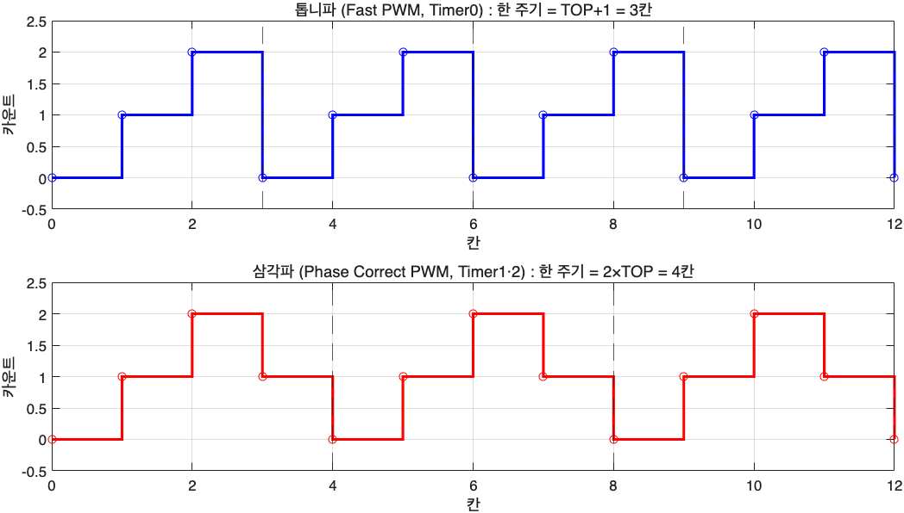
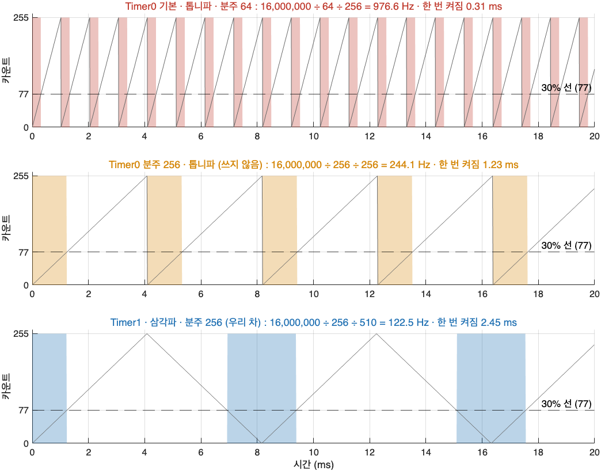
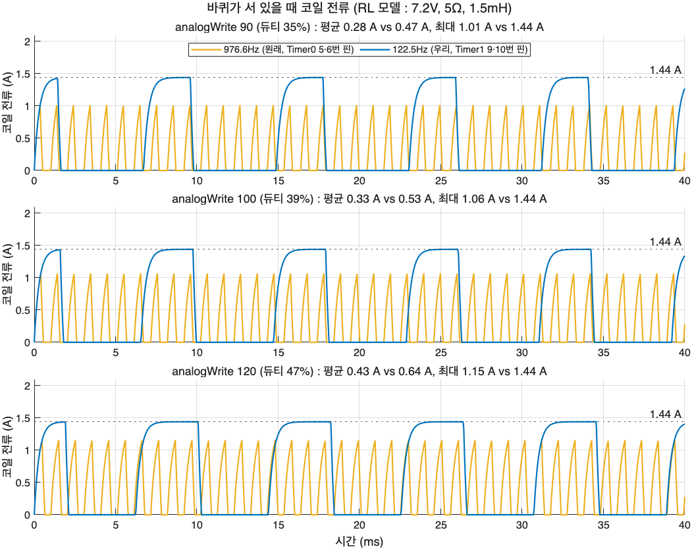
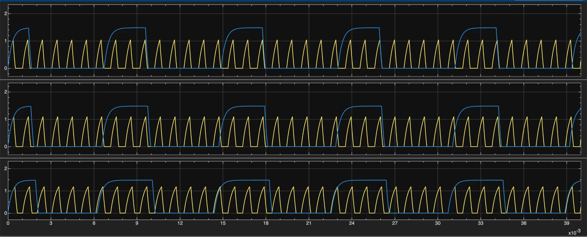
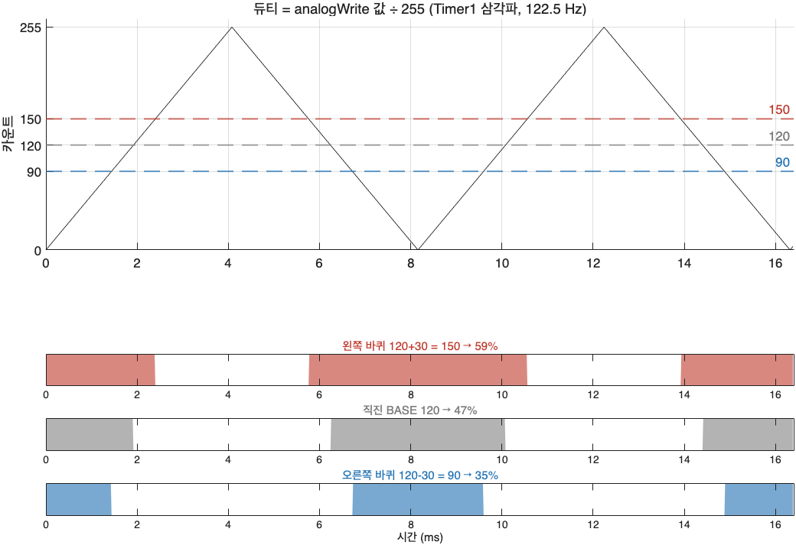
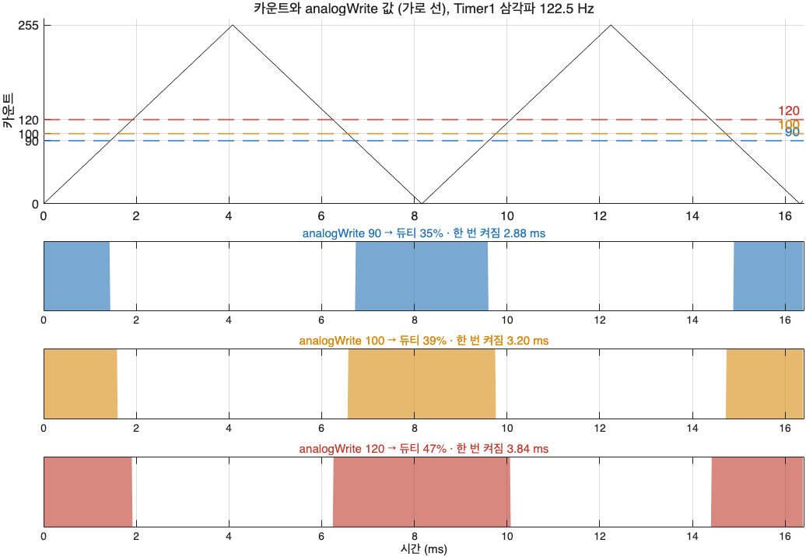
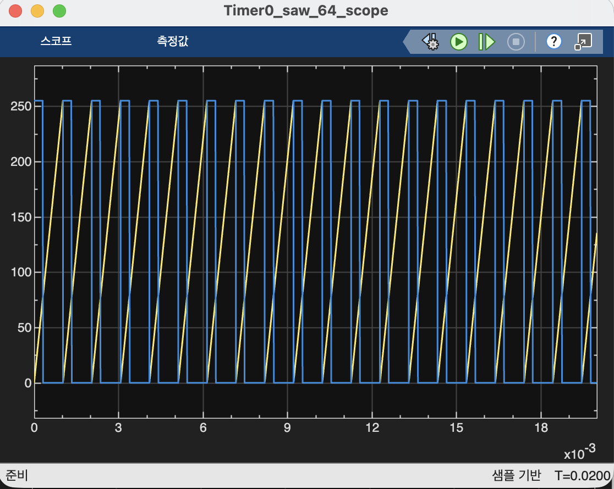
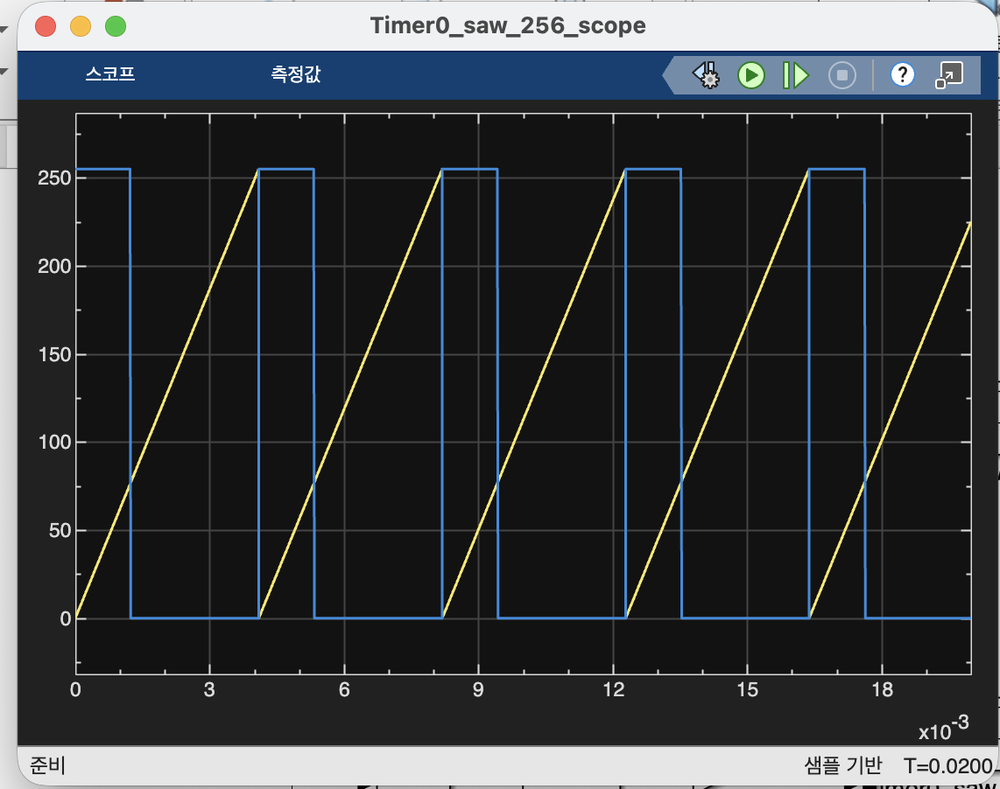
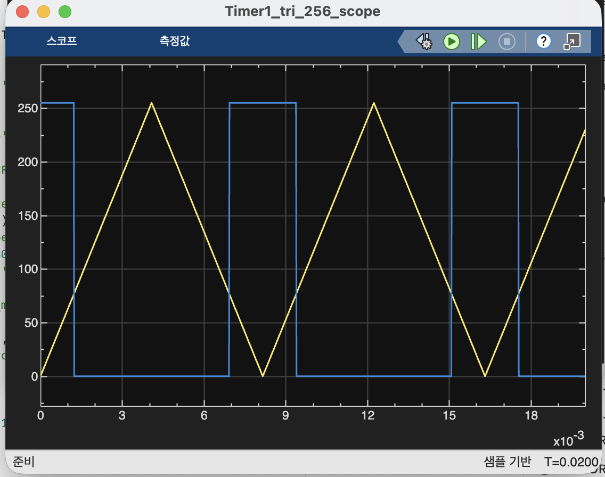

# PWM 과 타이머 : 122.5Hz 는 어떻게 나오고, 왜 Timer1 인가

> English : [PWM.en.md](PWM.en.md) · 짧은 요약은 README [2-1](https://github.com/CHOESEUNGJUN/4wd_car_project/blob/main/README.md#2-1-저주파는-왜-핀을-바꾸나), [5-1](https://github.com/CHOESEUNGJUN/4wd_car_project/blob/main/README.md#5-1-모터--고주파-pwm-버전-c--저주파-pwm-버전-e)

**한 줄 요약** : 아두이노는 칩 안의 **타이머 카운터**로 PWM 을 만든다. 주파수는 `16,000,000 ÷ 분주 ÷ 한 주기 칸 수` 로 정해지고, 듀티는 코드의 `analogWrite` 값으로 정해진다. 우리 차는 **Timer1 을 삼각파·분주 256** 으로 바꿔 **122.5Hz** 를 쓴다. Timer0 은 `millis()`·`delay()` 시계라서 건드리면 안 된다.

---

## 1. 아두이노는 PWM 을 어떻게 만드나 : 타이머 카운터

PWM 은 모터 전원을 빠르게 켰다 껐다 하는 것이다. 이 켜고 끄기는 코드가 아니라 **칩 안의 타이머(하드웨어)** 가 스스로 한다.

1. **시계** : UNO 는 1초에 **16,000,000번** 똑딱 (16MHz).
2. **분주 (prescaler)** : "똑딱 몇 번에 한 칸 갈지". 칩이 정해 둔 1, 8, 64, 256, 1024 중에서 고른다.
3. **카운터** : 한 칸씩 0 부터 **TOP** 까지 센다. 8비트 타이머는 TOP = 2⁸ − 1 = **255**.
4. **비교** : 카운트가 `analogWrite` 값(**OCR**)보다 **아래면 켜짐**, 위면 꺼짐.

카운터가 세는 방식(파형)은 두 가지다.



| 파형 | 이름 (데이터시트) | 세는 법 | 한 주기 칸 수 | 아두이노에서 |
|---|---|---|---|---|
| **톱니파** | Fast PWM | 0 → TOP 까지 올라가고, 0 으로 뚝 떨어짐 (떨어지는 것도 한 칸) | **TOP + 1** | Timer0 (5·6번 핀) |
| **삼각파** | Phase Correct PWM | 0 → TOP 까지 올라갔다가 다시 0 까지 내려옴 | **2 × TOP** | Timer1 (9·10번), Timer2 (3·11번) |

- 파형과 분주는 아두이노가 켜질 때 `init()` 이 칩의 설정 칸(`TCCRnA`, `TCCRnB` 의 **WGM**, **CS** 비트)에 넣어 둔다. 기본 분주는 세 타이머 모두 **64**.
- 파형 자체는 힘을 바꾸지 않는다. 주파수와 듀티가 같으면 톱니파든 삼각파든 한 번 켜지는 길이가 같다. 힘을 바꾸는 것은 **주파수**다 (3장).

## 2. 주파수 계산 : 세 단계

| 단계 | 식 | 뜻 |
|---|---|---|
| ① | 시계 ÷ 분주 | 1초에 가는 칸 수 |
| ② | 톱니파 TOP + 1, 삼각파 2 × TOP | 한 주기 칸 수 |
| ③ | ① ÷ ② | 1초에 몇 주기 = **주파수 (Hz)** |

> **주파수 = 16,000,000 ÷ (분주 × 한 주기 칸 수)**

### 장난감 숫자로 먼저

시계 1초에 1,000번, TOP = 2, 삼각파 (한 주기 4칸) :

| 분주 | ① 1초에 가는 칸 | ② 한 주기 | ③ 주파수 |
|---|---|---|---|
| 10 | 1000 ÷ 10 = 100 | 4 | 100 ÷ 4 = **25Hz** |
| 20 | 1000 ÷ 20 = 50 | 4 | 50 ÷ 4 = **12.5Hz** |

분주가 2배가 되면 한 칸이 2배 느려지므로 주파수는 **절반**이 된다. "분주가 클수록 주파수가 낮다" 는 이 뜻이다.

### 실제 UNO (8비트, TOP = 255)

| 타이머 | 파형 | 분주 | ① 1초에 가는 칸 | ② 한 주기 | ③ 주파수 | 한 주기 시간 |
|---|---|---|---|---|---|---|
| Timer0 기본 | 톱니파 | 64 | 250,000 | 256 | **976.6Hz** | 1.024ms |
| Timer1·2 기본 | 삼각파 | 64 | 250,000 | 510 | **490.2Hz** | 2.04ms |
| Timer0 분주만 256 (쓰지 않음) | 톱니파 | 256 | 62,500 | 256 | **244.1Hz** | 4.096ms |
| **Timer1 우리 차** | **삼각파** | **256** | **62,500** | **510** | **122.5Hz** | **8.16ms** |

- 교안 배선(버전 C)은 속도 핀이 5·6번 = Timer0 이라 **약 980Hz** 였다.
- 같은 분주 256 이라도 톱니파(256칸)보다 삼각파(510칸)가 한 주기가 거의 2배 길어서, 주파수는 거의 절반이다.

## 3. 그래프로 보기 : 같은 듀티 30%, 다른 주파수



- 세 줄 모두 **켜진 비율은 30%** 로 같다 (평균 전압이 같다).
- 다른 것은 **한 번 켜질 때의 길이** : 0.31ms → 1.23ms → **2.45ms**.
- 모터 코일은 전류가 차오르는 데 시간이 걸린다 (우리 모터 모델로 약 0.3ms). 0.31ms 로는 다 차기 전에 꺼지고, 2.45ms 면 끝까지 찬다 → **순간 힘(토크)이 커져** 멈춘 차가 다시 출발한다.

### 실제로 흐르는 전력 : 코일 전류



| `analogWrite` | 듀티 | 원래 976.6Hz : 평균 / 최대 | 우리 122.5Hz : 평균 / 최대 |
|---|---|---|---|
| 30 | 12% | 0.05A (3%) / 0.48A (33%) | **0.13A (9%) / 1.38A (96%)** |
| 60 | 24% | 0.15A (11%) / 0.79A (55%) | **0.30A (21%) / 1.44A (100%)** |
| 90 | 35% | 0.28A (20%) / 1.01A (70%) | **0.47A (33%) / 1.44A (100%)** |
| 120 | 47% | 0.43A (30%) / 1.15A (80%) | **0.64A (45%) / 1.44A (100%)** |

(괄호 = 계속 켜 두었을 때 1.44A 대비. Simulink 모델 [`matlab/pwm_power_simulink.m`](matlab/pwm_power_simulink.m) : 바퀴가 서 있을 때(역기전력 0)의 RL 모델 7.2V (1.2V 충전지 6개)·5Ω·1.5mH, 켜짐 +V, 꺼짐 L298N 다이오드로 −V. 예시값이라 실제 차와 숫자는 다를 수 있고, 두 주파수의 차이 방향은 같다.)

- **노란 선(976.6Hz)은 삼각파처럼 보이지만 삼각파가 아니다.** 카운터가 아니라 **코일 전류**다. 켜지면 곡선으로 차오르다 0.12\~0.48ms 만에 꺼져 곡선 앞부분(거의 직선)만 지나가고, 꺼지면 L298N 이 전류를 빠르게 빼서 직선으로 떨어진다. 그래서 삼각파처럼 보일 뿐, **매번 끝까지 차기 전에 끊기는 전류**다.
- 976.6Hz 는 끊길 때마다 전류를 빼는 시간이 한 주기에서 큰 몫이라, 듀티 35% 를 줘도 평균은 20% 만 흐른다. 122.5Hz 는 그 손해가 작아서 듀티와 거의 같은 33% 가 흐른다.
- **파란 선(122.5Hz)** 은 매번 1.44A 까지 차서 평평하게 유지된다. 값을 올리면 높이가 아니라 **폭**이 넓어진다.

**왜 고주파에서는 PWM 값을 크게 올려야만 차가 나갔나** : 같은 모델로 값을 더 올려 보면 (`pwm_power_simulink.m` 의 `vals` 만 바꿈)

| `analogWrite` | 976.6Hz : 평균 / 최대 | 122.5Hz : 평균 / 최대 |
|---|---|---|
| 130 | 0.48A / 1.19A (82%) | 0.70A / 1.44A (100%) |
| 150 | 0.58A / 1.25A (87%) | 0.81A / 1.44A (100%) |
| 180 | 0.74A / 1.31A (91%) | 0.98A / 1.44A (100%) |
| 210 | 0.93A / 1.36A (94%) | 1.15A / 1.44A (100%) |
| 255 | 1.44A / 1.44A (100%) | 1.44A / 1.44A (100%) |

- 122.5Hz 에서 90 이 내는 평균 전류(0.47A)를 976.6Hz 로 내려면 **약 130** 이 필요하다.
- 976.6Hz 의 순간 전류는 210 에서도 94% 이고, **255 (계속 켜짐)** 에서야 100% 가 된다. 버전 C 가 서 있는 차를 출발시키려고 **킥 255** 를 줘야 했던 이유다.

Simulink 스코프에서 직접 본 것 (위부터 30 / 60 / 90 / 120, 노랑 976.6Hz, 파랑 122.5Hz) :



- 삼각파에서는 켜진 구간이 카운트가 0 에 닿는 곳(8.16ms, 16.3ms)을 **가운데**로 양쪽에 대칭으로 생긴다. 그래서 이름이 Phase Correct 다. 듀티가 바뀌어도 펄스의 가운데 위치가 그대로라 신호가 고르다.

## 4. 듀티는 누가 정하나 : `analogWrite` 값 = 가로 선 높이

타이머는 **주파수(얼마나 자주)** 를 정하고, 코드는 **듀티(얼마나 오래)** 를 정한다.

> 삼각파 듀티 = `analogWrite` 값 ÷ 255



우리 차의 PID 는 매번 이 값을 바꾼다 ([`motor_control_low_frequency.ino`](../arduino/motor_control_low_frequency/motor_control_low_frequency.ino)) :

```cpp
const int BASE = 120;                                   // 기본 속도 -> 120/255 = 47%
int left = BASE + (int)u, right = BASE - (int)u;        // u = PID 보정값
driveManualLR(constrain(left, 0, 255), constrain(right, 0, 255));
analogWrite(RightMotor_E_pin, rightSpeed);              // 가로 선 높이를 칩(OCR1A/B)에 넣음
analogWrite(LeftMotor_E_pin,  leftSpeed);
```

| u = 30 인 예 | 값 | 듀티 |
|---|---|---|
| 왼쪽 바퀴 | 120 + 30 = 150 | 59% |
| 오른쪽 바퀴 | 120 − 30 = 90 | 35% |

왼쪽이 더 오래 켜져서 차가 오른쪽으로 돌며 라인으로 돌아온다.

값을 90, 100, 120 으로 바꾸면 (주파수 122.5Hz 는 그대로) :



| `analogWrite` | 듀티 | 한 번 켜지는 시간 (주기 8.16ms 중) | 우리 코드에서 |
|---|---|---|---|
| 90 | 35% | 2.88ms | 최소 힘 `MIN_PWM` |
| 100 | 39% | 3.20ms | |
| 120 | 47% | 3.84ms | 기본 속도 `BASE` |
 저주파로 바꾼 것은 PID(제어)를 바꾼 게 아니라, **PID 의 명령을 모터에 전달하는 신호의 주파수**를 바꾼 것이다.

## 5. 왜 Timer1 인가

| 타이머 | 핀 | 이미 쓰는 곳 | 주파수를 바꾸면 |
|---|---|---|---|
| Timer0 | 5, 6 | `millis()`, `delay()` | 시계가 틀어짐 → **못 바꿈** |
| Timer1 | 9, 10 | 서보 (켤 때 한 번 정면만 봄) | **바꿔도 됨** |
| Timer2 | 3, 11 | 3번 = 블루투스 받는 핀, 11번 = 모터 방향 | 비어 있지 않음 |

**Timer0 을 바꾸면 시계가 얼마나 틀어지나** : 아두이노는 "Timer0 한 주기 = 1.024ms (256칸 × 분주 64 ÷ 16MHz)" 라고 믿고 주기마다 시간을 더한다.

| Timer0 설정 | 실제 한 주기 | 시계 | `delay(1000)` 이 실제로 기다리는 시간 |
|---|---|---|---|
| 기본 (톱니파, 64) | 1.024ms | 맞음 | 1초 |
| 톱니파, 256 | 256 × 256 ÷ 16MHz = 4.096ms | 4배 느림 | 약 4초 |
| 삼각파, 256 | 510 × 256 ÷ 16MHz = 8.16ms | 약 8배 느림 | 약 8초 |

그러면 PID 20ms 주기, 수동 조종 끊김 정지(0.45초), 출발 킥(0.06초)이 다 틀어진다. 그래서 **Timer1 만** 바꾸고, 속도 핀(ENA, ENB)을 Timer1 이 나오는 9·10번으로 옮겼다 (배선 5↔9, 6↔10 맞바꿈, README [2-1](https://github.com/CHOESEUNGJUN/4wd_car_project/blob/main/README.md#2-1-저주파는-왜-핀을-바꾸나)).

### 코드 : `setup()` 의 세 줄

```cpp
TIMSK1 = 0;              // 서보 라이브러리가 켜 둔 Timer1 인터럽트 끄기 (PWM 값을 덮어쓰지 않게)
TCCR1A = _BV(WGM10);     // WGM = 1 : 8비트 Phase Correct PWM (삼각파, TOP 255)
TCCR1B = _BV(CS12);      // CS = 100 : 분주 256
```

| `CS12 CS11 CS10` | 분주 | Timer1 삼각파 주파수 |
|---|---|---|
| 0 0 1 | 1 | 31,372Hz |
| 0 1 0 | 8 | 3,922Hz |
| 0 1 1 | 64 (아두이노 기본) | 490.2Hz |
| **1 0 0** | **256 (우리 차)** | **122.5Hz** |
| 1 0 1 | 1024 | 30.6Hz |

## 6. 직접 보기 : MATLAB · Simulink

이 문서의 그래프는 모두 MATLAB 으로 그렸다 ([`matlab/export_doc_figures.m`](matlab/export_doc_figures.m) 을 Run 하면 `docs/img/pwm_*.png` 를 한국어·영어로 다시 저장). 코일 전류 그림은 Simulink 모델 `pwm_power_simulink.m` 을 돌린 결과다.

- [`matlab/pwm_shapes.m`](matlab/pwm_shapes.m) : 장난감(TOP 2) 톱니파·삼각파와 세 타이머, 듀티 90·100·120 을 그린다. MATLAB 에서 열고 Run (F5).
- [`matlab/pwm_power_simulink.m`](matlab/pwm_power_simulink.m) : 같은 analogWrite 30·60·90·120 에서 976.6Hz 와 122.5Hz 의 코일 전류를 비교한다 (스코프 값마다 한 칸, 명령 창에 평균·최대 표. 명령 창에서 `vals = [...]` 로 값을 바꿀 수 있음).
- [`matlab/pwm_duty_simulink.m`](matlab/pwm_duty_simulink.m) : 122.5Hz 에서 analogWrite 90·100·120 의 PWM 파형 (값마다 스코프).
- [`matlab/pwm_timers_simulink.m`](matlab/pwm_timers_simulink.m) : Simulink 모델 `pwm_timers` 를 만들어 돌린다. 한 줄이 타이머 하나 : `Repeating Sequence`(카운터) → `<` 비교(OCR 77) → PWM 출력 → 스코프.

Simulink 스코프 결과 (노랑 = 카운트, 파랑 = PWM 출력, 20ms) :

| Timer0 기본 (톱니파, 64) : 976.6Hz | Timer0 분주 256 (톱니파) : 244.1Hz | Timer1 우리 차 (삼각파, 256) : 122.5Hz |
|---|---|---|
|  |  |  |

## 7. 한 장 정리

```
주파수 = 16,000,000 ÷ (분주 × 한 주기 칸 수)
한 주기 칸 수 : 톱니파 = TOP + 1 = 256,  삼각파 = 2 × TOP = 510   (8비트, TOP 255)
듀티 = analogWrite 값 ÷ 255   (PID 가 매번 정함)
우리 차 : Timer1, 삼각파, 분주 256 → 62,500 ÷ 510 = 122.5Hz, 한 주기 8.16ms
```
