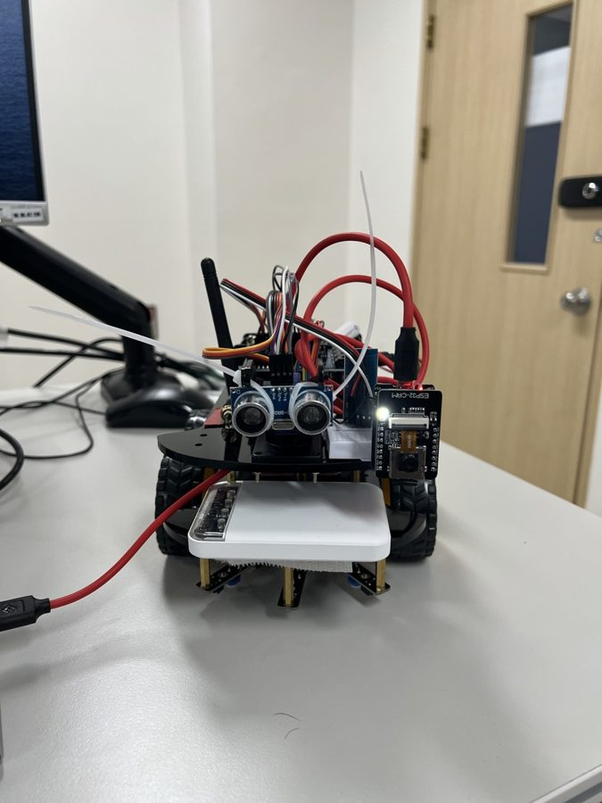
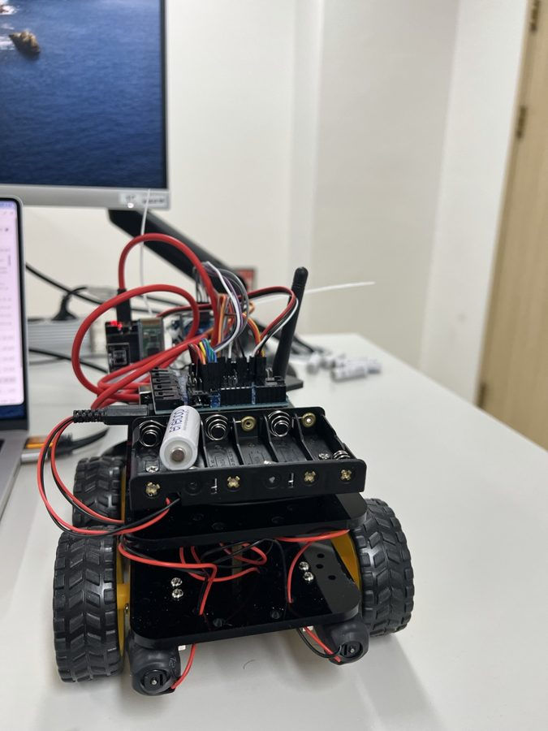
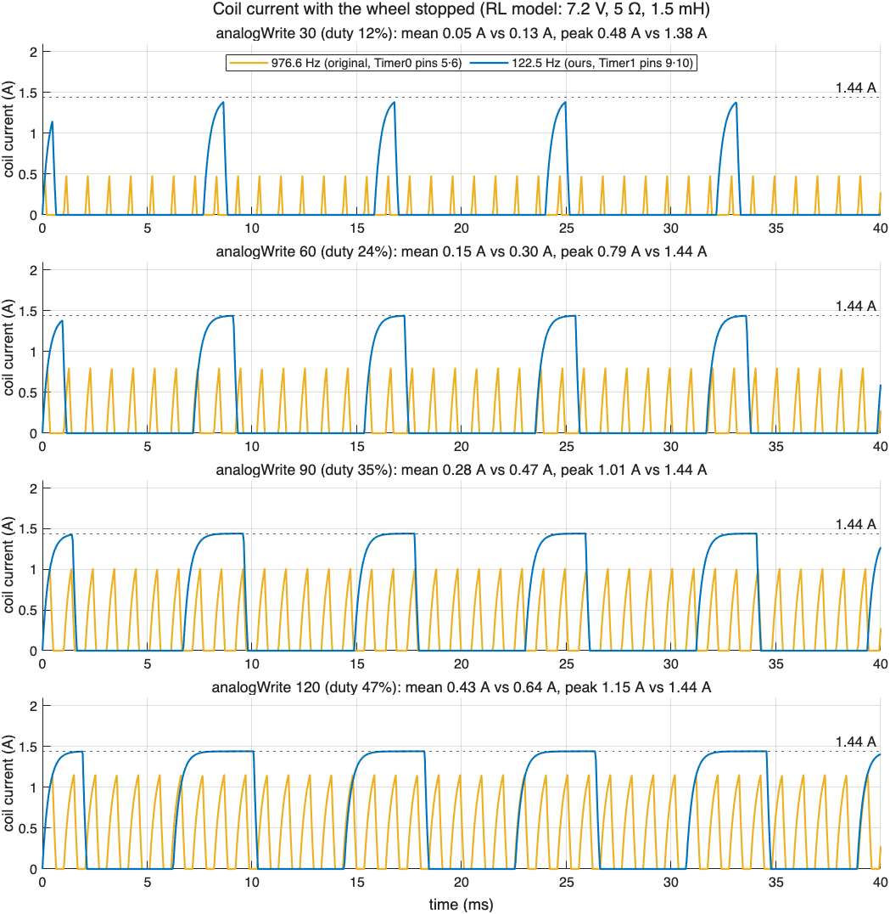

# Work report, 2026-11-12 to 11-18 (final)

> Each number says where it comes from: **measured** (on the board or track) / **tested** (PC synthetic scenes, builds) / **model** (calculation, MATLAB · Simulink).
> 한국어 : [REPORT_20261116.md](REPORT_20261116.md)
> See also: [README](../README.en.md) · [PWM calculation and graphs](PWM.en.md) · [photos and videos](https://github.com/CHOESEUNGJUN/4wd_car_project/blob/extra/esp32cam/docs/GALLERY.en.md) · [drive logs](https://github.com/CHOESEUNGJUN/4wd_car_project/tree/extra/esp32cam/docs/drive_logs/) · [ESP32 flashing](https://github.com/CHOESEUNGJUN/4wd_car_project/blob/extra/esp32cam/docs/ESP32_UPLOAD.en.md) · [release V1.0](https://github.com/CHOESEUNGJUN/4wd_car_project/releases/tag/4wd-car-esp32-car-control-v1.0) · earlier reports [11-09 (PID)](REPORT_20261109.md), [11-11 (camera start)](https://github.com/CHOESEUNGJUN/4wd_car_project/blob/extra/esp32cam/docs/REPORT_20261111.md) (Korean)

 The finished car (2026-11-18): front · side · rear · HC-06 Bluetooth

## 0. Conclusion

| | Result | Source |
|---|---|---|
| **Version C** (PID, high-frequency PWM) | Passed the track | Measured 2026-11-16 |
| **Version E** (PID + low-frequency PWM 122.5 Hz) | Passed the track, smoother. Release `4wd-car Low Frequency PWM_PID Control Car` (1.0.1) | Measured 2026-11-16 |
| **Version D** (line sensors + ESP32-CAM traffic lights and stop signs) | **Passed the track**: stops on red, goes on green, stops 3 s at a stop sign then goes, stops for obstacles | Measured 2026-11-18 (SD logs log_0011, log_0012, 3 screen recordings) |

- The camera **does not follow the line; it only watches signals** (the line is followed by the line sensors + PID). Colour detection is **HSV + a class table**.
- From seeing a signal to the car reacting: **0.1–0.5 s** (chapter 7), 4–20× faster than the first version (~2 s).
- With Bluetooth + Wi-Fi + camera all on, a 4 min 26 s drive had **no restart**, 13–25 KB of internal memory free.
- With low frequency (122.5 Hz), the same `analogWrite` value drives **about 1.5–1.7×** the mean motor current (model). That is why version C only started when the PWM was raised a lot and given a 255 kick (chapter 1).

## 0-1. The car

| Part | Used for | Note |
|---|---|---|
| Eduino 4WD kit: Arduino UNO, sensor shield, L298N motor driver, 4 TT gear motors | The car | |
| 3 digital line sensors (black = 1) | Line following | left A3 / centre A4 / right A5, 4.9 cm apart |
| HC-SR04 ultrasonic sensor + SG90 servo | Obstacle stop (10 cm) | servo faces forward once at start |
| HC-06 Bluetooth (classic, 9600 bps) | Phone / ESP32-CAM → car | HM-10 (BLE) for iPhone |
| Battery: **six 1.2 V rechargeable cells (7.2 V)** | Motors | freshly charged cells turn harder (corner values tuned for that) |
| ESP32-CAM (AI-Thinker, 4 MB PSRAM, **OV3660** camera) + microSD | Traffic lights and stop signs, recording | **separate 5 V** (power bank) |
| Track: bright floor + black electrical tape ~1.9 cm | | |

| Software | Folder | Uploaded with |
|---|---|---|
| Car: version C `team2_bt_pid`, version E `motor_control_low_frequency`, version D `team2_bt_cam` and `motor_control_low_frequency_cam` (used in the driving test) | `arduino/` | Arduino IDE |
| ESP32-CAM firmware + web page | `esp32/esp32cam_line/` | PlatformIO (not the Arduino IDE, chapter 5) |
| Apps: Android, iPhone and Mac, web | `apps/` | Android Studio, Xcode, Chrome |
| Tests and calculation: PC tests, MATLAB · Simulink | `esp32/test/`, `docs/matlab/` | |

## 0-2. Timeline

| Date | Work |
|---|---|
| 11-12 | Started version D (version C + camera), cleaned up the CSV debug version, ESP32-CAM handling guide |
| 11-13 | Low-frequency PWM test builds (version E, version D + low frequency) |
| 11-16 | Versions C and E passed the track, HSV + class-table colour detection, SD recording, brightness overflow bug, red confirmed after 2 frames |
| 11-18 | Fixed the Bluetooth + Wi-Fi memory problem, HSV video, web status lag, **version D passed the driving test**, release V1.0, licensing |
| 11-18 – 19 | PWM explained (timers, prescaler, triangle wave), coil-current comparison in MATLAB · Simulink, README and report clean-up |

## 1. Low-frequency PWM (version E)

| Item | Details | Source |
|---|---|---|
| Goal | **Restart after a stop**, **control stability**, **low-speed torque** (not the noise) | |
| Problem | A stopped car couldn't start again at a small PWM → a 255 kick forced it, so it jerked; at low speed the motors only whined | Observed |
| Cause | UNO default PWM 976.6 Hz (pins 5 and 6, Timer0) → the on-time (0.36 ms at analogWrite 90) is shorter than the time the coil current needs, so it is **cut off every time before it fills up** | Model (Simulink) |
| Fix | Timer1 in 8-bit phase-correct mode (triangle), prescaler 256 → 16,000,000 ÷ (256 × 510) = **122.5 Hz**. Speed pins moved to 9 and 10 (swap 4 wires: 5↔9, 6↔10) | Code |
| Result | Passed the track, **noticeably smoother**. Start kick reduced from 255 / 0.12 s to **170 / 0.06 s** | Measured 2026-11-16 |
| Not affected | `millis()` (Timer0), Bluetooth (SoftwareSerial), ultrasonic (`pulseIn`) | Code |
| Sound | The high-frequency whine at low speed is gone; **quieter** (976.6 Hz is where the ear is most sensitive, 122.5 Hz is a low tone heard less) | Observed 2026-11-16 |
| Cost | Servo can't move while driving (faces forward once at startup) | |
| Process | Version C kept untouched in its own folder (easy rollback). Tried first on the camera build (D + low frequency), then version E | |

**Frequency** (code): frequency = 16,000,000 ÷ (prescaler × steps per period). Steps per period: sawtooth (Timer0) TOP + 1 = 256, triangle (Timer1·2) 2 × TOP = 510.

| Timer setup | Frequency | Period | On-time at 30 % duty |
|---|---|---|---|
| Timer0 default (sawtooth, prescaler 64) = version C | 976.6 Hz | 1.024 ms | 0.31 ms |
| Timer1 default (triangle, prescaler 64) | 490.2 Hz | 2.04 ms | 0.61 ms |
| **Timer1 triangle, prescaler 256 = version E** | **122.5 Hz** | **8.16 ms** | **2.45 ms** |

Timer0 is the `millis()` / `delay()` clock; changing it would make time 4–8× wrong → only Timer1 is changed and the speed pins move to 9 and 10.

**Coil current** (model: Simulink RL, wheel stopped, 7.2 V · 5 Ω · 1.5 mH example values, `docs/matlab/pwm_power_simulink.m`):

| `analogWrite` | 976.6 Hz mean / peak | 122.5 Hz mean / peak |
|---|---|---|
| 90 (`MIN_PWM`) | 0.28 A / 70 % | **0.47 A / 100 %** |
| 120 (`BASE`) | 0.43 A / 80 % | **0.64 A / 100 %** |
| 130 | 0.48 A / 82 % | 0.70 A / 100 % |
| 255 | 1.44 A / 100 % | 1.44 A / 100 % |

- Matching the mean force of 90 at 122.5 Hz takes **about 130** at 976.6 Hz, and the full peak comes only at **255** → why version C only started when the PWM was raised a lot and given a 255 kick.
- The 976.6 Hz current (yellow) looks like a triangle wave, but it is current cut off every time, not the counter.
- Full calculation, graphs and MATLAB / Simulink files: [`PWM.en.md`](PWM.en.md).

Lesson: PWM force depends not only on the duty (how long) but also on the **frequency** (how often). At the same duty, if the on-time is shorter than the coil needs to fill, less force comes out (compared with VVVF trains and engine torque vs horsepower). The goal is precise control, not top speed, so we fixed the low frequency.

## 2. Camera principle change: signals only

- Why: on the track the car turned out faster than expected, so steering from the camera (~20 fps plus wireless delay) was too late. The line sensors + PID already follow the line every 20 ms.
- Removed: line detection (mask, morphology, tracking), camera driving, the morphology view.
- Signals: 🔴 `x` stop (does not time out), 🟡 `v` slow (120 → 100, back to normal after 1 s without `v`), 🟢 `n` normal, 🛑 stop sign (`x` for 3 s → `n`, then ignore it for 5 s). Sent every 0.2 s (10 times in 2 s).
- Safety: if the ESP32 dies on a red light the car stays stopped; a person can release it with `a`/`m`.

## 3. Recognition speed and colour detection

| Step | Loop time | Signal response | Source |
|---|---|---|---|
| Start | 166 ms (6 fps) | ~2 s | Measured |
| 2 frame buffers, separable morphology | 64 ms | | Measured |
| Bit mask, row-by-row processing | processing 35–45 → 8–9 ms | | Measured |
| Line detection removed + 160x120 + every pixel | **~48 ms (~20 fps)** | **0.1–0.15 s** (inside the ESP) | Measured |
| IRAM + -O2, read each frame once, HSV table | ~48 ms (mostly the 40 ms frame grab) | | Measured 2026-11-18: signal counting 9–13 ms → **~7 ms** |

- **The camera chip is an OV3660** (confirmed on the board, not an OV2640). At 160x120 colour the sensor delivers **one frame every 45 ms (22.2 fps)** (measured on VSYNC). Of the 48 ms loop only ~7 ms is processing, so trimming code no longer helps. Raising the sensor clock (PLL 8 → 10) gives 27.8 fps from the sensor but the ESP32 can't capture it (broken frames 1 → 28 per 10 s), so it stays. Faster needs an ESP32-S3 board.
- Tried and dropped: 320x240 (sensor gives 9–10 fps), sensor JPEG + decode (95 ms), 24 MHz clock (unstable).
- **HSV + table**: a 4096-entry colour class table (4 KB) built at boot, one lookup per pixel. On 17 synthetic scenes RGB rules got 12, **HSV got 17** (dark and faded colours). RGB was dropped for **accuracy** more than speed.
- **Telling a stop sign from a red light**: red blob box fill < 80 % and white ≥ 4 % inside the central 60 % of the box.
  - The box uses only rows with more than 3 red pixels and trims 3 % at each end (fixes a red light read as a stop sign on the real camera because of stray red dots: fill 32 % → 94 %).
  - Measured: stop sign **fill 46–73 %, white 7–29 %**, red light **fill 91–99 %, white 0 %** (phone screen, on the track). 27 synthetic scenes pass (`sh esp32/test/run.sh`).
- Bug found from SD recordings: brightness overflow (`>> 4` → `>> 5`).

## 4. Web page and video

- **HSV video without JPEG**: each pixel's colour class is packed as "3-bit class + 5-bit run length", sent over the WebSocket and painted by the browser. ~1.4 KB per frame (JPEG ~3.3 KB), no 55 ms encode. Same hotspot: **JPEG 3–4 fps → HSV 5–11 fps** (measured). **HSV is the power-on default.**
- **Car status lagging**: video filled the link, so status that should arrive every 0.2 s came only 5 times in 15 s. The page now answers 'k' per video frame and the ESP sends the next one only after the answer → **64 in 15 s (avg 0.23 s)**, and video rose from 2.1 to 4.6 fps (measured, `python3 esp32/test/lag.py 15 1`).
- **Faster JPEG video**: removed the per-frame pause (0.1/0.2 s) and the copy before encoding → encode 75–85 ms → 55–60 ms (measured).
- Rotation 0/90/180/270, address card, checked at phone width. WebSocket sends never block (a slow viewer can't stall signal detection).

## 5. Memory and Bluetooth

- **Freeze when Bluetooth turned on** (fixed usage, not a leak): Bluetooth takes ~60 KB of internal memory, leaving 9–20 KB, so the page dropped or the board restarted.
  - Fixes: ① the ESP's own Wi-Fi turns off once it joins the hotspot (printer-style) ② bitmaps moved to PSRAM, sender task removed ③ library rebuilt without unused Bluetooth audio (A2DP, HFP) and GATT, Bluetooth stacks 8 KB×2 → 5 KB and 4.3 KB.
  - Result (measured): Bluetooth off 61–69 KB → **~80 KB**, HC-06 connected 9–20 KB → **33–36 KB**, 13–25 KB while driving (no restart).
- **Antenna sharing**: with HC-06 connected Wi-Fi latency went up to ~5 s → **Wi-Fi first** brings the median to 0.25 s, with about three 1–3 s stalls per minute (measured). Signals to the car go over Bluetooth separately and are not affected (reaction times in chapter 7).
- **SD recording** follows the HSV view switch: on saves what the ESP sees (HSV), off saves real colour ("record what it sees").

## 6. Apps and tools

- **SD recording**: video `rec_NNNN.mjpeg` + log `log_NNNN.csv`, viewer `esp32/rec_viewer.html`. All reaction times in this report come from the SD logs.
- **Apps**: iPhone traffic-light / stop-sign screen (installed), Android traffic-light and camera screens (built only).
- **Test tools**: `esp32/test/run.sh` (signal detection, HSV video, recording colour; PC), `esp32/test/lag.py` (status interval; board).
- **Calculation and graphs**: 5 MATLAB · Simulink scripts (`docs/matlab/`) — timer waveforms, duty 90 · 100 · 120 waveforms, coil-current comparison, redrawing the document figures. All document graphs are drawn with MATLAB.
- **Docs**: README chapter 5 "what changed and why" with figures, [`PWM.en.md`](PWM.en.md), [`ESP32_UPLOAD.en.md`](https://github.com/CHOESEUNGJUN/4wd_car_project/blob/extra/esp32cam/docs/ESP32_UPLOAD.en.md) (Windows · Linux · macOS), [`GALLERY.en.md`](https://github.com/CHOESEUNGJUN/4wd_car_project/blob/extra/esp32cam/docs/GALLERY.en.md), Korean and English versions of everything.
- **Release**: V1.0 (Arduino sketches, ESP32-CAM firmware `.bin`, Android APK, drive logs and videos, photos, usage guide), code is **MIT** open source; original photos, videos, figures, drive logs and documents are for **non-commercial education and learning only** (from 2026-11-18, no commercial use) — [`NOTICE.md`](../NOTICE.md).

## 7. Driving test results (2026-11-18, version D, measured from SD logs)

**log_0011** (55.6 s): manual → auto → line following → stop on red for 18 s → go on green → obstacle stop (8 cm) → go → stop on red.
**log_0012** (4 min 26 s, 1850 rows): several red lights, green lights and stop signs, obstacles and corners.

| Signal | Count | From ESP confirmation to car reaction | Note |
|---|---|---|---|
| 🔴 red → stop | 7 | **0.21–0.54 s** | Waits until another signal arrives (longest 18 s) |
| 🟢 green → go | 4 | **0.11–0.33 s** | |
| 🛑 stop sign → stop | 5 | **0.10–0.22 s** | Waits 2.9–3.3 s, then goes by itself |
| Obstacle (ultrasonic 10 cm) | 1 in log_0011 | Immediate | Goes again once cleared |

(Only the first confirmed signal while in auto mode is counted; repeats while already stopped and red lights seen in manual mode are excluded.)

- Reaction includes ESP confirmation (2 frames red, 3 others), Bluetooth, and the car's 0.2 s status interval.
- Bluetooth stayed connected for the whole run, ESP decisions averaged 18.9 fps, 13–25 KB internal memory, no restart.
- 3 screen recordings (about 13 min in total, `진행 영상/`, not in the repository): the web page shows HSV video and the border colour (red, green, magenta) changing with the signal.

## 8. Not done / limits

- **Brief flips between red light and stop sign**: when the sign is seen at an angle or partly, white is around 4–7 %, so the decision flips (log_0012 at 712–713 s and 873–879 s). Both mean "stop", so it is safe, but the 3 s stop-sign count can restart, or a switch to red holds the car until green. Tune the threshold or use a bigger sign.
- **False green**: green objects around the track were seen as a green light (log_0012 685–736 s). Green means normal driving, so driving is unaffected, but a green object seen while waiting at a red light could start the car → narrow the view (`SIG_Y1`) or raise the green threshold.
- The web video still pauses for 1–3 s at times while Bluetooth is connected (one shared antenna).
- Android app not tested on a phone.

## 8-1. Design note

**Design note: why Bluetooth and a separate power supply**
- This project follows the **course guidance (lecture deck, team 2 assignment: talk to the car over HC-06 Bluetooth, power the camera module separately)**. So the ESP32-CAM runs from its own 5 V power bank and talks to the car (Arduino) **only over Bluetooth (HC-06)**.
- **Had we designed it ourselves**, the ESP32-CAM would **take power from the car's battery through pins** (battery → 5 V buck module, 2 A or more → ESP32-CAM 5 V pin, common GND) and connect to the Arduino **directly by wire (UART)** (ESP32 TX → Arduino RX, Arduino TX → resistor divider → ESP32 RX, 9600).
  - Gains: no Bluetooth, so ~45 KB of ESP32 internal memory comes back; no antenna sharing, so no 1–3 s Wi-Fi stalls; less delay for signals to reach the car; one power source.
  - The memory and antenna problems in these docs come from keeping the wireless setup, and the numbers show how far we reduced them within it.

## 9. Next

1. Retune the stop-sign white threshold and the green threshold under track lighting (using fill, white and green from the SD logs).
2. Install and test the Android app on a phone.
3. (Optional) Using the camera to assist line following (to reduce PID oscillation) is on hold with this board (decided 2026-11-18): the floor is only the bottom fifth of the picture, HSV can't tell tape from shadows, and a frame takes 48 ms plus Bluetooth delay.
4. (Optional) A better board or link:
   - **Wire the ESP32 to the Arduino (UART)**: dropping Bluetooth frees ~45 KB of internal memory and removes the antenna sharing (the 1–3 s Wi-Fi stalls). Possible with the current board.
   - **An ESP32-S3 camera board** (e.g. XIAO ESP32S3 Sense, Freenove ESP32-S3 CAM): faster camera input, more memory (8 MB PSRAM) and CPU. But it has **no Bluetooth Classic, so it can't connect to the HC-06** → switch to an HM-10 (BLE) or use the wire above.
   - Raspberry Pi + camera: OpenCV can really see the line and signs, but more power, size and complexity.
