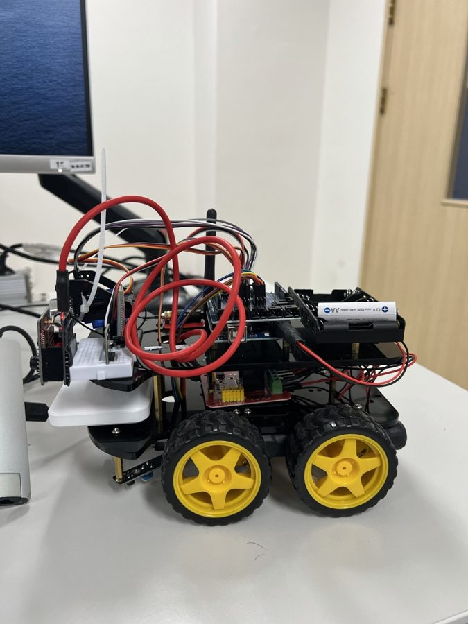
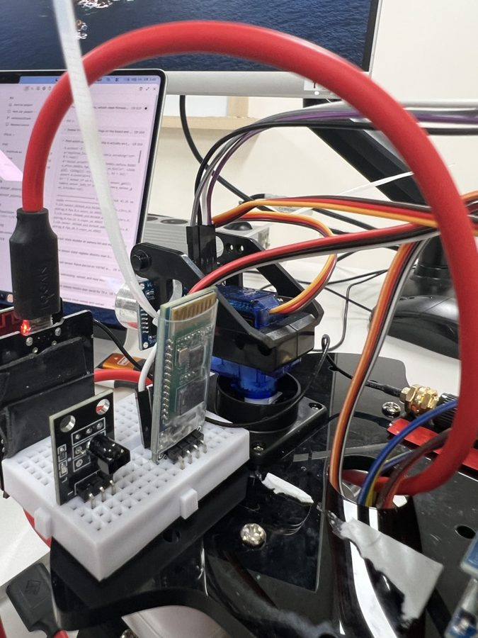

# Work report, 2026-11-12 to 11-18 (final)

> Each number says where it comes from: **measured** (on the board or track) / **tested** (PC synthetic scenes, builds) / **model** (calculation).
> 한국어 : [REPORT_20261116.md](REPORT_20261116.md)

 The finished car (2026-11-18): front · side · rear · HC-06 Bluetooth

## 0. Conclusion

| | Result | Source |
|---|---|---|
| **Version C** (PID, high-frequency PWM) | Passed the track | Measured 2026-11-16 |
| **Version E** (PID + low-frequency PWM ~122 Hz) | Passed the track, smoother. Release `4wd-car Low Frequency PWM_PID Control Car` (1.0.1) | Measured 2026-11-16 |
| **Version D** (line sensors + ESP32-CAM traffic lights and stop signs) | **Passed the track**: stops on red, goes on green, stops 3 s at a stop sign then goes, stops for obstacles | Measured 2026-11-18 (SD logs log_0011, log_0012, 3 screen recordings) |

- The camera **does not follow the line; it only watches signals** (the line is followed by the line sensors + PID). Colour detection is **HSV + a class table**.
- From seeing a signal to the car reacting: **0.1–0.5 s** (chapter 7), 4–20× faster than the first version (~2 s).
- With Bluetooth + Wi-Fi + camera all on, a 4 min 26 s drive had **no restart**, 13–25 KB of internal memory free.

## 1. Low-frequency PWM (version E)

| Item | Details | Source |
|---|---|---|
| Problem | Jerky starts in manual driving; at low speed the motors just whine without torque | Observed |
| Cause | UNO default PWM is ~980 Hz → the on-pulse (~0.3 ms at 30 % duty) is about as long as the coil current rise time, so peak torque never builds up | Model (README figure 9-1) |
| Fix | Timer1 in 8-bit phase-correct mode, prescaler 256 → ~122 Hz. Speed pins moved to 9 and 10 (swap 4 wires: 5↔9, 6↔10) | Code |
| Result | Passed the track, **noticeably smoother**. Start kick reduced from 255 / 0.12 s to **170 / 0.06 s** | Measured 2026-11-16 |
| Not affected | `millis()` (Timer0), Bluetooth (SoftwareSerial), ultrasonic (`pulseIn`) | Code |
| Cost | Servo can't move while driving (faces forward once at startup), low audible hum | |
| Process | Version C kept untouched in its own folder (easy rollback). Tried first on the camera build (D + low frequency), then version E | |

Lesson: how PWM frequency relates to torque (compared with VVVF trains and engine torque vs horsepower). The goal is precise control, not top speed, so we fixed the low frequency.

## 2. Camera principle change: signals only

- Why: on the track the car turned out faster than expected, so steering from the camera (~20 fps plus wireless delay) was too late. The line sensors + PID already follow the line every 20 ms.
- Removed: line detection (mask, morphology, tracking), camera driving, the morphology view.
- Signals: 🔴 `x` stop (does not time out), 🟡 `v` slow (120 → 100, back to normal after 1 s without `v`), 🟢 `n` normal, 🛑 stop sign (`x` for 3 s → `n`, then ignore it for 5 s). Sent every 0.2 s (10 times in 2 s).
- Safety: if the ESP32 dies on a red light the car stays stopped; a person can release it with `a`/`m`.

## 3. Recognition speed and colour detection

| Step | Loop time | Signal response | Source |
|---|---|---|---|
| Start | 166 ms (6 fps) | ~2 s | Measured |
| 2 frame buffers, separable morphology | 64 ms | | Measured |
| Bit mask, row-by-row processing | processing 35–45 → 8–9 ms | | Measured |
| Line detection removed + 160x120 + every pixel | **~48 ms (~20 fps)** | **0.1–0.15 s** (inside the ESP) | Measured |
| IRAM + -O2, read each frame once, HSV table | ~48 ms (mostly the 40 ms frame grab) | | Measured 2026-11-18: signal counting 9–13 ms → **~7 ms** |

- **The camera chip is an OV3660** (confirmed on the board, not an OV2640). At 160x120 colour the sensor delivers **one frame every 45 ms (22.2 fps)** (measured on VSYNC). Of the 48 ms loop only ~7 ms is processing, so trimming code no longer helps. Raising the sensor clock (PLL 8 → 10) gives 27.8 fps from the sensor but the ESP32 can't capture it (broken frames 1 → 28 per 10 s), so it stays. Faster needs an ESP32-S3 board.
- Tried and dropped: 320x240 (sensor gives 9–10 fps), sensor JPEG + decode (95 ms), 24 MHz clock (unstable).
- **HSV + table**: a 4096-entry colour class table (4 KB) built at boot, one lookup per pixel. On 17 synthetic scenes RGB rules got 12, **HSV got 17** (dark and faded colours). RGB was dropped for **accuracy** more than speed.
- **Telling a stop sign from a red light**: red blob box fill < 80 % and white ≥ 4 % inside the central 60 % of the box.
  - The box uses only rows with more than 3 red pixels and trims 3 % at each end (fixes a red light read as a stop sign on the real camera because of stray red dots: fill 32 % → 94 %).
  - Measured: stop sign **fill 46–73 %, white 7–29 %**, red light **fill 91–99 %, white 0 %** (phone screen, on the track). 27 synthetic scenes pass (`sh esp32/test/run.sh`).
- Bug found from SD recordings: brightness overflow (`>> 4` → `>> 5`).

## 4. Web page and video

- **HSV video without JPEG**: each pixel's colour class is packed as "3-bit class + 5-bit run length", sent over the WebSocket and painted by the browser. ~1.4 KB per frame (JPEG ~3.3 KB), no 55 ms encode. Same hotspot: **JPEG 3–4 fps → HSV 5–11 fps** (measured). **HSV is the power-on default.**
- **Car status lagging**: video filled the link, so status that should arrive every 0.2 s came only 5 times in 15 s. The page now answers 'k' per video frame and the ESP sends the next one only after the answer → **64 in 15 s (avg 0.23 s)**, and video rose from 2.1 to 4.6 fps (measured, `python3 esp32/test/lag.py 15 1`).
- **Faster JPEG video**: removed the per-frame pause (0.1/0.2 s) and the copy before encoding → encode 75–85 ms → 55–60 ms (measured).
- Rotation 0/90/180/270, address card, checked at phone width. WebSocket sends never block (a slow viewer can't stall signal detection).

## 5. Memory and Bluetooth

- **Freeze when Bluetooth turned on** (fixed usage, not a leak): Bluetooth takes ~60 KB of internal memory, leaving 9–20 KB, so the page dropped or the board restarted.
  - Fixes: ① the ESP's own Wi-Fi turns off once it joins the hotspot (printer-style) ② bitmaps moved to PSRAM, sender task removed ③ library rebuilt without unused Bluetooth audio (A2DP, HFP) and GATT, Bluetooth stacks 8 KB×2 → 5 KB and 4.3 KB.
  - Result (measured): Bluetooth off 61–69 KB → **~80 KB**, HC-06 connected 9–20 KB → **33–36 KB**, 13–25 KB while driving (no restart).
- **Antenna sharing**: with HC-06 connected Wi-Fi latency went up to ~5 s → **Wi-Fi first** brings the median to 0.25 s, with about three 1–3 s stalls per minute (measured). Signals to the car go over Bluetooth separately and are not affected (reaction times in chapter 7).
- **SD recording** follows the HSV view switch: on saves what the ESP sees (HSV), off saves real colour ("record what it sees").

## 6. Apps and tools

- **SD recording**: video `rec_NNNN.mjpeg` + log `log_NNNN.csv`, viewer `esp32/rec_viewer.html`. All reaction times in this report come from the SD logs.
- **Apps**: iPhone traffic-light / stop-sign screen (installed), Android traffic-light and camera screens (built only).
- **Test tools**: `esp32/test/run.sh` (signal detection, HSV video, recording colour; PC), `esp32/test/lag.py` (status interval; board).
- **Docs**: README chapter 9 "what changed and why" with figures, English README and report.

## 7. Driving test results (2026-11-18, version D, measured from SD logs)

**log_0011** (55.6 s): manual → auto → line following → stop on red for 18 s → go on green → obstacle stop (8 cm) → go → stop on red.
**log_0012** (4 min 26 s, 1850 rows): several red lights, green lights and stop signs, obstacles and corners.

| Signal | Count | From ESP confirmation to car reaction | Note |
|---|---|---|---|
| 🔴 red → stop | 7 | **0.21–0.54 s** | Waits until another signal arrives (longest 18 s) |
| 🟢 green → go | 4 | **0.11–0.33 s** | |
| 🛑 stop sign → stop | 5 | **0.10–0.22 s** | Waits 2.9–3.3 s, then goes by itself |
| Obstacle (ultrasonic 10 cm) | 1 in log_0011 | Immediate | Goes again once cleared |

(Only the first confirmed signal while in auto mode is counted; repeats while already stopped and red lights seen in manual mode are excluded.)

- Reaction includes ESP confirmation (2 frames red, 3 others), Bluetooth, and the car's 0.2 s status interval.
- Bluetooth stayed connected for the whole run, ESP decisions averaged 18.9 fps, 13–25 KB internal memory, no restart.
- 3 screen recordings (about 13 min in total, `진행 영상/`, not in the repository): the web page shows HSV video and the border colour (red, green, magenta) changing with the signal.

## 8. Not done / limits

- **Brief flips between red light and stop sign**: when the sign is seen at an angle or partly, white is around 4–7 %, so the decision flips (log_0012 at 712–713 s and 873–879 s). Both mean "stop", so it is safe, but the 3 s stop-sign count can restart, or a switch to red holds the car until green. Tune the threshold or use a bigger sign.
- **False green**: green objects around the track were seen as a green light (log_0012 685–736 s). Green means normal driving, so driving is unaffected, but a green object seen while waiting at a red light could start the car → narrow the view (`SIG_Y1`) or raise the green threshold.
- The web video still pauses for 1–3 s at times while Bluetooth is connected (one shared antenna).
- Android app not tested on a phone. Low-frequency numeric comparison not recorded.

## 9. Next

1. Retune the stop-sign white threshold and the green threshold under track lighting (using fill, white and green from the SD logs).
2. Install and test the Android app on a phone.
3. Low-frequency numeric comparison (starting PWM, lap time).
4. (Optional) wide-angle lens module, ESP32-S3 (fixes both frame rate and antenna sharing).
