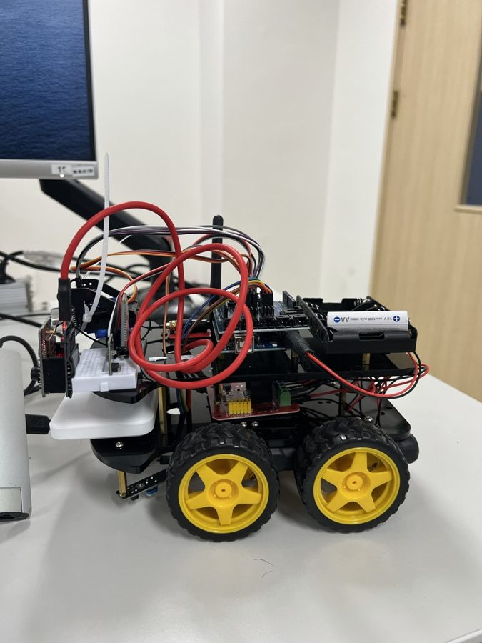
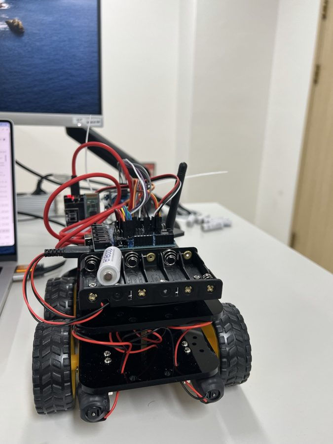
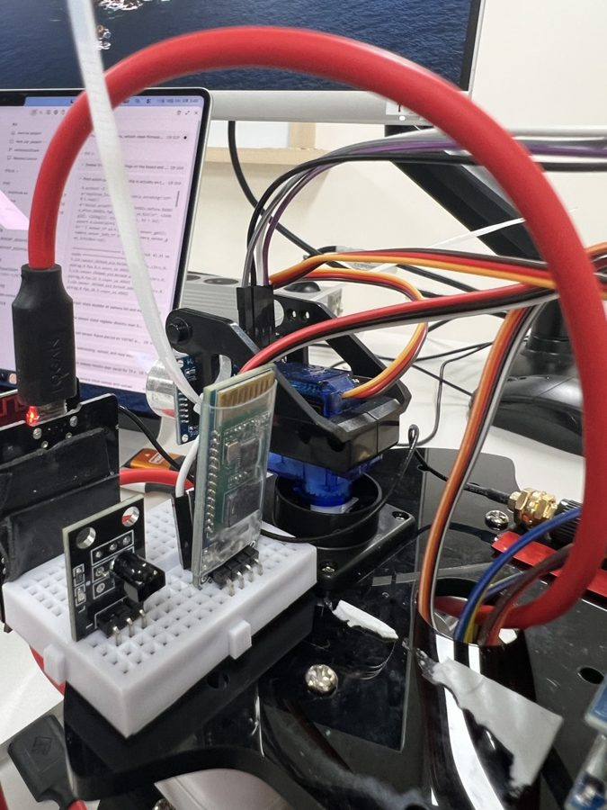

# 2026-11-12 ~ 11-18 작업 보고 (최종)

> 숫자 옆에 근거를 적었다 : **실측**(보드·트랙에서 잼) / **시험**(PC 가짜 사진·빌드) / **모델**(계산).
> English : [REPORT_20261116.en.md](REPORT_20261116.en.md)

 완성 차량 (2026-11-18) : 앞 · 옆 · 뒤 · HC-06 블루투스

## 0. 결론

| | 결과 | 근거 |
|---|---|---|
| **버전 C** (PID, 고주파 PWM) | 트랙 주행 통과 | 실측 2026-11-16 |
| **버전 E** (PID + 저주파 PWM 약 122Hz) | 트랙 주행 통과, 더 부드러움. 릴리스 `4wd-car Low Frequency PWM_PID Control Car` (1.0.1) | 실측 2026-11-16 |
| **버전 D** (라인센서 + ESP32-CAM 신호등·정지 표지판) | **트랙 주행 통과** : 빨간불 정지, 초록불 출발, 정지 표지판 3초 정지 후 출발, 장애물 정지 모두 동작 | 실측 2026-11-18 (SD 기록 log_0011, log_0012, 화면 녹화 3개) |

- 카메라는 **라인을 보지 않고 신호만** 본다 (라인은 라인센서 + PID). 색 판단은 **HSV + 색 종류표**.
- 신호를 본 뒤 차가 반응하기까지 **0.1~0.5초** (아래 7장). 처음(약 2초)보다 4~20배 빨라짐.
- 블루투스 + 와이파이 + 카메라를 같이 켜고 4분 26초 주행하는 동안 **재시작 없음**, 남은 내부 메모리 13~25KB.

## 1. 저주파 PWM (버전 E)

| 항목 | 내용 | 근거 |
|---|---|---|
| 문제 | 수동 조종에서 툭툭 튀어나감, 저속에서 힘 없이 "이잉" 소리 | 주행 관찰 |
| 원인 | UNO 기본 PWM 약 980Hz → 펄스(약 0.3ms @ 듀티 30%)가 모터 코일 전류가 차는 시간과 비슷해서 순간 힘이 덜 참 | 모델 (README 5-1 그림) |
| 해결 | Timer1 을 8비트 위상 보정, 분주 256 → 약 122Hz. 속도 핀을 9·10번으로 (배선 4개 맞바꿈 : 5↔9, 6↔10) | 코드 |
| 결과 | 트랙 주행 통과, **더 부드러움**. 출발 킥 255·0.12초 → **170·0.06초** 로 줄임 | 실측 2026-11-16 |
| 영향 없음 | `millis()`(Timer0), 블루투스(SoftwareSerial), 초음파(`pulseIn`) | 코드 |
| 대가 | 주행 중 서보 못 씀 (켤 때 한 번 정면), 낮은 "웅" 소리 | |
| 진행 방식 | 버전 C 는 그대로 두고 새 폴더로 (롤백 가능). 카메라 실험(버전 D + 저주파)에서 먼저 시험 → 버전 E 로 | |

배운 것 : PWM 주파수와 토크의 관계 (VVVF 전동차·엔진 토크/마력 비유). 빨리 달리는 게 목적이 아니라 정밀 제어라서 저주파로 고정.

## 2. 카메라 원칙 변경 : 신호등·표지판만

- 이유 : 트랙에서 달려 보니 차가 빨라서 카메라(초당 약 20장 + 무선 지연)로 라인을 보고 조향하면 늦음. 라인은 라인센서 + PID 로 20ms 마다 이미 잘 따라감.
- 삭제 : 라인 인식(마스크·모폴로지·추적), 카메라 주행, 모폴로지 화면.
- 신호 : 🔴 `x` 정지(시간으로 안 풀림), 🟡 `v` 서행(120 → 100, 1초 안 오면 보통), 🟢 `n` 보통, 🛑 정지 표지판(`x` 3초 → `n`, 5초 무시). 0.2초마다 계속 보냄 (2초면 10번).
- 안전 : ESP32 가 꺼져도 빨간불이면 계속 정지, 사람이 `a`/`m` 으로 풀 수 있음.

## 3. 인지 속도와 색 판단

| 단계 | 한 바퀴 | 신호 반응 | 근거 |
|---|---|---|---|
| 처음 | 166ms (초당 6장) | 약 2초 | 실측 |
| 버퍼 2장, 모폴로지 나눠 계산 | 64ms | | 실측 |
| 마스크를 비트로, 줄마다 처리 | 처리 35~45 → 8~9ms | | 실측 |
| 라인 인식 삭제 + 160x120 + 모든 칸 | **약 48ms (초당 약 20장)** | **0.1~0.15초** (ESP 안) | 실측 |
| IRAM + -O2, 사진 한 번만 읽기, HSV 표 | 약 48ms (사진 받기 40ms 가 대부분) | | 실측 2026-11-18 : 신호 세기 9~13ms → **약 7ms** |

- **카메라 칩은 OV3660** (보드에서 확인, OV2640 이 아님). 컬러 160x120 에서 센서가 **45ms 마다 한 장 (초당 22.2장)** 을 줌 (VSYNC 핀 실측). 한 바퀴 48ms 중 처리는 약 7ms → 코드를 더 줄여도 빨라지지 않음. 센서 클럭을 올리면(PLL 8 → 10) 센서는 초당 27.8장을 내지만 ESP32 가 못 받아 깨진 사진이 10초에 1장 → 28장 → 그대로 둠. 더 빠르게는 ESP32-S3 보드.
- 시험하고 뺀 것 : 320x240 (센서가 초당 9~10장), 센서 JPEG + 디코드 (95ms), 클럭 24MHz (불안정).
- **HSV + 표** : 켤 때 4096 색 종류표(4KB)를 만들고 칸마다 표만 봄. 가짜 사진 17가지에서 RGB 12개 → **HSV 17개** 맞음 (어두운·바랜 색). RGB 를 뺀 이유는 속도보다 **정확도**.
- **정지 표지판 가르기** : 빨강 덩어리 네모의 채움 < 80% + 가운데 60% 안의 흰색 ≥ 4%.
  - 네모는 빨강이 3칸 넘는 줄만 보고 양 끝 3% 를 잘라 잡음 (실제 화면에서 떨어진 빨강 점 때문에 빨간불을 표지판으로 보던 것 고침 : 채움 32% → 94%).
  - 실측 : 정지 표지판 **채움 46~73%, 흰색 7~29%**, 빨간불 **채움 91~99%, 흰색 0%** (폰 화면, 트랙). 가짜 사진 27가지 시험 통과 (`sh esp32/test/run.sh`).
- 버그 (SD 기록으로 찾음) : 밝기 계산 넘침 (`>> 4` → `>> 5`).

## 4. 웹 화면과 영상

- **HSV 영상 (JPEG 없이)** : 칸마다 색 종류를 "종류 3비트 + 이어진 칸 수 5비트" 로 묶어 웹소켓으로 보내고 브라우저가 칠함. 한 장 약 1.4KB (JPEG 약 3.3KB), 압축 55ms 없음. 같은 핫스팟에서 **JPEG 초당 3~4장 → HSV 5~11장** (실측). **켤 때 기본 영상 = HSV**.
- **차 상태가 늦게 따라오던 것** : 영상이 연결을 가득 채워 0.2초마다 가야 할 상태가 15초에 5번만 옴. 화면이 영상 한 장마다 'k' 로 답하고 ESP 는 답이 와야 다음 장을 보내게 → **15초에 64번 (평균 0.23초)**, 영상도 초당 2.1 → 4.6장 (실측, `python3 esp32/test/lag.py 15 1`).
- **웹 영상(JPEG) 빠르게** : 한 장마다 쉬던 시간(0.1/0.2초)을 줄이고 압축 전 복사를 없앰 → 압축 75~85ms → 55~60ms (실측).
- 화면 회전 0/90/180/270, 접속 주소 칸, 폰 너비 확인. 웹소켓 보내기는 기다리지 않는 방식 (느린 화면 때문에 신호 판단이 멈추지 않게).

## 5. 메모리와 블루투스

- **블루투스를 켜면 멈추던 것** (누수가 아니라 고정으로 쓰는 양) : 블루투스가 내부 메모리 약 60KB 를 써서 켜면 9~20KB 만 남아 화면이 끊기거나 재시작.
  - 고친 것 : ① ESP 자기 와이파이는 핫스팟을 잡으면 끔 (프린터처럼) ② 비트 표를 외부 메모리로, 보내기 작업 없앰 ③ 라이브러리에서 안 쓰는 블루투스 오디오(A2DP·HFP)·GATT 를 빼고 블루투스 스택 8KB×2 → 5KB·4.3KB.
  - 결과 (실측) : 블루투스 끔 61~69KB → **약 80KB**, HC-06 연결 9~20KB → **33~36KB**, 주행 중 13~25KB (재시작 없음).
- **안테나 나누기** : HC-06 이 붙으면 와이파이 응답이 약 5초까지 밀림 → **와이파이 우선** 으로 바꿔 가운데값 0.25초, 1분에 1~3초 멈춤 3번쯤 (실측). 차로 가는 신호는 블루투스로 따로 가서 영향 없음 (7장 반응 시간).
- **SD 기록** 은 HSV 보기를 따라감 : 켜면 ESP 가 본 HSV, 끄면 실제 컬러 ("보는 대로 기록").

## 6. 앱과 도구

- **SD 기록** : 영상 `rec_NNNN.mjpeg` + 로그 `log_NNNN.csv`, 보기 페이지 `esp32/rec_viewer.html`. 이 보고서의 반응 시간은 모두 SD 로그에서 뽑음.
- **앱** : 아이폰 신호등·정지 표지판 화면 (설치 확인), 안드로이드 앱 신호등·카메라 화면 (빌드만).
- **시험 도구** : `esp32/test/run.sh` (신호 판단·HSV 영상·기록 색, PC), `esp32/test/lag.py` (상태 줄 간격, 보드).
- **문서** : README 5장 "무엇을 왜 바꿨나" + 그림, 영어 README·보고서.

## 7. 주행 시험 결과 (2026-11-18, 버전 D, SD 로그 실측)

**log_0011** (55.6초) : 수동 → 자동 → 라인 주행 → 빨간불 정지 18초 → 초록불 출발 → 장애물 정지(8cm) → 출발 → 빨간불 정지.
**log_0012** (4분 26초, 1850줄) : 빨간불·초록불·정지 표지판을 여러 번, 장애물, 코너 포함.

| 신호 | 횟수 | ESP 가 확정한 뒤 차가 반응하기까지 | 비고 |
|---|---|---|---|
| 🔴 빨간불 → 정지 | 7 | **0.21~0.54초** | 다른 신호가 올 때까지 서 있음 (최장 18초) |
| 🟢 초록불 → 출발 | 4 | **0.11~0.33초** | |
| 🛑 정지 표지판 → 정지 | 5 | **0.10~0.22초** | 2.9~3.3초 서 있다가 스스로 출발 |
| 장애물 (초음파 10cm) | log_0011 1번 | 바로 | 치우면 다시 출발 |

(자동 모드일 때 처음 확정된 신호만 셈. 이미 서 있을 때 다시 잡힌 것과, 수동 모드일 때 본 빨간불은 뺌)

- 반응 시간에는 ESP 확정(빨강 2장·나머지 3장), 블루투스, 차 상태 줄 간격(0.2초)이 모두 들어 있음.
- 주행 내내 블루투스 연결 유지, ESP 판단 초당 평균 18.9장, 내부 메모리 13~25KB, 재시작 없음.
- 화면 녹화 3개 (총 약 13분, `진행 영상/`, 저장소에는 안 올림) : 웹 화면에서 HSV 영상 + 테두리 색(빨강·초록·자홍)이 신호와 같이 바뀌는 것 확인.

## 8. 안된 점 / 한계

- **빨간불 ↔ 정지 표지판이 잠깐 오가는 순간** : 표지판을 비스듬히 보거나 일부만 보일 때 흰색이 4~7% 근처라 둘 사이를 오감 (log_0012 712~713초, 873~879초). 둘 다 "정지" 라 안전하지만, 표지판 3초 세기가 다시 시작되거나 빨간불로 바뀌면 초록이 올 때까지 서 있음. 기준을 더 맞추거나 표지판을 크게.
- **초록으로 잘못 보는 것** : 트랙 주변 초록 물건이 초록불로 잡힘 (log_0012 685~736초). 초록 = 보통 주행이라 주행에는 영향 없지만, 빨간불에서 서 있을 때 초록 물건이 보이면 출발할 수 있음 → 보는 범위(`SIG_Y1`)를 줄이거나 초록 기준을 높이기.
- 블루투스 연결 중 웹 영상이 가끔 1~3초 멈춤 (안테나 하나를 나눠 씀).
- 안드로이드 앱 폰 시험 전. 저주파 숫자 비교 기록 전.

## 9. 다음에 할 것

1. 정지 표지판 흰색 기준과 초록 기준을 트랙 조명으로 다시 맞추기 (SD 로그의 fill · white · green 값으로).
2. 안드로이드 앱 폰 설치 시험.
3. 저주파 숫자 비교 (돌기 시작하는 PWM, 한 바퀴 시간).
4. (선택) 카메라로 라인 보조 (PID 오실레이션 줄이기) 는 지금 보드로는 보류 (2026-11-18 결정) : 바닥이 화면 아래 5분의 1, HSV 로는 테이프·그림자 구분이 안 됨, 사진 48ms + 블루투스 지연.
5. (선택) 더 좋은 보드 / 연결 :
   - **ESP32 ↔ 아두이노를 선(UART)으로** : 블루투스를 안 쓰면 내부 메모리 약 45KB 를 돌려받고, 안테나 나눠 쓰기(와이파이 1~3초 멈춤)도 없어짐. 지금 보드로도 가능.
   - **ESP32-S3 카메라 보드** (예 XIAO ESP32S3 Sense, Freenove ESP32-S3 CAM) : 카메라 입력이 빠르고 메모리(PSRAM 8MB)·CPU 가 넉넉. 단 **블루투스 클래식이 없어 HC-06 에 못 붙음** → HM-10(BLE) 으로 바꾸거나 위처럼 선으로.
   - 라즈베리파이 + 카메라 : OpenCV 로 라인·표지판을 제대로 볼 수 있지만 전원·크기·복잡도가 큼.
