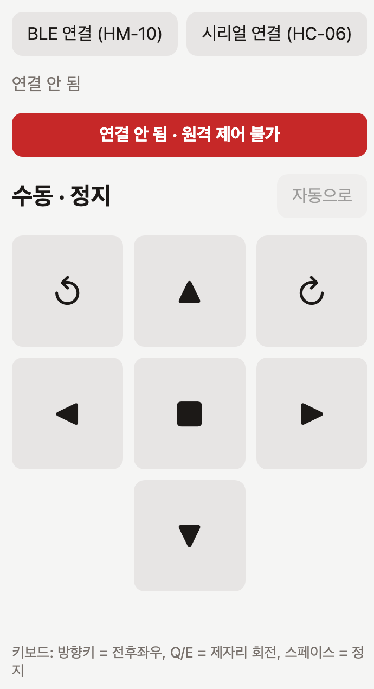
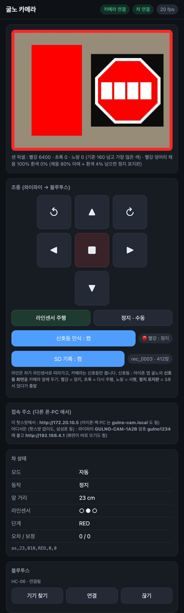
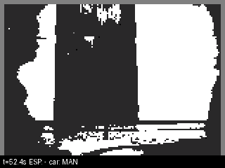
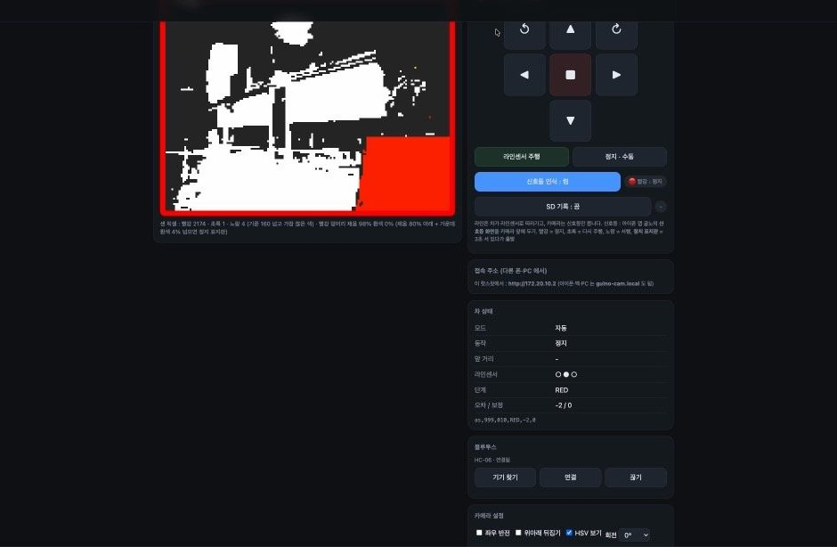
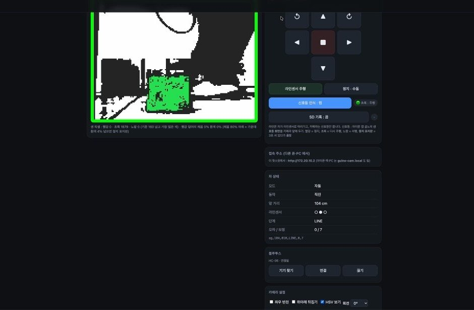
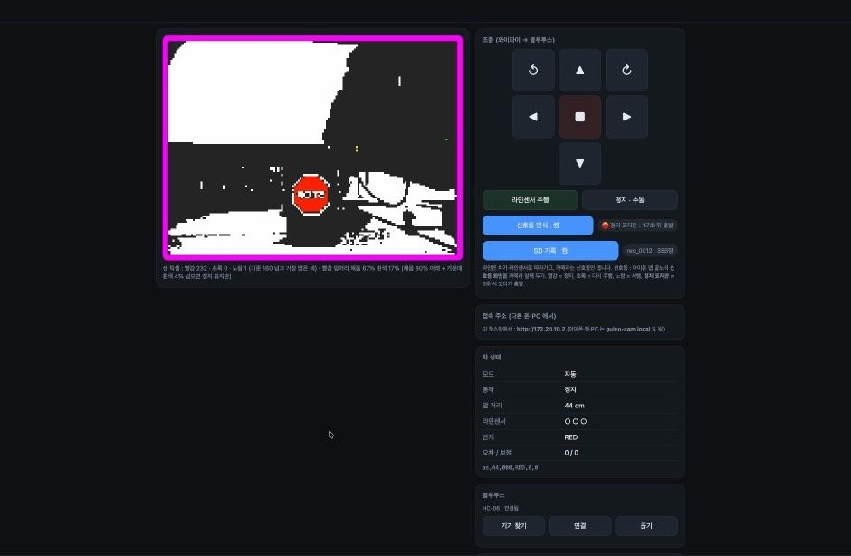
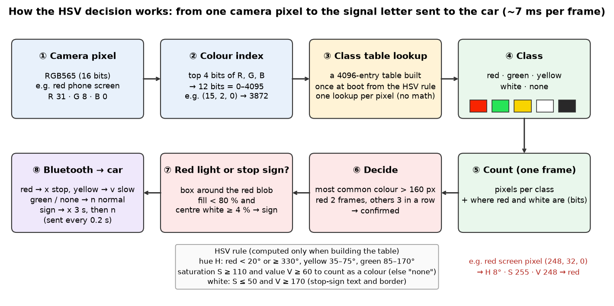
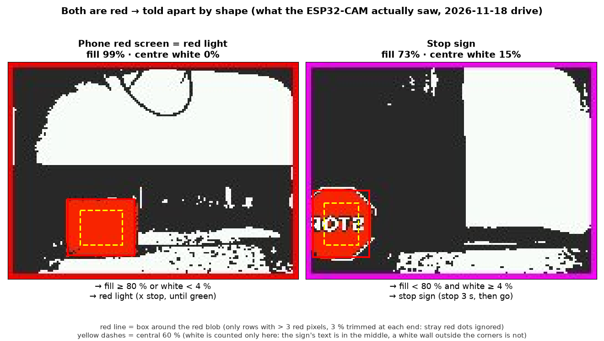
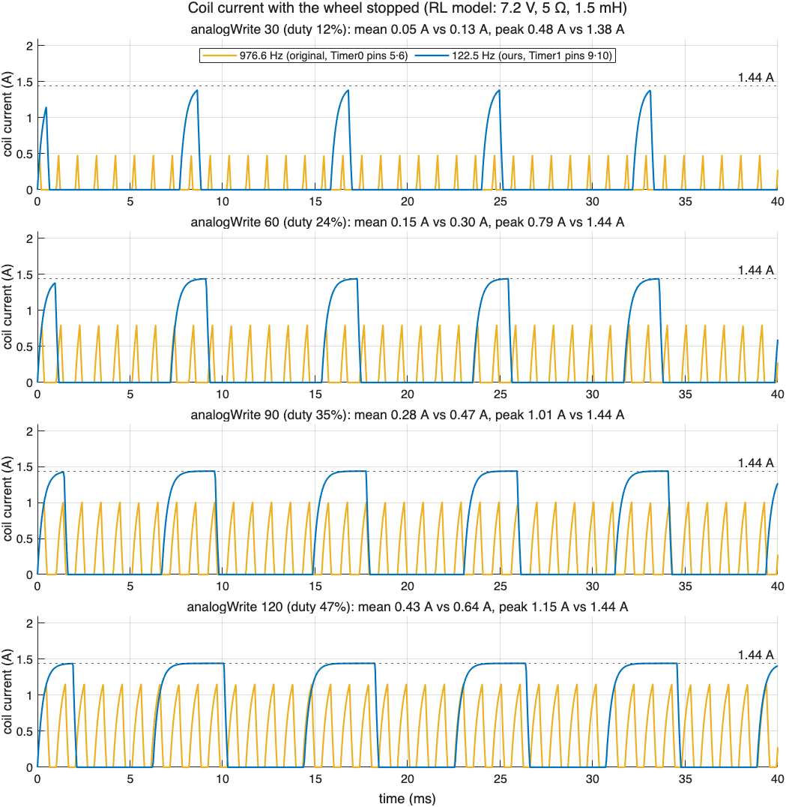

# Requirements: explanation · code · photos

> 한국어 : [REQUIREMENTS.md](REQUIREMENTS.md) · See also : [final report](REPORT_20261116.en.md) · [code walkthrough](CODE.en.md) · [PWM](PWM.en.md)

Line numbers point to the default car code, **version E** ([`motor_control_low_frequency.ino`](../arduino/motor_control_low_frequency/motor_control_low_frequency.ino)). Versions C and D share the structure ([CODE.en.md](CODE.en.md)).

| # | Requirement | Implemented in | Verified |
|---|---|---|---|
| 1 | Drive forward/back and steer left/right from a mobile app | 3 apps + `driveManual()` | ✅ track |
| 2 | Switch between auto and manual | `a` / `m` + `setMode()` | ✅ |
| 3 | Auto mode follows the line (PID for stability) | `pidLine()` | ✅ passed (C·E 11-16, D 11-18) |
| 4 | Parse Bluetooth commands and act | `serviceBT()` | ✅ |
| 5 | Keep the mode state and branch the control logic | `enum Mode` + `loop()` | ✅ |
| 6 | React within 300 ms of a Bluetooth command | non-blocking `loop()` | ✅ \~15 ms by design; log figures below |
| Extra 1 | Detect obstacles with the ultrasonic sensor | `updateObstacle()` | ✅ |
| Extra 2 | ESP32-CAM controls the car and reads traffic lights and signs | ESP32 firmware + `x v n` on the car | ✅ track (11-18) |
| Extra 3 | Optimise the DC motor PWM frequency | Timer1 122.5 Hz + low-frequency values | ✅ track (11-16, 11-23) |

---

## 1. Drive and steer from a mobile app

**How**: a button in the phone app (Android HC-06, iPhone HM-10, web) sends a one-letter command over Bluetooth, and the car sets the left and right wheel speeds for that letter. While held, the app resends it every 0.2 s; on release it sends `s` (stop) twice.

| Button | ▲ | ▼ | ◀ | ▶ | ↺ | ↻ | ■ |
|---|---|---|---|---|---|---|---|
| Letter | `g` forward | `b` back | `l` left | `r` right | `q` spin left | `w` spin right | `s` stop |

<p align="center"> <br><sub>Left: the control app of the original assignment (apps/web/index.html, phone → HC-06) · right: in the extra assignment (version D), the ESP32 web page on a phone (phone → Wi-Fi → ESP32 → HC-06), with the same direction buttons and auto/manual switch plus camera video, traffic-light detection and car status</sub></p>

In version D the ESP32 holds the HC-06, so a button on the web page goes web page → Wi-Fi → ESP32 → Bluetooth and reaches the car as **the same letters** (`g b l r q w s a m`). The car code is exactly the same as with the app.

**Code** — car [`driveManual()`](../arduino/motor_control_low_frequency/motor_control_low_frequency.ino#L330-L341) :
```cpp
case 'g': driveManualLR( MAN_FWD,  MAN_FWD); break;              // forward
case 'b': driveManualLR(-MAN_FWD, -MAN_FWD); break;              // back
case 'l': driveManualLR( MAN_CURVE_IN,  MAN_CURVE_OUT); break;   // left (curve)
case 'r': driveManualLR( MAN_CURVE_OUT, MAN_CURVE_IN); break;    // right (curve)
case 'q': driveManualLR(-MAN_SPIN,  MAN_SPIN); break;            // spin left
case 'w': driveManualLR( MAN_SPIN, -MAN_SPIN); break;            // spin right
```
App [`apps/web/index.html`](../apps/web/index.html#L170-L176) :
```js
setInterval(() => { if (held && held !== 's') write?.(held); }, 200);   // resend every 0.2 s while held
function press(c) { held = c; write?.(c); render(); }
function release() { if (held === null) return; held = null; write?.('s'); write?.('s'); render(); }
```

---

## 2. Auto / manual switch

**How**: "Auto" in the app → confirm dialog → `a`; "Manual" → `m`. Going to auto holds the car stopped for 0.5 s first (safety delay); going to manual is immediate. Pressing a direction button during auto counts as a person taking over and switches to manual at once.

**Code** [`setMode()`](../arduino/motor_control_low_frequency/motor_control_low_frequency.ino#L319-L328) :
```cpp
void setMode(Mode m) {
  mode = m;
  cmd = 's';
  stopCar();
  holdUntil = (m == AUTO) ? millis() + SWITCH_HOLD_MS : 0;   // 0.5 s hold only when going to auto
  resetPid();
  ...
}
```

---

## 3. Auto line following (PID)

**How**: three line sensors (black = 1) give the error: `010` = 0, `011`/`110` = ±1, `001`/`100` = ±2 (corner), `000` = lost. Within ±1, **PID** computes a correction u every 20 ms: left = BASE + u, right = BASE − u. Since the sensors are only 0/1, D is stretched over \~0.1 s (`D_DECAY`) and I is cleared when the error crosses over. Corners (±2) skip PID and turn with outer 150 / inner −100.

<p align="center"> <br><sub>Left: front of the car (3 line sensors underneath) · right: auto line following (recorded by the car)</sub></p>

**Code** [`pidLine()`](../arduino/motor_control_low_frequency/motor_control_low_frequency.ino#L185-L245) :
```cpp
if ((e > 0 && integ < 0) || (e < 0 && integ > 0)) integ = 0;   // clear I when the error crosses
integ = constrain(integ + e * dt, -I_LIMIT, I_LIMIT);           // I
dTerm = dTerm * D_DECAY + KD * (e - lastErr);                   // D: lasts ~0.1 s
float u = KP * e + KI * integ + dTerm;                          // P + I + D
int left = BASE + (int)u, right = BASE - (int)u;
driveManualLR(constrain(left, 0, 255), constrain(right, 0, 255));
```
**Stability**: KP 51 → 30, KD 25, BASE 90 (tuned for low frequency, 2026-11-23) reduced weaving on straights. More in README chapter 4 and [`PID.md`](PID.md) (Korean).

---

## 4. Parsing Bluetooth commands

**How**: characters from the HC-06 are read one at a time over D3/D4 SoftwareSerial (9600). **Anything not in the command table (newlines etc.) is dropped**; `h` (heartbeat) only refreshes the link time; `a`/`m` switch mode; the rest are stored as the drive command.

**Code** [`serviceBT()`](../arduino/motor_control_low_frequency/motor_control_low_frequency.ino#L266-L282) :
```cpp
while (BT.available()) {
  char c = BT.read();
  if (c == 0 || !strchr("gblrsqwamh", c)) continue;   // drop anything not in the table
  lastLink = millis();
  if (c == 'h') continue;                              // heartbeat
  lastRx = millis();
  if (c == 'a') setMode(AUTO);
  else if (c == 'm') setMode(MANUAL);
  else {
    if (mode == AUTO) setMode(MANUAL);                 // manual input during auto = takeover
    cmd = c;
  }
}
```
Car → app: one status line every 0.2 s (`ag,23,010,LINE` = mode, action, distance, sensors, stage). Full letter protocol: [`PROTOCOL.md`](../PROTOCOL.md).

---

## 5. Mode state and branching

**How**: the mode lives in one variable, `enum Mode {{ MANUAL, AUTO }}`, changed only by `setMode()`. Each pass `loop()` checks it and **branches to `pidLine()` in auto or `driveManual()` in manual**. The switch hold and obstacles are handled before either.

**Code** [`loop()`](../arduino/motor_control_low_frequency/motor_control_low_frequency.ino#L146-L168) :
```cpp
void loop() {
  serviceBT();                                           // read commands
  if (millis() - lastPing >= PING_MS) updateObstacle();  // obstacle
  if (millis() < holdUntil) { stopCar(); stage = "HOLD"; return; }   // switch hold
  if (mode == AUTO) {                                    // auto
    if (obstacleStopped) { stopCar(); ... return; }
    pidLine();
    return;
  }
  // manual
  if (millis() - lastRx > LINK_MS) cmd = 's';            // stop if commands stop
  bool blocked = obstacleStopped && (cmd == 'g' || cmd == 'l' || cmd == 'r');
  driveManual(blocked ? 's' : cmd);
}
```

---

## 6. Response within 300 ms

**How**: the car's `loop()` has no `delay()`. Every pass **reads Bluetooth first** and handles the command in that same pass, so the wheels change right away without waiting for a later pass.

```cpp
void loop() {
  serviceBT();                      // ① read commands: cmd / mode change right here
  if (millis() - lastPing >= PING_MS) updateObstacle();   // ② ultrasonic once every 60 ms (max 12 ms)
  if (mode == AUTO) {
    if (signalNow() == 'x') { stopCar(); ... return; }   // ③ red: stop before PID (camera version)
    pidLine();                      // ④ auto: returns at once unless 20 ms have passed
    return;
  }
  driveManual(cmd);                 // ⑤ manual: wheels set every pass
}
```

**Worst case: about 15 ms**

| What takes time | Time | Why |
|---|---|---|
| one character over Bluetooth | \~1 ms | at 9600 bps one character = 10 bits ÷ 9600 ≈ 1 ms |
| pause while the ultrasonic sensor measures | max 12 ms (once every 60 ms) | `pulseIn(echoPin, HIGH, 12000)` **waits up to 12 ms** for the echo (about 2 m). `loop()` is paused meanwhile, so a command arriving then is handled right after; incoming characters wait in the buffer and are not lost |
| handling the command, setting the wheels | \~1–2 ms | `serviceBT()` → `setMode()` / `driveManual()` → `analogWrite` |
| **total (command → wheels)** | **\~15 ms or less** | 1/20 of the 300 ms limit |

**What the 20 ms PID period is** — the interval at which auto mode **looks at the line and corrects the steering** (first line of `pidLine()`: `if (now - lastPid < PID_MS) return;`). With 0/1 sensors more frequent updates add nothing, and the D term needs a steady interval, so it is 20 ms. **Bluetooth commands do not wait for it.**

| Command | Where it is handled | Waits for the 20 ms PID? | Response |
|---|---|---|---|
| manual drive `g b l r q w s` | `serviceBT()` stores `cmd`; `driveManual()` sets the wheels in the same pass (PID does not run in manual) | ❌ | \~15 ms |
| mode switch `a` / `m` | `setMode()` stops and switches at once (auto then holds 0.5 s for safety before driving) | ❌ | \~15 ms (to stop) |
| direction button during auto (takeover) | `setMode(MANUAL)` at once → stop → drive | ❌ | \~15 ms |
| red `x` (camera version) | checked in `loop()` **before** PID → stop at once | ❌ | \~15 ms |
| green `n` | PID was reset on stop (`lastPid = 0`), so it computes on the next pass | ❌ | \~15 ms |
| yellow `v` | base speed becomes `SLOW_BASE` at the next PID step | ⭕ | up to \~35 ms (15 + 20) |

**Why the drive-log figures are larger** — The signal reactions in report chapter 7 (green 0.11–0.33 s, sign 0.10–0.22 s, red 0.21–0.54 s) are measured in the SD logs **from the moment the ESP32 confirms a signal to the moment the reaction shows up in the car's status line**. They include ① the status line only being sent every 0.2 s (up to 0.2 s of logging gap) and ② Bluetooth delay from Wi-Fi and Bluetooth sharing one antenna. The car itself changes the wheels about 15 ms after a command arrives, as above.

---

## Extra 1. Obstacle detection (ultrasonic)

**How**: the ultrasonic sensor (HC-SR04, TRIG 13 · ECHO 12) fires every 60 ms. **Within 10 cm**, auto stops and manual blocks only forward commands (`g l r`; back and spin still work). After 5 clear readings in a row it drives again.

**Code** [`updateObstacle()`](../arduino/motor_control_low_frequency/motor_control_low_frequency.ino#L249-L260) :
```cpp
long duration = pulseIn(echoPin, HIGH, 12000);
int mm = duration * 340L / 2000;                          // round-trip time → distance (mm)
frontDist = (duration == 0 || mm < MIN_VALID_MM) ? 9999 : mm;
if (frontDist < AVOID_MM) { obstacleStopped = true; clearCount = 0; }   // 10cm
else if (obstacleStopped && ++clearCount >= CLEAR_COUNT) obstacleStopped = false;
```
**Verified**: in log_0011 the car stopped at an obstacle 8 cm away and drove on once it was removed. The sensor sits on the servo at the front (photo in section 3, left).

---

## Extra 2. ESP32-CAM: traffic lights, signs and car control

**How**: the ESP32-CAM grabs a 160×120 colour frame every 45 ms, **looks up each pixel once in an HSV class table (4096 colours)** and counts red, green, yellow and white. The shape of the red blob (fill < 80 %, centre white ≥ 4 %) separates a stop sign from a red light. After 2–3 matching frames it confirms, then, **connected to the HC-06 over Bluetooth**, sends `x` (stop), `v` (slow) or `n` (normal) to the car every 0.2 s. The car keeps following the line and only stops or changes speed. The web page (Wi-Fi) also drives the car and shows its status.

<p align="center"></p>

| Red → red border, car stops | Green → green border, car goes | Stop sign → magenta border, 3 s stop |
|---|---|---|
|  |  |  |

<sub>The ESP32 web page while driving (cropped from screen recordings): HSV video, border = current signal, car status, control buttons</sub>





**Code** — ESP32 firmware [`esp32cam_line.ino`](../esp32/esp32cam_line/esp32cam_line.ino#L854-L858) :
```cpp
// stop sign (4) vs red light (1) by the red blob shape
if (red > best) { now = fill < SIGN_FILL_MAX && white >= SIGN_WHITE_MIN ? 4 : 1; best = red; }
if (grn > best) { now = 2; best = grn; }
if (yel > best) now = 3;
if (same >= (cand == 1 ? 2 : 3)) sigState = cand;   // confirm: red after 2 frames, others after 3
```
[Sending](../esp32/esp32cam_line/esp32cam_line.ino#L907-L912) :
```cpp
char want = sigState == 1 || stopLeft() ? 'x' : sigState == 3 ? 'v' : 'n';
if (sigMode && btOn() && (want != sentSig || millis() - lastSig >= 200)) { ... btSend(want); }
```
Car (camera low-frequency sketch [`motor_control_low_frequency_cam.ino`](../arduino/motor_control_low_frequency_cam/motor_control_low_frequency_cam.ino)) :
```cpp
if (strchr("xvn", c)) { sigCmd = c; sigAt = millis(); continue; }            // remember the signal only
if (signalNow() == 'x') { stopCar(); stage = "RED"; ... return; }           // stop on red
int left = baseSpeed() + (int)u, right = baseSpeed() - (int)u;              // slow on yellow
```
**Verified** (track, 2026-11-18, SD logs): stopped at red 7 times, started on green 4 times, 3 s stop at a stop sign 5 times. More in report chapters 2–7; car-side changes in [CODE.en.md ch. 3](CODE.en.md).

---

## Extra 3. Optimising the DC motor PWM frequency

**How**: the UNO default PWM (pins 5·6, Timer0, 976.6 Hz) switched off before the coil current filled up, so low-speed force was weak (70 % peak at 90; about 130 needed to move). **Timer1 was set to triangle, prescaler 256 → 122.5 Hz** and the speed pins moved to 9·10. The same value now drives 1.5–2.6× the current, the car starts at small values and the kick dropped from 255 to 130. The PID and speed values were then retuned for low frequency.



**Code** [`setup()`](../arduino/motor_control_low_frequency/motor_control_low_frequency.ino#L126-L128) :
```cpp
TIMSK1 = 0;              // turn off the Servo library Timer1 interrupt
TCCR1A = _BV(WGM10);     // 8-bit phase-correct PWM (triangle)
TCCR1B = _BV(CS12);      // prescaler 256 → 16,000,000 ÷ 256 ÷ 510 = 122.5 Hz
```
**Verified**: passed the track and smoother (11-16), restart after red / sign in 0.1–0.3 s (11-18), less weaving and good starts with the low-frequency values (11-23). Full calculation and graphs: [PWM.en.md](PWM.en.md).


---

## Appendix. ESP32-CAM firmware walkthrough

The firmware is [`esp32cam_line.ino`](../esp32/esp32cam_line/esp32cam_line.ino) (\~950 lines) + web page [`page.h`](../esp32/esp32cam_line/page.h) + build settings [`platformio.ini`](../esp32/esp32cam_line/platformio.ini). The ESP32 runs on FreeRTOS; image decisions (`loop`) and Bluetooth / web video run as separate tasks so slow wireless never stalls the signal decision. Flashing: [ESP32_UPLOAD.en.md](../docs/ESP32_UPLOAD.en.md) (not the Arduino IDE; PlatformIO).

### A-1. Overall flow

```
power on → setup() : build colour table → camera → Wi-Fi → web server → SD check → start Bluetooth task

loop() (one frame every 45 ms, core 1)
  ① grab a frame (160×120 RGB565, PSRAM)
  ② detectSignal(): per pixel colour table → count red/green/yellow/white → red blob shape → confirm signal
  ③ pack HSV video to the WebSocket, car status to the page every 0.2 s
  ④ send x / v / n to the car over Bluetooth (every 0.2 s), h while the page is open

btTask (separate task) : find / connect / reconnect the HC-06
web server (ESP-IDF task) : web page, settings, WebSocket (control letters → car)
recTask (only while recording) : video + log to the SD card
```

### A-2. Where each part is

| Part | Function | What it does | Line |
|---|---|---|---|
| Settings | `[설정]` | frame size, colour thresholds (H·S·V), confirm frames, sign thresholds, Bluetooth PIN, video rate | [30](../esp32/esp32cam_line/esp32cam_line.ino#L30) |
| Colour table | `colorClass()`, `buildColorLut()`, `lutIndex()` | RGB → HSV → red/green/yellow/white/none, 4096 colours tabulated once at start | [65](../esp32/esp32cam_line/esp32cam_line.ino#L65-L82) |
| SD recording | `recTask()` | rec_NNNN.mjpeg video + log_NNNN.csv log | [219](../esp32/esp32cam_line/esp32cam_line.ino#L219) |
| Web server | `startServer()`, `route()` | page, settings, device list, video | [387](../esp32/esp32cam_line/esp32cam_line.ino#L387) |
| Bluetooth | `btTask()` | memory check → start as master → Wi-Fi first → reconnect every 5 s | [411](../esp32/esp32cam_line/esp32cam_line.ino#L411-L447) |
| Car status | `readCar()` | read the status line the Arduino sends every 0.2 s | [450](../esp32/esp32cam_line/esp32cam_line.ino#L450) |
| WebSocket | `wsHandler()`, `wsSendAll()`, `pushStatus()` | receive control letters → car, send video / status (non-blocking) | [507](../esp32/esp32cam_line/esp32cam_line.ino#L507-L524) |
| Wi-Fi | `startWifi()` | join the saved hotspot, else its own Wi-Fi (setup mode) | [648](../esp32/esp32cam_line/esp32cam_line.ino#L648) |
| Camera | `startCamera()` | OV3660, RGB565 colour, 2 buffers (PSRAM), latest frame | [694](../esp32/esp32cam_line/esp32cam_line.ino#L694-L713) |
| Start | `setup()` | start everything in order | [715](../esp32/esp32cam_line/esp32cam_line.ino#L715-L740) |
| **Signal decision** | `detectSignal()` | count colours per pixel, red blob box and white, decide / confirm, pack HSV video | [776](../esp32/esp32cam_line/esp32cam_line.ino#L776-L860) |
| **Main loop** | `loop()` | frame → decide → video / status → signal to the car | [863](../esp32/esp32cam_line/esp32cam_line.ino#L863-L915) |
| Web page | `page.h` | HTML/JS: draw HSV video, control buttons, signal detection, SD recording | [page.h](../esp32/esp32cam_line/page.h) |

### A-3. Key code

**① Colour table: compute once at start** ([65–82](../esp32/esp32cam_line/esp32cam_line.ino#L65-L82))

HSV needs division and is slow, so at start each of the 4096 colours (4 bits each of R, G, B) is classified once into a 4 KB table; while driving each pixel is **just one table lookup**. One frame (19,200 pixels) takes about 7 ms.

```cpp
uint8_t colorClass(int r, int g, int b) {                  // used only to build the table
  int mx = max(r, max(g, b)), mn = min(r, min(g, b)), d = mx - mn;
  int v = mx, sat = mx ? d * 255 / mx : 0;
  if (sat <= WHITE_S_MAX && v >= WHITE_V_MIN) return C_WHITE;        // white: low saturation, bright
  if (sat < COLOR_S_MIN || v < COLOR_V_MIN || d == 0) return C_NONE;
  int h = ...;                                                      // hue 0–359°
  if (h < RED_H1 || h >= RED_H2) return C_RED;
  if (h >= YEL_H1 && h < YEL_H2) return C_YELLOW;
  if (h >= GRN_H1 && h < GRN_H2) return C_GREEN;
  return C_NONE;
}
inline int lutIndex(uint16_t p) { return ((p >> 4) & 0xF00) | ((p >> 3) & 0x0F0) | ((p >> 1) & 0x00F); }  // RGB565 → R4 G4 B4
```

**② Main loop: frame → decide → send** ([863](../esp32/esp32cam_line/esp32cam_line.ino#L863-L915))

```cpp
camera_fb_t* fb = esp_camera_fb_get();                       // grab a frame (every 45 ms, set by the sensor)
bool copied = (sigMode || rleOn) && detectSignal(b, wantView); // decide and copy for video in the same pass (frame read once)
if (rleOn) { ... wsSendAll(rleBuf, rleN, true); }             // send HSV video
esp_camera_fb_return(fb);
if (millis() - lastPush >= 200 || sigState != shownSig) pushStatus();   // status to the page
if (btOn() && ... ) btSend('h');                             // heartbeat while the page is open
char want = sigState == 1 || stopLeft() ? 'x' : sigState == 3 ? 'v' : 'n';
if (... want != sentSig || millis() - lastSig >= 200) btSend(want);   // at once on change, else every 0.2 s
```

**③ Signal decision** ([776–860](../esp32/esp32cam_line/esp32cam_line.ino#L776-L860)) — copies each row to internal memory, looks up each pixel and counts red / green / yellow, marking white and red pixels as bits. Using only rows and columns with more than 3 red pixels and trimming 3 % at each end, it finds the red blob box, then uses fill (red share of the box) and the white share in the centre 60 % to tell a sign (fill < 80 %, white ≥ 4 %) from a red light. Decision code: "Extra 2" above.

**④ Bluetooth task: connect to the HC-06 as master** ([411–447](../esp32/esp32cam_line/esp32cam_line.ino#L411-L447))

```cpp
while (heap_caps_get_free_size(MALLOC_CAP_INTERNAL) < BT_NEED) { btFail = true; ... }  // do not start without enough memory (avoids freezing)
BT.begin("GULNO-CAM", true, true);           // master (the ESP32 connects), BLE memory released
BT.setPin(BT_PIN, strlen(BT_PIN));           // HC-06 PIN 1234
esp_coex_preference_set(ESP_COEX_PREFER_WIFI);   // one antenna: Wi-Fi first (less web stalling)
...
if (btWant && !BT.connected() && millis() - lastTry > 5000) BT.connect(BTAddress(a));   // reconnect every 5 s
```

**⑤ Web control: forward the letter to the car** ([507–524](../esp32/esp32cam_line/esp32cam_line.ino#L507-L524))

```cpp
char c = b[0];                                           // one letter from a web button
if (c == 'k') { ... vidWait = false; return ESP_OK; }   // page acknowledged a video frame → send the next
if (strchr("gblrsqwam", c) && btOn()) btSend(c);         // same control letters as the app → car over Bluetooth
```

**⑥ HSV video (no JPEG)** — `detectSignal()` packs the colour class of each run of pixels into one byte (3-bit class + 5-bit run length), sends it over the WebSocket, and the browser (`page.h`) paints it on a canvas. About 1.4 KB per frame, no JPEG compression (\~55 ms). The page answers `k` per frame before the next is sent, so video never floods the link and car status stays on time.

**⑦ Wi-Fi · SD** — `startWifi()` joins the saved hotspot; if it cannot, it starts its own Wi-Fi (setup mode) so a phone can enter the hotspot name and password (like a printer). `recTask()` writes video (`rec_NNNN.mjpeg`) and a log (`log_NNNN.csv`: time, signal, colour pixel counts, fill / white, car status) to the SD card while recording is on. All reaction times in the report come from these logs.

**⑧ Memory (platformio.ini)** — With Bluetooth + Wi-Fi + camera together the internal memory (\~320 KB) ran out and the board froze. `custom_sdkconfig` in `platformio.ini` rebuilds the ESP32 libraries to put Bluetooth / Wi-Fi memory in external PSRAM first, drop unused Bluetooth audio and GATT, and shrink stacks and buffers → 33–36 KB left even with the HC-06 connected. That is why it cannot be flashed from the Arduino IDE.
