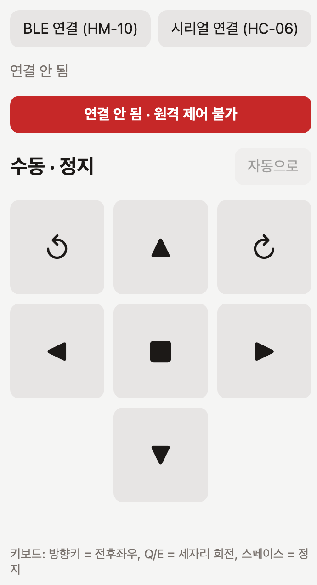
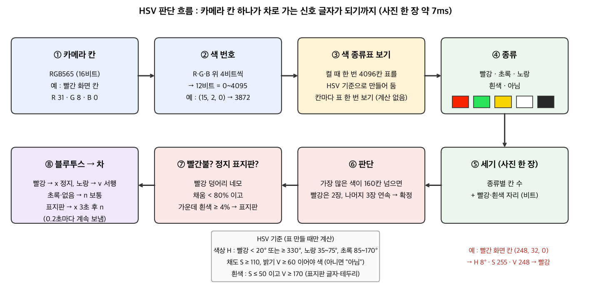
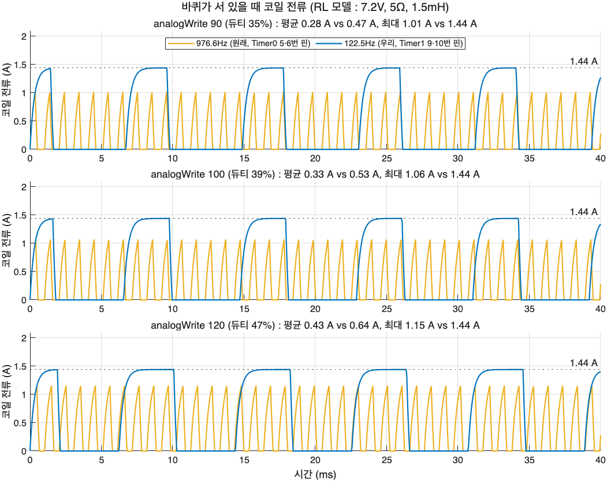

# 요구사항별 구현 : 설명 · 코드 · 사진

> English : [REQUIREMENTS.en.md](REQUIREMENTS.en.md) · 함께 보기 : [최종 보고서](REPORT_20261116.md) · [코드 해설](CODE.md) · [PWM 계산](PWM.md)

코드 줄 번호는 기본 차 코드 **버전 E** ([`motor_control_low_frequency.ino`](../arduino/motor_control_low_frequency/motor_control_low_frequency.ino)) 기준이다. 버전 C·D 도 같은 구조 ([CODE.md](CODE.md)).

| # | 요구사항 | 구현 | 확인 |
|---|---|---|---|
| 1 | 모바일 앱으로 전·후진, 좌·우 조종 | 앱 3종 + `driveManual()` | ✅ 트랙 |
| 2 | 자동 / 수동 모드 전환 | `a` / `m` + `setMode()` | ✅ |
| 3 | 자동 모드 라인 주행 (PID 로 주행 안정성 개선) | `pidLine()` | ✅ 트랙 통과 (C·E 11-16, D 11-18) |
| 4 | 블루투스 명령을 파싱해 동작 | `serviceBT()` | ✅ |
| 5 | 현재 모드 상태 유지, 제어 로직 분기 | `enum Mode` + `loop()` | ✅ |
| 6 | 블루투스 명령 후 반응 300ms 이내 | 기다리지 않는 `loop()` | ✅ 코드상 약 15ms 이내, 로그 측정은 아래 |
| 추가 1 | 초음파 센서로 장애물 판단 | `updateObstacle()` | ✅ |
| 추가 2 | ESP32-CAM 으로 차량 제어, 신호등·표지판 판단 | ESP32 펌웨어 + 차의 `x v n` | ✅ 트랙 (11-18) |
| 추가 3 | PWM 으로 DC 모터 구동 주파수 최적화 | Timer1 122.5Hz + 저주파 값 | ✅ 트랙 (11-16, 11-23) |

---

## 1. 모바일 앱으로 전·후진, 좌·우 조종

**설명** : 폰 앱(안드로이드 HC-06, 아이폰 HM-10, 웹)의 버튼을 누르면 한 글자 명령을 블루투스로 보내고, 차는 그 글자에 맞춰 왼쪽·오른쪽 바퀴 속도를 정한다. 누르고 있는 동안 0.2초마다 같은 글자를 다시 보내고, 손을 떼면 `s`(정지)를 두 번 보낸다.

| 버튼 | ▲ | ▼ | ◀ | ▶ | ↺ | ↻ | ■ |
|---|---|---|---|---|---|---|---|
| 글자 | `g` 전진 | `b` 후진 | `l` 좌회전 | `r` 우회전 | `q` 제자리 좌 | `w` 제자리 우 | `s` 정지 |

<p align="center"> <br><sub>왼쪽 : 원래 과제의 조종 앱 (apps/web/index.html, 폰 → HC-06) · 오른쪽 : 추가 과제(버전 D)에서 폰으로 연 ESP32 웹 화면 (폰 → 와이파이 → ESP32 → HC-06). 같은 방향 버튼·자동/수동 전환에 카메라 영상, 신호등 인식, 차 상태가 함께 나온다</sub></p>

버전 D 에서는 HC-06 에 ESP32 가 붙어 있어서, 조종 버튼을 누르면 웹 화면 → 와이파이 → ESP32 → 블루투스로 **같은 글자**(`g b l r q w s a m`)가 차에 간다. 차 코드는 앱으로 조종할 때와 똑같다.

**코드** — 차 [`driveManual()`](../arduino/motor_control_low_frequency/motor_control_low_frequency.ino#L330-L341) :
```cpp
case 'g': driveManualLR( MAN_FWD,  MAN_FWD); break;              // 전진
case 'b': driveManualLR(-MAN_FWD, -MAN_FWD); break;              // 후진
case 'l': driveManualLR( MAN_CURVE_IN,  MAN_CURVE_OUT); break;   // 좌회전(곡선)
case 'r': driveManualLR( MAN_CURVE_OUT, MAN_CURVE_IN); break;    // 우회전(곡선)
case 'q': driveManualLR(-MAN_SPIN,  MAN_SPIN); break;            // 제자리 좌회전
case 'w': driveManualLR( MAN_SPIN, -MAN_SPIN); break;            // 제자리 우회전
```
앱 [`apps/web/index.html`](../apps/web/index.html#L170-L176) :
```js
setInterval(() => { if (held && held !== 's') write?.(held); }, 200);   // 누르는 동안 0.2초마다 다시
function press(c) { held = c; write?.(c); render(); }
function release() { if (held === null) return; held = null; write?.('s'); write?.('s'); render(); }
```

---

## 2. 자동 / 수동 모드 전환

**설명** : 앱의 "자동으로" → 확인 창 → `a`, "수동으로" → `m`. 자동으로 갈 때는 0.5초 무조건 정지(안전 지연) 뒤 출발, 수동으로 갈 때는 즉시. 자동 중에 방향 버튼을 누르면 사람이 개입한 것으로 보고 바로 수동으로 바뀐다.

**코드** [`setMode()`](../arduino/motor_control_low_frequency/motor_control_low_frequency.ino#L319-L328) :
```cpp
void setMode(Mode m) {
  mode = m;
  cmd = 's';
  stopCar();
  holdUntil = (m == AUTO) ? millis() + SWITCH_HOLD_MS : 0;   // 자동으로 갈 때만 0.5초 정지
  resetPid();
  ...
}
```

---

## 3. 자동 모드 라인 주행 (PID)

**설명** : 라인센서 3개(검은 선 = 1)로 오차를 만든다 : `010` = 0, `011`/`110` = ±1, `001`/`100` = ±2 (코너), `000` = 선 놓침. 오차 ±1 이내는 **PID** 로 20ms 마다 보정 u 를 계산해 왼쪽 = BASE + u, 오른쪽 = BASE − u. 센서가 0/1 뿐이라 D 를 약 0.1초 이어지게 하고(`D_DECAY`), 오차가 반대로 넘어가면 I 를 비운다. 코너(±2)는 PID 대신 바깥 150 / 안쪽 −100 으로 확실히 돈다.

<p align="center"> <br><sub>왼쪽 : 차 앞 (바닥에 라인센서 3개) · 오른쪽 : 자동 라인 주행 (차의 카메라 기록)</sub></p>

**코드** [`pidLine()`](../arduino/motor_control_low_frequency/motor_control_low_frequency.ino#L185-L245) :
```cpp
if ((e > 0 && integ < 0) || (e < 0 && integ > 0)) integ = 0;   // 반대로 넘어가면 I 비움
integ = constrain(integ + e * dt, -I_LIMIT, I_LIMIT);           // I
dTerm = dTerm * D_DECAY + KD * (e - lastErr);                   // D : 약 0.1초 이어짐
float u = KP * e + KI * integ + dTerm;                          // P + I + D
int left = BASE + (int)u, right = BASE - (int)u;
driveManualLR(constrain(left, 0, 255), constrain(right, 0, 255));
```
**주행 안정성 개선** : KP 51 → 30, KD 25, BASE 90 (저주파에 맞춤, 2026-11-23) 으로 직선 흔들림을 줄였다. 자세히는 README 4장, [`PID.md`](PID.md).

---

## 4. 블루투스 명령 파싱

**설명** : HC-06 이 받은 글자를 D3/D4 소프트웨어 시리얼(9600)로 한 글자씩 읽는다. **명령표에 없는 글자(줄바꿈 등)는 버리고**, `h`(연결 신호)는 연결 시각만 갱신, `a`/`m` 은 모드 전환, 나머지는 주행 명령으로 저장한다.

**코드** [`serviceBT()`](../arduino/motor_control_low_frequency/motor_control_low_frequency.ino#L266-L282) :
```cpp
while (BT.available()) {
  char c = BT.read();
  if (c == 0 || !strchr("gblrsqwamh", c)) continue;   // 명령표에 없는 글자는 버림
  lastLink = millis();
  if (c == 'h') continue;                              // 연결 신호
  lastRx = millis();
  if (c == 'a') setMode(AUTO);
  else if (c == 'm') setMode(MANUAL);
  else {
    if (mode == AUTO) setMode(MANUAL);                 // 자동 중 조종 = 사람이 개입
    cmd = c;
  }
}
```
차 → 앱으로는 0.2초마다 상태 한 줄 (`ag,23,010,LINE` = 모드·동작·거리·센서·단계). 글자 약속 전체는 [`PROTOCOL.md`](../PROTOCOL.md).

---

## 5. 모드 상태 유지와 제어 분기

**설명** : 모드는 `enum Mode {{ MANUAL, AUTO }}` 변수 하나에 들고 있고, `setMode()` 로만 바뀐다. `loop()` 가 매번 이 값을 보고 **자동이면 `pidLine()`, 수동이면 `driveManual()`** 로 갈라진다. 장애물·전환 대기는 두 모드 앞에서 먼저 처리한다.

**코드** [`loop()`](../arduino/motor_control_low_frequency/motor_control_low_frequency.ino#L146-L168) :
```cpp
void loop() {
  serviceBT();                                           // 명령 받기
  if (millis() - lastPing >= PING_MS) updateObstacle();  // 장애물
  if (millis() < holdUntil) { stopCar(); stage = "HOLD"; return; }   // 전환 안전 지연
  if (mode == AUTO) {                                    // 자동
    if (obstacleStopped) { stopCar(); ... return; }
    pidLine();
    return;
  }
  // 수동
  if (millis() - lastRx > LINK_MS) cmd = 's';            // 명령이 끊기면 정지
  bool blocked = obstacleStopped && (cmd == 'g' || cmd == 'l' || cmd == 'r');
  driveManual(blocked ? 's' : cmd);
}
```

---

## 6. 블루투스 명령 후 반응 300ms 이내

**설명** : `loop()` 에 `delay()` 가 없어서 매 바퀴 블루투스를 먼저 읽고 바로 바퀴 값을 바꾼다. 한 바퀴에서 가장 오래 걸리는 것은 초음파 재기(최대 12ms, 60ms 마다 한 번)이고, 9600bps 에서 한 글자 전송은 약 1ms 다. 그래서 **명령이 도착한 뒤 바퀴 값이 바뀌기까지 약 15ms 이내** (300ms 기준의 1/20).

| 시간 | 값 | 어디 |
|---|---|---|
| 글자 1개 전송 (9600bps) | 약 1ms | HC-06 |
| 초음파 최대 대기 | 12ms (60ms 마다) | [`pulseIn(echoPin, HIGH, 12000)`](../arduino/motor_control_low_frequency/motor_control_low_frequency.ino#L253) |
| PID 계산 주기 | 20ms | `PID_MS` |
| 명령 → 바퀴 | **약 15ms 이내** | 위의 합 |
| 신호 → 차 반응 (주행 기록, ESP 확정 + 블루투스 + 상태 줄 0.2초 간격 포함) | 초록 0.11~0.33초, 표지판 0.10~0.22초, 빨강 0.21~0.54초 | 보고서 7장 |

주행 기록의 값은 차가 0.2초마다 보내는 상태 줄로 잰 것이라 그 간격만큼 늦게 찍히고, ESP32 가 신호를 확정하는 시간(사진 2~3장)과 와이파이·블루투스 안테나 공유 지연도 들어 있다. 차 쪽 처리 자체는 위 표처럼 수 ms 다.

---

## 추가 1. 초음파 센서로 장애물 판단

**설명** : 초음파 센서(HC-SR04, TRIG 13 · ECHO 12)를 60ms 마다 쏘아 앞 거리를 잰다. **10cm 안이면** 자동은 정지하고, 수동은 앞으로 가는 명령(`g l r`)만 막는다 (후진·제자리 회전은 됨). 5번 연속 안 보이면 다시 출발.

**코드** [`updateObstacle()`](../arduino/motor_control_low_frequency/motor_control_low_frequency.ino#L249-L260) :
```cpp
long duration = pulseIn(echoPin, HIGH, 12000);
int mm = duration * 340L / 2000;                          // 왕복 시간 → 거리 (mm)
frontDist = (duration == 0 || mm < MIN_VALID_MM) ? 9999 : mm;
if (frontDist < AVOID_MM) { obstacleStopped = true; clearCount = 0; }   // 10cm
else if (obstacleStopped && ++clearCount >= CLEAR_COUNT) obstacleStopped = false;
```
**확인** : 주행 기록 log_0011 에서 8cm 장애물에 정지 → 치우자 다시 출발. 초음파는 차 앞의 서보 위 (위 3장 사진 왼쪽).

---

## 추가 2. ESP32-CAM 으로 신호등·표지판 판단, 차량 제어

**설명** : ESP32-CAM 이 160×120 컬러 사진을 45ms 마다 받아 **칸마다 HSV 색 종류표(4096 색)를 한 번 보고** 빨강·초록·노랑·흰색을 센다. 빨강 덩어리의 모양(채움 < 80%, 가운데 흰색 ≥ 4%)으로 정지 표지판과 빨간불을 가른다. 같은 결과가 2~3장 이어지면 확정하고, **HC-06 에 블루투스로 붙어** 차에 `x`(정지)·`v`(서행)·`n`(보통)을 0.2초마다 보낸다. 차는 라인 주행을 계속하면서 이 글자로 멈추거나 속도만 바꾼다. 웹 화면(와이파이)에서 차 조종·상태 보기도 한다.

<p align="center"></p>

| 빨간불 → 테두리 빨강, 차 정지 | 초록불 → 테두리 초록, 출발 | 정지 표지판 → 테두리 자홍, 3초 정지 |
|---|---|---|
|  |  |  |

<sub>주행 중 ESP32 웹 화면 (화면 녹화에서 잘라 냄) : HSV 영상, 테두리 = 지금 신호, 차 상태, 조종 버튼</sub>




**코드** — ESP32 펌웨어 [`esp32cam_line.ino`](https://github.com/CHOESEUNGJUN/4wd_car_project/blob/extra/esp32cam/esp32/esp32cam_line/esp32cam_line.ino#L854-L858) :
```cpp
// 빨강 덩어리 모양으로 정지 표지판(4) / 빨간불(1)
if (red > best) { now = fill < SIGN_FILL_MAX && white >= SIGN_WHITE_MIN ? 4 : 1; best = red; }
if (grn > best) { now = 2; best = grn; }
if (yel > best) now = 3;
if (same >= (cand == 1 ? 2 : 3)) sigState = cand;   // 빨강 2장, 나머지 3장 연속이면 확정
```
[보내기](https://github.com/CHOESEUNGJUN/4wd_car_project/blob/extra/esp32cam/esp32/esp32cam_line/esp32cam_line.ino#L907-L912) :
```cpp
char want = sigState == 1 || stopLeft() ? 'x' : sigState == 3 ? 'v' : 'n';
if (sigMode && btOn() && (want != sentSig || millis() - lastSig >= 200)) { ... btSend(want); }
```
차 (카메라 저주파판 [`motor_control_low_frequency_cam.ino`](https://github.com/CHOESEUNGJUN/4wd_car_project/blob/extra/esp32cam/arduino/motor_control_low_frequency_cam/motor_control_low_frequency_cam.ino)) :
```cpp
if (strchr("xvn", c)) { sigCmd = c; sigAt = millis(); continue; }            // 신호는 기억만
if (signalNow() == 'x') { stopCar(); stage = "RED"; ... return; }           // 빨간불 정지
int left = baseSpeed() + (int)u, right = baseSpeed() - (int)u;              // 노랑이면 서행
```
**확인** (2026-11-18 트랙, SD 기록) : 빨간불 7번 정지, 초록불 4번 출발, 정지 표지판 5번 3초 정지 후 출발. 자세히는 보고서 2~7장, 차 쪽 변경은 [CODE.md 3장](CODE.md).

---

## 추가 3. PWM 으로 DC 모터 구동 주파수 최적화

**설명** : UNO 기본 PWM(5·6번 핀, Timer0, 976.6Hz)은 켜진 시간이 짧아 모터 코일 전류가 다 차기 전에 끊겨 저속 힘이 약했다 (90 에서 순간 70%, 130 은 줘야 움직임). **Timer1 을 삼각파·분주 256 으로 바꿔 122.5Hz** 로 낮추고 속도 핀을 9·10번으로 옮겼다. 같은 값에서 전류가 1.5~2.6배가 되어 작은 값에서도 출발하고, 킥을 255 → 130 으로 줄였다. 그 뒤 PID·속도 값을 저주파에 맞춰 다시 정했다.



**코드** [`setup()`](../arduino/motor_control_low_frequency/motor_control_low_frequency.ino#L126-L128) :
```cpp
TIMSK1 = 0;              // 서보 라이브러리의 Timer1 인터럽트 끄기
TCCR1A = _BV(WGM10);     // 8비트 위상 보정 PWM (삼각파)
TCCR1B = _BV(CS12);      // 분주 256 → 16,000,000 ÷ 256 ÷ 510 = 122.5Hz
```
**확인** : 트랙 주행 통과·더 부드러움 (11-16), 빨간불·표지판 뒤 재출발 0.1~0.3초 (11-18), 저주파 값으로 직선 흔들림 감소·출발 양호 (11-23). 계산과 그래프 전체는 [PWM.md](PWM.md).
