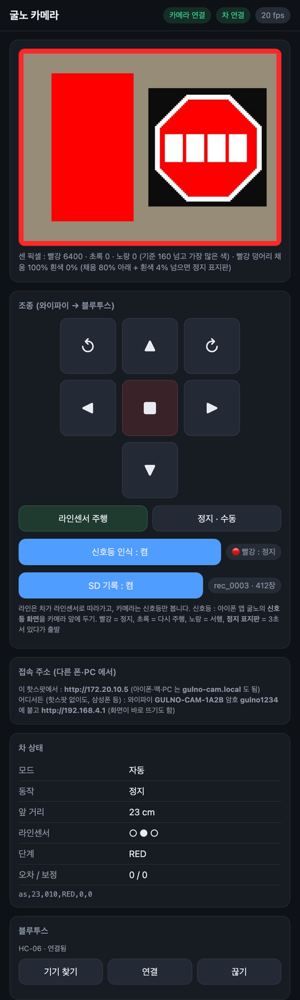
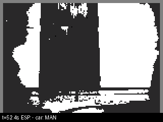
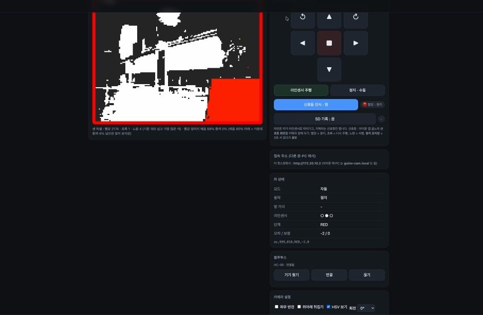
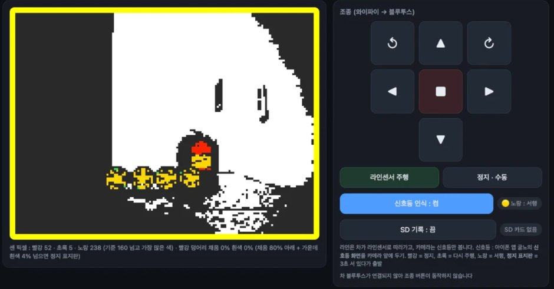
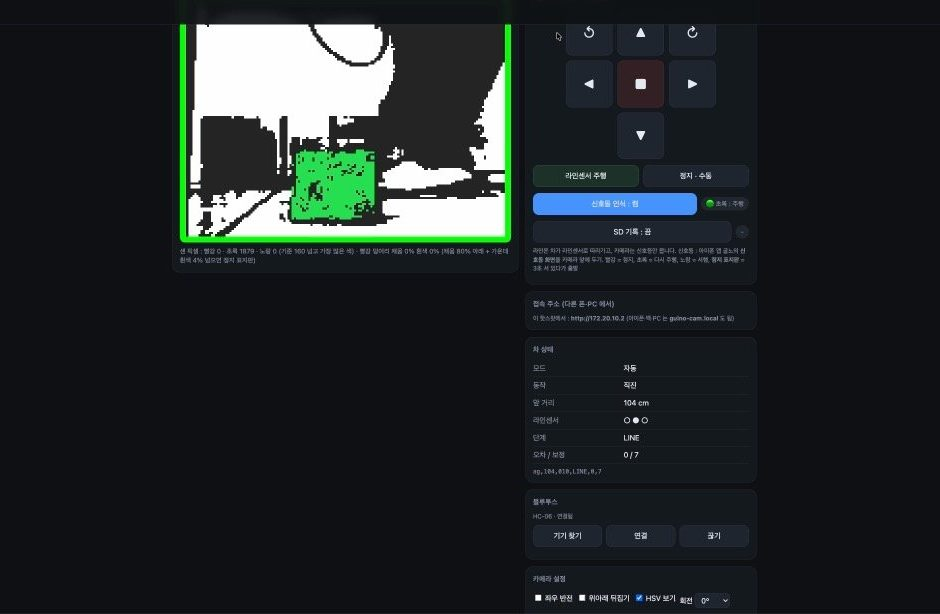
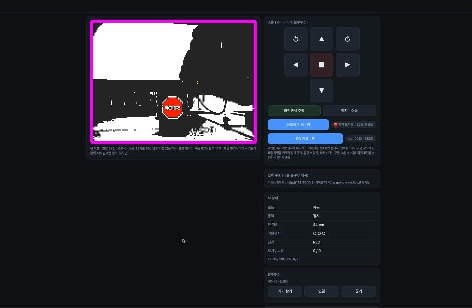
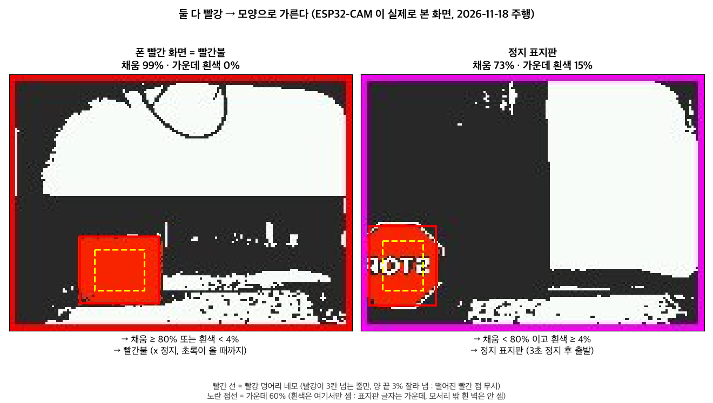

# 요구사항별 구현 : 설명 · 코드 · 사진

> English : [REQUIREMENTS.en.md](REQUIREMENTS.en.md) · 함께 보기 : [최종 보고서](REPORT_20261116.md) · [코드 해설](CODE.md) · [PWM 계산](PWM.md)

코드 줄 번호는 기본 차 코드 **버전 E** ([`motor_control_low_frequency.ino`](../arduino/motor_control_low_frequency/motor_control_low_frequency.ino)) 기준이다. 버전 C·D 도 같은 구조 ([CODE.md](CODE.md)).

| # | 요구사항 | 구현 | 확인 |
|---|---|---|---|
| 1 | 모바일 앱으로 전·후진, 좌·우 조종 | 앱 3종 + `driveManual()` | ✅ 트랙 |
| 2 | 자동 / 수동 모드 전환 | `a` / `m` + `setMode()` | ✅ |
| 3 | 자동 모드 라인 주행 (PID 로 주행 안정성 개선) | `pidLine()` | ✅ 트랙 통과 (C·E 11-16, D 11-18) |
| 4 | 블루투스 명령을 파싱해 동작 | `serviceBT()` | ✅ |
| 5 | 현재 모드 상태 유지, 제어 로직 분기 | `enum Mode` + `loop()` | ✅ |
| 6 | 블루투스 명령 후 반응 300ms 이내 | 기다리지 않는 `loop()` | ✅ 코드상 약 15ms 이내, 로그 측정은 아래 |
| 추가 1 | 초음파 센서로 장애물 판단 | `updateObstacle()` | ✅ |
| 추가 2 | ESP32-CAM 으로 차량 제어, 신호등·표지판 판단 | ESP32 펌웨어 + 차의 `x v n` | ✅ 트랙 (11-18) |
| 추가 3 | PWM 으로 DC 모터 구동 주파수 최적화 | Timer1 122.5Hz + 저주파 값 | ✅ 트랙 (11-16, 11-23) |

---

## 1. 모바일 앱으로 전·후진, 좌·우 조종

**설명** : 폰 앱(안드로이드 HC-06, 아이폰 HM-10, 웹)의 버튼을 누르면 한 글자 명령을 블루투스로 보내고, 차는 그 글자에 맞춰 왼쪽·오른쪽 바퀴 속도를 정한다. 누르고 있는 동안 0.2초마다 같은 글자를 다시 보내고, 손을 떼면 `s`(정지)를 두 번 보낸다.

| 버튼 | ▲ | ▼ | ◀ | ▶ | ↺ | ↻ | ■ |
|---|---|---|---|---|---|---|---|
| 글자 | `g` 전진 | `b` 후진 | `l` 좌회전 | `r` 우회전 | `q` 제자리 좌 | `w` 제자리 우 | `s` 정지 |

<p align="center"> <br><sub>왼쪽 : 원래 과제의 조종 앱 (apps/web/index.html, 폰 → HC-06) · 오른쪽 : 추가 과제(버전 D)에서 폰으로 연 ESP32 웹 화면 (폰 → 와이파이 → ESP32 → HC-06). 같은 방향 버튼·자동/수동 전환에 카메라 영상, 신호등 인식, 차 상태가 함께 나온다</sub></p>

버전 D 에서는 HC-06 에 ESP32 가 붙어 있어서, 조종 버튼을 누르면 웹 화면 → 와이파이 → ESP32 → 블루투스로 **같은 글자**(`g b l r q w s a m`)가 차에 간다. 차 코드는 앱으로 조종할 때와 똑같다.

**코드** — 차 [`driveManual()`](../arduino/motor_control_low_frequency/motor_control_low_frequency.ino#L330-L341) :
```cpp
case 'g': driveManualLR( MAN_FWD,  MAN_FWD); break;              // 전진
case 'b': driveManualLR(-MAN_FWD, -MAN_FWD); break;              // 후진
case 'l': driveManualLR( MAN_CURVE_IN,  MAN_CURVE_OUT); break;   // 좌회전(곡선)
case 'r': driveManualLR( MAN_CURVE_OUT, MAN_CURVE_IN); break;    // 우회전(곡선)
case 'q': driveManualLR(-MAN_SPIN,  MAN_SPIN); break;            // 제자리 좌회전
case 'w': driveManualLR( MAN_SPIN, -MAN_SPIN); break;            // 제자리 우회전
```
앱 [`apps/web/index.html`](../apps/web/index.html#L170-L176) :
```js
setInterval(() => { if (held && held !== 's') write?.(held); }, 200);   // 누르는 동안 0.2초마다 다시
function press(c) { held = c; write?.(c); render(); }
function release() { if (held === null) return; held = null; write?.('s'); write?.('s'); render(); }
```

---

## 2. 자동 / 수동 모드 전환

**설명** : 앱의 "자동으로" → 확인 창 → `a`, "수동으로" → `m`. 자동으로 갈 때는 0.5초 무조건 정지(안전 지연) 뒤 출발, 수동으로 갈 때는 즉시. 자동 중에 방향 버튼을 누르면 사람이 개입한 것으로 보고 바로 수동으로 바뀐다.

**코드** [`setMode()`](../arduino/motor_control_low_frequency/motor_control_low_frequency.ino#L319-L328) :
```cpp
void setMode(Mode m) {
  mode = m;
  cmd = 's';
  stopCar();
  holdUntil = (m == AUTO) ? millis() + SWITCH_HOLD_MS : 0;   // 자동으로 갈 때만 0.5초 정지
  resetPid();
  ...
}
```

---

## 3. 자동 모드 라인 주행 (PID)

**설명** : 라인센서 3개(검은 선 = 1)로 오차를 만든다 : `010` = 0, `011`/`110` = ±1, `001`/`100` = ±2 (코너), `000` = 선 놓침. 오차 ±1 이내는 **PID** 로 20ms 마다 보정 u 를 계산해 왼쪽 = BASE + u, 오른쪽 = BASE − u. 센서가 0/1 뿐이라 D 를 약 0.1초 이어지게 하고(`D_DECAY`), 오차가 반대로 넘어가면 I 를 비운다. 코너(±2)는 PID 대신 바깥 150 / 안쪽 −100 으로 확실히 돈다.

<p align="center"> <br><sub>왼쪽 : 차 앞 (바닥에 라인센서 3개) · 오른쪽 : 자동 라인 주행 (차의 카메라 기록)</sub></p>

**코드** [`pidLine()`](../arduino/motor_control_low_frequency/motor_control_low_frequency.ino#L185-L245) :
```cpp
if ((e > 0 && integ < 0) || (e < 0 && integ > 0)) integ = 0;   // 반대로 넘어가면 I 비움
integ = constrain(integ + e * dt, -I_LIMIT, I_LIMIT);           // I
dTerm = dTerm * D_DECAY + KD * (e - lastErr);                   // D : 약 0.1초 이어짐
float u = KP * e + KI * integ + dTerm;                          // P + I + D
int left = BASE + (int)u, right = BASE - (int)u;
driveManualLR(constrain(left, 0, 255), constrain(right, 0, 255));
```
**주행 안정성 개선** : KP 51 → 30, KD 25, BASE 90 (저주파에 맞춤, 2026-11-23) 으로 직선 흔들림을 줄였다. 자세히는 README 4장, [`PID.md`](PID.md).

---

## 4. 블루투스 명령 파싱

**설명** : HC-06 이 받은 글자를 D3/D4 소프트웨어 시리얼(9600)로 한 글자씩 읽는다. **명령표에 없는 글자(줄바꿈 등)는 버리고**, `h`(연결 신호)는 연결 시각만 갱신, `a`/`m` 은 모드 전환, 나머지는 주행 명령으로 저장한다.

**코드** [`serviceBT()`](../arduino/motor_control_low_frequency/motor_control_low_frequency.ino#L266-L282) :
```cpp
while (BT.available()) {
  char c = BT.read();
  if (c == 0 || !strchr("gblrsqwamh", c)) continue;   // 명령표에 없는 글자는 버림
  lastLink = millis();
  if (c == 'h') continue;                              // 연결 신호
  lastRx = millis();
  if (c == 'a') setMode(AUTO);
  else if (c == 'm') setMode(MANUAL);
  else {
    if (mode == AUTO) setMode(MANUAL);                 // 자동 중 조종 = 사람이 개입
    cmd = c;
  }
}
```
차 → 앱으로는 0.2초마다 상태 한 줄 (`ag,23,010,LINE` = 모드·동작·거리·센서·단계). 글자 약속 전체는 [`PROTOCOL.md`](../PROTOCOL.md).

---

## 5. 모드 상태 유지와 제어 분기

**설명** : 모드는 `enum Mode {{ MANUAL, AUTO }}` 변수 하나에 들고 있고, `setMode()` 로만 바뀐다. `loop()` 가 매번 이 값을 보고 **자동이면 `pidLine()`, 수동이면 `driveManual()`** 로 갈라진다. 장애물·전환 대기는 두 모드 앞에서 먼저 처리한다.

**코드** [`loop()`](../arduino/motor_control_low_frequency/motor_control_low_frequency.ino#L146-L168) :
```cpp
void loop() {
  serviceBT();                                           // 명령 받기
  if (millis() - lastPing >= PING_MS) updateObstacle();  // 장애물
  if (millis() < holdUntil) { stopCar(); stage = "HOLD"; return; }   // 전환 안전 지연
  if (mode == AUTO) {                                    // 자동
    if (obstacleStopped) { stopCar(); ... return; }
    pidLine();
    return;
  }
  // 수동
  if (millis() - lastRx > LINK_MS) cmd = 's';            // 명령이 끊기면 정지
  bool blocked = obstacleStopped && (cmd == 'g' || cmd == 'l' || cmd == 'r');
  driveManual(blocked ? 's' : cmd);
}
```

---

## 6. 블루투스 명령 후 반응 300ms 이내

**설명** : 차의 `loop()` 에는 `delay()` 가 없다. 한 바퀴를 돌 때마다 **블루투스를 가장 먼저 읽고**, 받은 명령을 그 바퀴 안에서 바로 처리한다. 그래서 명령이 오면 다음 바퀴를 기다리지 않고 곧바로 바퀴 값이 바뀐다.

```cpp
void loop() {
  serviceBT();                      // ① 명령 받기 : 여기서 바로 cmd / mode 가 바뀜
  if (millis() - lastPing >= PING_MS) updateObstacle();   // ② 60ms 에 한 번 초음파 (최대 12ms)
  if (mode == AUTO) {
    if (signalNow() == 'x') { stopCar(); ... return; }   // ③ 빨간불은 PID 전에 바로 정지 (카메라판)
    pidLine();                      // ④ 자동 : 20ms 가 안 지났으면 계산 없이 return
    return;
  }
  driveManual(cmd);                 // ⑤ 수동 : 매 바퀴 바로 바퀴 값
}
```

**가장 늦는 경우 : 약 15ms**

| 걸리는 것 | 시간 | 설명 |
|---|---|---|
| 글자 1개가 블루투스로 오는 시간 | 약 1ms | 9600bps 에서 한 글자 = 10비트 ÷ 9600 ≈ 1ms |
| 초음파 재는 동안 멈춤 | 최대 12ms (60ms 에 한 번) | `pulseIn(echoPin, HIGH, 12000)` 은 초음파 메아리가 돌아올 때까지 **최대 12ms 기다린다** (약 2m 거리). 그동안 `loop()` 가 멈춰 있어서, 운 나쁘게 이때 명령이 오면 다 잰 뒤에 처리된다. 들어온 글자는 버퍼에 쌓여 있어 없어지지 않는다 |
| 명령 처리·바퀴 값 | 약 1\~2ms | `serviceBT()` → `setMode()` / `driveManual()` → `analogWrite` |
| **합 (명령 → 바퀴)** | **약 15ms 이내** | 300ms 기준의 1/20 |

**PID 20ms 는 무엇인가** — 자동 주행 중 **선을 보고 핸들을 고치는 간격**이다 (`pidLine()` 첫 줄 `if (now - lastPid < PID_MS) return;`). 센서가 0/1 뿐이라 이보다 자주 계산해도 의미가 없고, D 항 계산에 일정한 시간 간격이 필요해서 20ms 로 정했다. **블루투스 명령은 이 20ms 를 기다리지 않는다.**

| 명령 | 어디서 처리 | PID 20ms 를 기다리나 | 반응 |
|---|---|---|---|
| 수동 조종 `g b l r q w s` | `serviceBT()` 가 받자마자 `cmd` 에 넣고 같은 바퀴의 `driveManual()` 이 바퀴 값을 바꿈 (수동에서는 PID 가 안 돈다) | ❌ | 약 15ms |
| 모드 전환 `a` / `m` | `setMode()` 가 바로 정지·전환 (자동은 그 뒤 0.5초 안전 정지 후 출발) | ❌ | 약 15ms (정지까지) |
| 자동 중 방향 버튼 (사람 개입) | 바로 `setMode(MANUAL)` → 정지 → 조종 | ❌ | 약 15ms |
| 빨간불 `x` (카메라판) | `loop()` 에서 PID **앞**에서 검사 → 바로 정지 | ❌ | 약 15ms |
| 초록불 `n` | 정지할 때 PID 를 비워 둬서(`lastPid = 0`) 다음 바퀴에 바로 계산 | ❌ | 약 15ms |
| 노란불 `v` | 다음 PID 계산 때 기본 속도가 `SLOW_BASE` 로 | ⭕ | 최대 약 35ms (15 + 20) |

**주행 기록으로 잰 값과의 차이** — 보고서 7장의 신호 반응(초록 0.11\~0.33초, 표지판 0.10\~0.22초, 빨강 0.21\~0.54초)은 **ESP32 가 신호를 확정한 순간부터 차가 보낸 상태 줄에 반응이 찍힌 순간까지**를 SD 로그에서 잰 것이다. 여기에는 ① 차가 상태 줄을 0.2초마다만 보내서 생기는 기록 간격 (최대 0.2초), ② 와이파이·블루투스가 안테나 하나를 나눠 써서 생기는 블루투스 지연이 들어 있다. 차가 명령을 받아 바퀴를 바꾸는 시간 자체는 위 표처럼 약 15ms 다.

---

## 추가 1. 초음파 센서로 장애물 판단

**설명** : 초음파 센서(HC-SR04, TRIG 13 · ECHO 12)를 60ms 마다 쏘아 앞 거리를 잰다. **10cm 안이면** 자동은 정지하고, 수동은 앞으로 가는 명령(`g l r`)만 막는다 (후진·제자리 회전은 됨). 5번 연속 안 보이면 다시 출발.

**코드** [`updateObstacle()`](../arduino/motor_control_low_frequency/motor_control_low_frequency.ino#L249-L260) :
```cpp
long duration = pulseIn(echoPin, HIGH, 12000);
int mm = duration * 340L / 2000;                          // 왕복 시간 → 거리 (mm)
frontDist = (duration == 0 || mm < MIN_VALID_MM) ? 9999 : mm;
if (frontDist < AVOID_MM) { obstacleStopped = true; clearCount = 0; }   // 10cm
else if (obstacleStopped && ++clearCount >= CLEAR_COUNT) obstacleStopped = false;
```
**확인** : 주행 기록 log_0011 에서 8cm 장애물에 정지 → 치우자 다시 출발. 초음파는 차 앞의 서보 위 (위 3장 사진 왼쪽).

---

## 추가 2. ESP32-CAM 으로 신호등·표지판 판단, 차량 제어

**설명** : ESP32-CAM 이 160×120 컬러 사진을 45ms 마다 받아 **칸마다 HSV 색 종류표(4096 색)를 한 번 보고** 빨강·초록·노랑·흰색을 센다. 빨강 덩어리의 모양(채움 < 80%, 가운데 흰색 ≥ 4%)으로 정지 표지판과 빨간불을 가른다. 같은 결과가 2\~3장 이어지면 확정하고, **HC-06 에 블루투스로 붙어** 차에 `x`(정지)·`v`(서행)·`n`(보통)을 0.2초마다 보낸다. 차는 라인 주행을 계속하면서 이 글자로 멈추거나 속도만 바꾼다. 웹 화면(와이파이)에서 차 조종·상태 보기도 한다.

<p align="center"></p>

| 빨간불 → 테두리 빨강, 차 정지 | 노랑 → 테두리 노랑, "노랑 : 서행" (노란 바퀴로 시험) | 초록불 → 테두리 초록, 출발 | 정지 표지판 → 테두리 자홍, 3초 정지 |
|---|---|---|---|
|  |  |  |  |

<sub>주행 중 ESP32 웹 화면 (화면 녹화에서 잘라 냄) : HSV 영상, 테두리 = 지금 신호, 차 상태, 조종 버튼</sub>




**코드** — ESP32 펌웨어 [`esp32cam_line.ino`](../esp32/esp32cam_line/esp32cam_line.ino#L854-L858) :
```cpp
// 빨강 덩어리 모양으로 정지 표지판(4) / 빨간불(1)
if (red > best) { now = fill < SIGN_FILL_MAX && white >= SIGN_WHITE_MIN ? 4 : 1; best = red; }
if (grn > best) { now = 2; best = grn; }
if (yel > best) now = 3;
if (same >= (cand == 1 ? 2 : 3)) sigState = cand;   // 빨강 2장, 나머지 3장 연속이면 확정
```
[보내기](../esp32/esp32cam_line/esp32cam_line.ino#L907-L912) :
```cpp
char want = sigState == 1 || stopLeft() ? 'x' : sigState == 3 ? 'v' : 'n';
if (sigMode && btOn() && (want != sentSig || millis() - lastSig >= 200)) { ... btSend(want); }
```
차 (카메라 저주파판 [`motor_control_low_frequency_cam.ino`](../arduino/motor_control_low_frequency_cam/motor_control_low_frequency_cam.ino)) :
```cpp
if (strchr("xvn", c)) { sigCmd = c; sigAt = millis(); continue; }            // 신호는 기억만
if (signalNow() == 'x') { stopCar(); stage = "RED"; ... return; }           // 빨간불 정지
int left = baseSpeed() + (int)u, right = baseSpeed() - (int)u;              // 노랑이면 서행
```
**확인** (2026-11-18 트랙, SD 기록) : 빨간불 7번 정지, 초록불 4번 출발, 정지 표지판 5번 3초 정지 후 출발. 추가 기록 log_0013 : 노랑 15번 서행 (노란 표지판이 없어 노란 바퀴로 시험), 빨간불 4번 정지 0.18\~0.34초. 자세히는 보고서 2\~7장, 차 쪽 변경은 [CODE.md 3장](CODE.md).

---

## 추가 3. PWM 으로 DC 모터 구동 주파수 최적화

**설명** : UNO 기본 PWM(5·6번 핀, Timer0, 976.6Hz)은 켜진 시간이 짧아 모터 코일 전류가 다 차기 전에 끊겨 저속 힘이 약했다 (90 에서 순간 70%, 130 은 줘야 움직임). **Timer1 을 삼각파·분주 256 으로 바꿔 122.5Hz** 로 낮추고 속도 핀을 9·10번으로 옮겼다. 같은 값에서 전류가 1.5\~2.6배가 되어 작은 값에서도 출발하고, 킥을 255 → 130 으로 줄였다. 그 뒤 PID·속도 값을 저주파에 맞춰 다시 정했다.


**코드** [`setup()`](../arduino/motor_control_low_frequency/motor_control_low_frequency.ino#L126-L128) :
```cpp
TIMSK1 = 0;              // 서보 라이브러리의 Timer1 인터럽트 끄기
TCCR1A = _BV(WGM10);     // 8비트 위상 보정 PWM (삼각파)
TCCR1B = _BV(CS12);      // 분주 256 → 16,000,000 ÷ 256 ÷ 510 = 122.5Hz
```
**확인** : 트랙 주행 통과·더 부드러움 (11-16), 빨간불·표지판 뒤 재출발 0.1\~0.3초 (11-18), 저주파 값으로 직선 흔들림 감소·출발 양호 (11-23). 계산과 그래프 전체는 [PWM.md](PWM.md).


---

## 부록. ESP32-CAM 펌웨어 코드 해설

펌웨어는 [`esp32cam_line.ino`](../esp32/esp32cam_line/esp32cam_line.ino) (약 950줄) + 웹 화면 [`page.h`](../esp32/esp32cam_line/page.h) + 빌드 설정 [`platformio.ini`](../esp32/esp32cam_line/platformio.ini). ESP32 는 FreeRTOS 위에서 돌고, 사진 판단(`loop`)과 블루투스·웹 영상을 다른 작업으로 나눠서 무선이 느려져도 신호 판단이 멈추지 않게 했다. 올리는 방법은 [ESP32_UPLOAD.md](../docs/ESP32_UPLOAD.md) (Arduino IDE 안 됨, PlatformIO).

### A-1. 전체 흐름

```
켜짐 → setup() : 색 종류표 만들기 → 카메라 → 와이파이 → 웹 서버 → SD 확인 → 블루투스 작업 시작

loop() (45ms 마다 한 장, 1번 코어)
  ① 카메라 사진 받기 (160×120 RGB565, PSRAM)
  ② detectSignal() : 칸마다 색 종류표 → 빨강·초록·노랑·흰색 세기 → 빨강 덩어리 모양 → 신호 확정
  ③ HSV 영상 묶어서 웹소켓으로, 화면에 차 상태 0.2초마다
  ④ 차에 블루투스로 x / v / n (0.2초마다), 화면이 열려 있으면 h

btTask (따로 작업) : HC-06 찾기·연결·다시 연결
웹 서버 (ESP-IDF 작업) : 웹 화면, 설정, 웹소켓 (조종 글자 → 차)
recTask (기록할 때만) : SD 카드에 영상 + 로그
```

### A-2. 파트별 위치

| 파트 | 함수 | 하는 일 | 줄 |
|---|---|---|---|
| 설정 | `[설정]` | 사진 크기, 색 기준(H·S·V), 신호 확정 장수, 표지판 기준, 블루투스 PIN, 영상 속도 | [30](../esp32/esp32cam_line/esp32cam_line.ino#L30) |
| 색 종류표 | `colorClass()`, `buildColorLut()`, `lutIndex()` | RGB → HSV → 빨강/초록/노랑/흰색/없음, 4096 색을 켤 때 한 번 표로 | [65](../esp32/esp32cam_line/esp32cam_line.ino#L65-L82) |
| SD 기록 | `recTask()` | rec_NNNN.mjpeg 영상 + log_NNNN.csv 로그 | [219](../esp32/esp32cam_line/esp32cam_line.ino#L219) |
| 웹 서버 | `startServer()`, `route()` | 웹 화면, 설정, 기기 목록, 영상 | [387](../esp32/esp32cam_line/esp32cam_line.ino#L387) |
| 블루투스 | `btTask()` | 메모리 확인 → 마스터로 시작 → 와이파이 먼저 → 5초마다 다시 연결 | [411](../esp32/esp32cam_line/esp32cam_line.ino#L411-L447) |
| 차 상태 받기 | `readCar()` | 아두이노가 0.2초마다 보내는 상태 줄 읽기 | [450](../esp32/esp32cam_line/esp32cam_line.ino#L450) |
| 웹소켓 | `wsHandler()`, `wsSendAll()`, `pushStatus()` | 조종 글자 받기 → 차로, 영상·상태 보내기 (기다리지 않는 방식) | [507](../esp32/esp32cam_line/esp32cam_line.ino#L507-L524) |
| 와이파이 | `startWifi()` | 저장된 핫스팟에 붙기, 못 찾으면 자기 와이파이(설정 모드) | [648](../esp32/esp32cam_line/esp32cam_line.ino#L648) |
| 카메라 | `startCamera()` | OV3660, RGB565 컬러, 버퍼 2장(PSRAM), 가장 최근 사진 | [694](../esp32/esp32cam_line/esp32cam_line.ino#L694-L713) |
| 시작 | `setup()` | 위 순서대로 켜기 | [715](../esp32/esp32cam_line/esp32cam_line.ino#L715-L740) |
| **신호 판단** | `detectSignal()` | 칸마다 색 세기, 빨강 덩어리 네모·흰색, 판단·확정, HSV 영상 묶기 | [776](../esp32/esp32cam_line/esp32cam_line.ino#L776-L860) |
| **한 바퀴** | `loop()` | 사진 → 판단 → 영상·상태 → 차에 신호 | [863](../esp32/esp32cam_line/esp32cam_line.ino#L863-L915) |
| 웹 화면 | `page.h` | HTML·JS : HSV 영상 칠하기, 조종 버튼, 신호등 인식, SD 기록 | [page.h](../esp32/esp32cam_line/page.h) |

### A-3. 핵심 코드

**① 색 종류표 : 계산은 켤 때 한 번만** ([65–82](../esp32/esp32cam_line/esp32cam_line.ino#L65-L82))

HSV 계산은 나눗셈이 있어 느리다. 그래서 켤 때 R·G·B 를 4비트씩 나눈 4096 색마다 한 번 계산해 표(4KB)에 넣고, 달리는 동안에는 칸마다 **표를 한 번 보기만** 한다. 사진 한 장(19,200칸)이 약 7ms.

```cpp
uint8_t colorClass(int r, int g, int b) {                  // 표 만들 때만 씀
  int mx = max(r, max(g, b)), mn = min(r, min(g, b)), d = mx - mn;
  int v = mx, sat = mx ? d * 255 / mx : 0;
  if (sat <= WHITE_S_MAX && v >= WHITE_V_MIN) return C_WHITE;        // 흰색 : 채도 낮고 밝음
  if (sat < COLOR_S_MIN || v < COLOR_V_MIN || d == 0) return C_NONE;
  int h = ...;                                                      // 색상 0~359°
  if (h < RED_H1 || h >= RED_H2) return C_RED;
  if (h >= YEL_H1 && h < YEL_H2) return C_YELLOW;
  if (h >= GRN_H1 && h < GRN_H2) return C_GREEN;
  return C_NONE;
}
inline int lutIndex(uint16_t p) { return ((p >> 4) & 0xF00) | ((p >> 3) & 0x0F0) | ((p >> 1) & 0x00F); }  // RGB565 → R4 G4 B4
```

**② 한 바퀴 : 사진 → 판단 → 보내기** ([863](../esp32/esp32cam_line/esp32cam_line.ino#L863-L915))

```cpp
camera_fb_t* fb = esp_camera_fb_get();                       // 사진 받기 (45ms 마다, 센서가 정함)
bool copied = (sigMode || rleOn) && detectSignal(b, wantView); // 판단하면서 같은 줄을 영상용으로도 (사진을 한 번만 읽음)
if (rleOn) { ... wsSendAll(rleBuf, rleN, true); }             // HSV 영상 보내기
esp_camera_fb_return(fb);
if (millis() - lastPush >= 200 || sigState != shownSig) pushStatus();   // 화면에 상태
if (btOn() && ... ) btSend('h');                             // 화면이 열려 있으면 연결 신호
char want = sigState == 1 || stopLeft() ? 'x' : sigState == 3 ? 'v' : 'n';
if (... want != sentSig || millis() - lastSig >= 200) btSend(want);   // 바뀌면 바로, 아니면 0.2초마다
```

**③ 신호 판단** ([776–860](../esp32/esp32cam_line/esp32cam_line.ino#L776-L860)) — 줄마다 내부 메모리로 옮겨 칸마다 표를 보고 빨강·초록·노랑을 세며, 흰색·빨강 칸은 비트로 적어 둔다. 빨강이 3칸 넘는 줄·칸만 보고 양 끝 3% 를 잘라 빨강 덩어리 네모를 잡고, 네모를 빨강이 채운 비율(채움)과 가운데 60% 의 흰색 비율로 표지판(채움 < 80%, 흰색 ≥ 4%)과 빨간불을 가른다. 판단 코드는 위 "추가 2".

**④ 블루투스 작업 : HC-06 에 마스터로 붙기** ([411–447](../esp32/esp32cam_line/esp32cam_line.ino#L411-L447))

```cpp
while (heap_caps_get_free_size(MALLOC_CAP_INTERNAL) < BT_NEED) { btFail = true; ... }  // 메모리가 모자라면 켜지 않음 (멈춤 방지)
BT.begin("GULNO-CAM", true, true);           // 마스터 (ESP32 가 먼저 붙음), BLE 메모리는 돌려받음
BT.setPin(BT_PIN, strlen(BT_PIN));           // HC-06 PIN 1234
esp_coex_preference_set(ESP_COEX_PREFER_WIFI);   // 안테나 하나 : 와이파이 먼저 (웹이 덜 멈춤)
...
if (btWant && !BT.connected() && millis() - lastTry > 5000) BT.connect(BTAddress(a));   // 끊기면 5초마다 다시
```

**⑤ 웹으로 조종 : 글자를 그대로 차에** ([507–524](../esp32/esp32cam_line/esp32cam_line.ino#L507-L524))

```cpp
char c = b[0];                                           // 웹 화면 버튼이 보낸 글자 하나
if (c == 'k') { ... vidWait = false; return ESP_OK; }   // 화면이 영상 한 장을 받았다는 답 → 다음 장
if (strchr("gblrsqwam", c) && btOn()) btSend(c);         // 앱과 똑같은 조종 글자 → 블루투스로 차에
```

**⑥ HSV 영상 (JPEG 없이)** — `detectSignal()` 이 칸마다 색 종류를 "종류 3비트 + 이어진 칸 수 5비트" 1바이트로 묶어 웹소켓으로 보내고, 브라우저(`page.h`)가 캔버스에 칠한다. 한 장 약 1.4KB, JPEG 압축(약 55ms)이 없다. 화면이 한 장마다 `k` 로 답해야 다음 장을 보내서 영상이 연결을 다 차지하지 않고 차 상태가 늦지 않는다.

**⑦ 와이파이 · SD** — `startWifi()` 는 저장된 핫스팟에 붙고, 못 찾으면 자기 와이파이(설정 모드)를 켜서 폰으로 핫스팟 이름·암호를 넣게 한다 (프린터처럼). `recTask()` 는 기록 버튼을 누르는 동안 SD 카드에 영상(`rec_NNNN.mjpeg`)과 로그(`log_NNNN.csv` : 시각, 신호, 색 픽셀 수, 채움·흰색, 차 상태)를 쓴다. 보고서의 반응 시간은 모두 이 로그에서 뽑았다.

**⑧ 메모리 (platformio.ini)** — 블루투스 + 와이파이 + 카메라를 같이 켜면 내부 메모리(약 320KB)가 모자라 멈췄다. `platformio.ini` 의 `custom_sdkconfig` 로 ESP32 라이브러리를 다시 빌드해 블루투스·와이파이 메모리를 외부 PSRAM 에 먼저 잡고, 안 쓰는 블루투스 오디오·GATT 를 빼고, 스택·버퍼를 줄였다 → HC-06 연결 중에도 33\~36KB 남음. 그래서 Arduino IDE 로는 올릴 수 없다.
